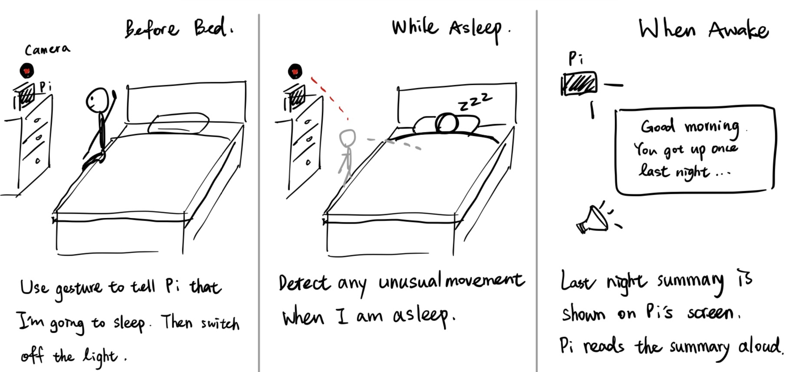
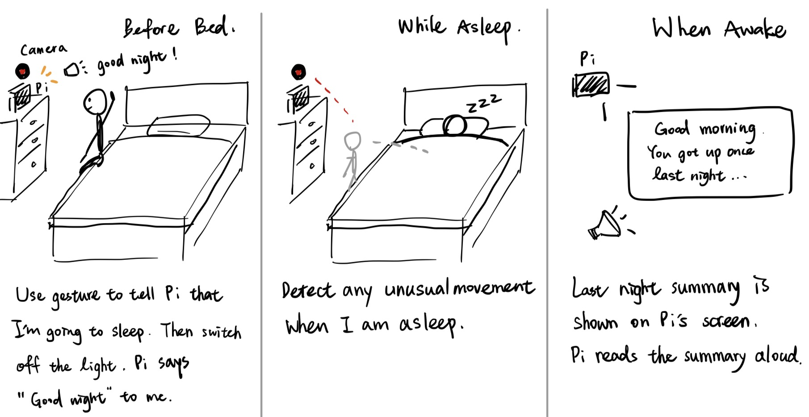
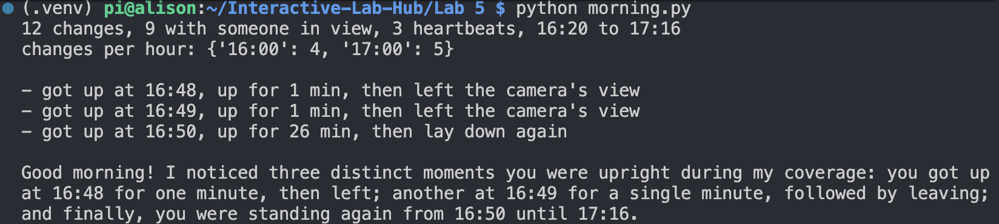

# Observant Systems: Overnight Sensation

**Members:** Chih-Hsin Liu (cl2889, Cyalisonliu), ...

**Project name:**

<details>
	<summary><strong>Instructions for Students (Click to Expand)</strong></summary>
  
	**Submission Cleanup Reminder:**
	- This README.md contains extra instructional text for guidance.
	- Before submitting, remove all instructional text and example prompts from this file.
	- You may delete these sections or use the toggle/hide feature in VS Code to collapse them for a cleaner look.
	- Your final submission should be neat, focused on your own work, and easy to read for grading.
  
	This helps ensure your README.md is clear, professional, and uniquely yours!
</details>


For lab this week, we focus on creating interactive systems that can detect and respond to events or stimuli in the environment of the Pi, like the Boat Detector we mentioned in lecture. 
Your **observant device** could, for example, count items, find objects, recognize an event or continuously monitor a room.

This lab will help you think through the design of observant systems, particularly corner cases that the algorithms need to be aware of.

**New this year: the AI runs on the Pi.** Your Pi 5 can run an object detector ([YOLO](https://docs.ultralytics.com/)) and a small language model ([Qwen](https://ollama.com/library/qwen3.5) through [Ollama](https://ollama.com)) completely offline. In Part 1 you get both running and connect them: YOLO *sees*, Qwen *reasons* about what was seen. These models are slow, but they have all night. In Part 2 you use them to design a **night-time interaction**: what you tell the device before bed, what it does while you sleep, and what it shows you when you wake up.

**Please indicate anyone that helped with this Lab here.**
Be generous in acknowledging their contributions! And also recognizing any other influences (e.g. from YouTube, Github, Twitter) that informed your design. 

## Overview

**Part 1: the tools**

A) [Set up your Pi for on-device AI](#part-a)

B) [See: recognize people in real time with YOLO](#part-b)

C) [See more: hands and pose with MediaPipe](#part-c)

D) [Reason: run Qwen on the Pi with Ollama](#part-d)

E) [Connect: from YOLO readings to Qwen reasoning](#part-e)

**Part 2: Overnight Sensation**

F) [Read Part 2 and storyboard your night-time interaction](#part-f)

G) [Design the interaction before bed](#part-g)

H) [Incorporate the observant system during sleep](#part-h)

I) [Design the interaction when awake](#part-i)

The tools from earlier versions of this lab (MobileNet, Teachable Machine, Moondream, audio analysis, classic OpenCV) live in the [legacy folder](legacy/README.md). They are optional, but any of them can be the sensor in your Part 2 system.


## Prep for Part 1

Please check the instructions in [prep.md](prep.md) and complete them before lab. The installs in Part A take a while, so prep.md also tells you how to get a head start.

## The Report

This readme.md page in your own repository should be edited to include the work you have done. You can delete everything but the headers and the sections between the \*\*\***stars**\*\*\*. Write the answers to the questions under the starred sentences. Include any material that explains what you did in this lab hub folder, and link it in the readme.

---

# Part 1

## Part A. 
### Set up your Pi for on-device AI

Create a virtual environment and install the requirements. They include `ultralytics` (YOLO), which pulls in torch, so this takes a while:

```
pi@raspberrypi:~$ cd Interactive-Lab-Hub/Lab\ 5
pi@raspberrypi:~/Interactive-Lab-Hub/Lab 5 $ python3 -m venv .venv
pi@raspberrypi:~/Interactive-Lab-Hub/Lab 5 $ source .venv/bin/activate
(.venv) pi@raspberrypi:~/Interactive-Lab-Hub/Lab 5 $ pip install -r requirements.txt
```

As in Lab 3, [`uv`](https://docs.astral.sh/uv/) is a much faster drop-in for `pip`: `pip install uv && uv pip install -r requirements.txt`.

### YOLO: download the nano model and export it for the Pi

We use the nano model of [YOLO26](https://docs.ultralytics.com/models/yolo26/), exported once to NCNN, the format that runs fastest on the Pi. This downloads the weights:

```
(.venv) pi@raspberrypi:~/Interactive-Lab-Hub/Lab 5 $ python -c "from ultralytics import YOLO; YOLO('yolo26n.pt').export(format='ncnn')"
(.venv) pi@raspberrypi:~/Interactive-Lab-Hub/Lab 5 $ yolo export model=yolo26n.pt format=ncnn
```
If every ultralytics message is followed by a `--- Logging error ---` traceback ending in `UnicodeEncodeError: 'latin-1' codec can't encode character`, fix your shell's locale once::

```
echo 'export LANG=C.UTF-8' >> ~/.bashrc
echo 'export LC_ALL=C.UTF-8' >> ~/.bashrc
echo 'export PYTHONIOENCODING=utf-8' >> ~/.bashrc
source ~/.bashrc
```

The second command converts the .pt model to a .ncnn model.

Test it on an image from the internet. `project="$PWD"` keeps the output in `predict` in the current lab folder; without it, ultralytics writes to a `runs/` folder at the top of your git repo, where you will not think to look.

```
(.venv) pi@raspberrypi:~/Interactive-Lab-Hub/Lab 5 $ yolo predict model=yolo26n_ncnn_model source=https://ultralytics.com/images/bus.jpg project="$PWD"
```

The result is in `predict/bus.jpg`: boxes around the people and the bus.

Now a photo of your own. Plug in the webcam and take one with `snap.py` (`--delay 3` gives you three seconds to get into the frame), or choose any picture you downloaded from the internet and put under this folder. Put your selected picture after the `source=` Then run the same command on it:

```
(.venv) pi@raspberrypi:~/Interactive-Lab-Hub/Lab 5 $ python snap.py --delay 3
(.venv) pi@raspberrypi:~/Interactive-Lab-Hub/Lab 5 $ yolo predict model=yolo26n_ncnn_model source=snap.jpg project=runs
```

Every run gets its own numbered folder, so this one is in `runs/predict2/snap.jpg`; the command prints where it saved. Keep `snap.jpg`, you will show it to Qwen in Part D.

### Ollama: install it and pull Qwen

[Ollama](https://ollama.com) runs language models locally. Nothing leaves the Pi: no API key, no internet after the download.

```
pi@raspberrypi:~ $ curl -fsSL https://ollama.com/install.sh | sh
pi@raspberrypi:~ $ ollama pull qwen3.5:0.8b
pi@raspberrypi:~ $ ollama pull qwen3:0.6b
pi@raspberrypi:~ $ ollama list
```

| model | download | what it does |
|---|---|---|
| `qwen3.5:0.8b` | ~1.3 GB | text **and images**; the one we use in this lab |
| `qwen3:0.6b` | ~0.5 GB | text only, smaller and faster (~16 tokens/s on a Pi 5) |

\*\*\***Include a screenshot of `ollama list` showing your models.**\*\*\*


## Part B. 
### See: recognize people in real time with YOLO

YOLO is an *object detector*: it finds every person, cup, cat and so on (the 80 [COCO](https://cocodataset.org/) classes), draws a box around each, and gives a confidence. For an observant system that is exactly what you want: *how many*, *where*, *how sure*.

Connect your webcam, connect to your Pi through **VNC** (the script opens a window), and run the person detector. Read `yolo_person.py` first; the loop at the bottom is the whole idea.

```
(.venv) pi@raspberrypi:~/Interactive-Lab-Hub/Lab 5 $ python yolo_person.py
```

While it runs, walk in and out of the frame, sit down, turn your back, hold up a photo of a person on your phone. Watch the confidence number on the box change with each.

Then press q to quit and run it again with a flag. Each one changes a single thing:

```
(.venv) pi@raspberrypi:~/Interactive-Lab-Hub/Lab 5 $ python yolo_person.py --conf 0.2     # lower the bar: see what the model is unsure about
(.venv) pi@raspberrypi:~/Interactive-Lab-Hub/Lab 5 $ python yolo_person.py --conf 0.7     # raise the bar: see what you lose
(.venv) pi@raspberrypi:~/Interactive-Lab-Hub/Lab 5 $ python yolo_person.py --all          # all 80 classes, not only people: what else is on your desk, and what does it get wrong?
(.venv) pi@raspberrypi:~/Interactive-Lab-Hub/Lab 5 $ python yolo_person.py --headless     # no window, only the printed readings: how it runs over ssh, and at night
```

\*\*\***Include a short video or screenshots of your experiments with the person detection. Write down three situations where it did not see you, or saw a person who was not there, and what you think the cause was.**\*\*\*


- Situation 1: it did not see me (--conf 0.7). When I walked quickly across the frame there was no box at all. 
  - Cause I guess: the blur smears the outline, and dark clothes on a bright wall leave little for the model to match, so its confidence fell below 0.7. At --conf 0.2 the same movement was detected, so the model might be a bit unsure rather than blind.

- Situation 2: it saw a person who was not there (phone, --conf 0.2). When I held up my phone in a dim room, a box “person 0.25” appeared around the phone and my hand. 
  - Cause I guess: low light leaves less detail, and a hand holding a phone looks like a body part to the model; the low threshold lets this uncertain box through. At the default 0.4 it would not be drawn.

- Situation 3: the giraffe was ignored, but my hand was called a person (--conf 0.2 and 0.7). I held up a stuffed giraffe and the model did not label it at either threshold, because the script only looks for the class “person”. Instead it drew “person 0.76” around my hand and forearm. 
  - Cause I guess: the class filter hides every non-person object, and with only the “person” class available, skin and a sleeve might be enough for the model to categorize as “person”. With --all the giraffe was detected (0.61), so the model could see it.


## Part C. 
### See more: hands and pose with MediaPipe

YOLO tells you that a person is there. Google's [MediaPipe](https://mediapipe.dev/) tells you what their hands and body are doing: face, hand and body pose detection, fast on the Pi.


The demo plays a looping audio file, so make the helper script executable first:

```
(.venv) pi@raspberrypi:~/Interactive-Lab-Hub/Lab 5 $ chmod +x loop_audio.sh
```

Connect your webcam, connect to your Pi through **VNC**, and run the hand pose script:
(***it will not work if you use ssh from your laptop***)

```
(.venv) pi@raspberrypi:~/Interactive-Lab-Hub/Lab 5 $ python hand_pose.py
```

Try the two main features of this script: 1) pinching for percentage control (the thumb-to-index distance sets the volume), and 2) "[Quiet Coyote](https://www.youtube.com/watch?v=qsKlNVpY7zg)" for instant percentage setting (the gesture mutes it). Notice how this example uses hardcoded positions and relates those positions with a desired set of events, in `hand_pose.py`: a hand is 21 landmark coordinates, and an *event* is a rule you write over them. That is the same job as `interpret()` in Part E.

Consider how you might use this position based approach to create an interaction, and write how you might use it on either face, hand or body pose tracking.

\*\*\***Include a screenshot or short video of the hand pose demo, and write how you might use face, hand or body pose tracking in your observant system.**\*\*\*


**How I would use pose tracking in my observant system (detecting night-time wandering):**

My observant system watches for times when someone gets up and walks around at night without knowing it, such as sleepwalking. I want to use pose tracking in two ways:

- **Body pose:** I want to use it to tell whether the person is lying down, sitting up or standing, and where they are in the room. A rule over a few landmarks (for example, shoulders and hips at the same height means lying down) turns each frame into a short reading such as "lying down" or "standing near the door".
- **Hand pose:** I want to use a gesture (a pinch or the Quiet Coyote) as the "before bed" signal that tells the device to start watching for the night.

The camera cannot tell whether a person is asleep, so the device reports "up and walking".

## Part D. 
### Reason: run Qwen on the Pi with Ollama
<!-- 
Talk to the model in the terminal first. Qwen3 models "think" before they answer, which is slow on a Pi, so turn it off. Then ask about something you can check:

```
pi@raspberrypi:~ $ ollama run qwen3.5:0.8b
>>> /set nothink
>>> Tell me a bit about the history of Roosevelt Island. Three sentences.
>>> /bye
```

Roosevelt Island is a good first question because you know the ground truth: it was Blackwell's Island, then Welfare Island, got its current name in 1973, and Cornell Tech opened on it in 2017. Count how many of the model's facts are true.

From Python, qwen requests can be triggered by the `ask_qwen.py` script. It turns thinking off, tells the model to answer in at most three sentences, and cuts it off after 120 tokens (`--max-tokens` changes that), because a small model left alone writes an essay. Read the script, then run:

```
(.venv) pi@raspberrypi:~/Interactive-Lab-Hub/Lab 5 $ python ask_qwen.py "Tell me a bit about the history of Roosevelt Island."
(.venv) pi@raspberrypi:~/Interactive-Lab-Hub/Lab 5 $ python ask_qwen.py --model qwen3:0.6b "Tell me a bit about the history of Roosevelt Island."
(.venv) pi@raspberrypi:~/Interactive-Lab-Hub/Lab 5 $ python ask_qwen.py --image snap.jpg "What is in this photo?"
```

Things in the [Ollama API](https://github.com/ollama/ollama/blob/main/docs/api.md) worth knowing:

* `think: false` skips the reasoning trace. Always, on a Pi. `ask_qwen.py` sends it on every request; `--think` turns the trace back on for one question, so you can see what you are skipping and how long it takes.
* `format` makes the model answer as JSON with the fields you name (`--json`). Handy when a display or a servo has to read the answer.
* `images` sends a photo along with the prompt (`--image snap.jpg`, the photo from Part A). `qwen3.5:0.8b` can look at pictures.

A 0.8B model is slow and sometimes wrong. It will invent events that are not in the data and agree with a wrong premise. Give it the data, keep its job narrow, and decide what the device does when the model is unsure. -->

\*\*\***Ask Qwen three questions to answer. Paste the questions, the answers and how long each took. Try one of them with `qwen3:0.6b` and compare.**\*\*\*

- Q1: "Tell me a bit about the history of Roosevelt Island."
  - Ans: "Roosevelt Island is a historic district on Long Island, New York, originally built by the Dutch as a refuge from English settlers during the 17th century. It was later developed by the United States in the late 19th century to serve as a military base and political center for the Republican Party. Today, it remains a significant part of New York City's history, featuring landmarks like the Statue of Liberty and the Roosevelt Island Railroad."
  - [qwen3.5:0.8b, 13.9 s]
- Q2: "Why is Sydney the capital of Australia?"
  - Ans: "Sydney is the capital of Australia because it was designated as such by the Australian Constitution in 1900, and its location on the Great Barrier Reef makes it a natural hub for tourism and trade."
  - [qwen3.5:0.8b, 7.1 s]
- Q3: "--image snap.jpg What is in this photo?"
  - Ans: "A young woman with glasses and a Nike hoodie is standing against a plain wall."
- Q1 with `qwen3:0.6b`:
  - Ans: "Roosevelt Island is a small, remote island located in the Pacific Ocean, off the coast of New Zealand. It was originally a military base during World War II, and it became a symbol of the United States in the 1950s. The island was used for various purposes, including military operations, and it has since become a significant cultural and historical site. Today, it is a peaceful place that attracts visitors and a symbol of the United States."
  - Comparison: 
    | | qwen3.5:0.8b | qwen3:0.6b |
    |---|---|---|
    | Time | 13.9 s | 15.9 s |
    | Accuracy | Wrong: placed it on Long Island, invented a Dutch origin, mentioned the Statue of Liberty | Wrong: placed it in the Pacific near New Zealand, invented a WWII base |
    
    Both models got the facts wrong. The 0.8b model (13.9 s) at least kept it in New York, while the 0.6b model (15.9 s) put it near New Zealand, so the smaller model was no faster and a bit less accurate.


## Part E. 
<!-- ### Connect: from YOLO readings to Qwen reasoning

An observant system is a pipeline: a **detector** turns pixels into boxes, an **interpreter** turns boxes into readings in words ("one person, left, close"), the readings pile up in a **log**, and a **reasoner** answers a question about the log. The language model never sees pixels, only the words you chose in the interpreter. That makes the interpreter the most important design decision in the system.

`yolo_to_qwen.py` is the pipeline in one file, one function per stage. Read it before you run it:

* `interpret(r)` is the interpreter. It takes one YOLO result and returns one reading. A person is *left*, *center* or *right* by which third of the frame the middle of their box is in, and *close* if the box is taller than 60% of the frame, *far* otherwise. The reading is a string like `1 person(s) at center/close`, or `nobody`. Fifteen lines, and they decide everything the model can know.
* `watch(seconds)` is the detector and the log. Twice a second it reads a frame, runs YOLO on it and calls `interpret()`. A time-stamped reading goes into the log **only when it differs from the previous one**, so a minute of sitting still is one line, not 120.
* `ask(log, question)` is the reasoner. It pastes the log and your question into one prompt, tells Qwen to answer in at most three sentences using only what is in the log, and sends it to Ollama with thinking off.

Run it through VNC and a window opens with YOLO's boxes, the current reading and the seconds left. Press q to stop watching early. Over plain ssh add `--headless` and you get the same thing minus the window.

```
(.venv) pi@raspberrypi:~/Interactive-Lab-Hub/Lab 5 $ python yolo_to_qwen.py
```

It watches for a minute, saves the log to `watch_log.txt` and asks Qwen the default question. The terminal looks something like this:

```
14:02:11 nobody
14:02:19 1 person(s) at right/far
14:02:24 1 person(s) at center/close
14:02:51 nobody

4 lines saved to watch_log.txt
asking Qwen...

Qwen (18.4 s):
One person came in from the right, moved close to the camera, and left after about half a minute. ...
```

--- -->

# Lab 5 Part 2: Overnight Sensation

For Part 2, you will use the observant system from Part 1 to design a night-time interaction. On-device AI is slow, so let it work while you sleep. The person meets the device twice: **before bed**, when they hand the night over, and **when awake**, when the device gives something back. In between, the pipeline from Part E runs on its own.

Two flavors, pick one or mix them:

* **Sense all night.** The Pi watches, listens or measures from bedtime until morning and keeps a log.
* **Process all night.** You already have the data (a day of phone photos, a long recording) and the Pi needs hours to get through it.

Two house rules. Sample rather than stream: one look every 5 to 30 seconds is plenty, and it keeps the Pi cool. And keep everything on the Pi: tell the people you live with, point the camera at things rather than at beds, and delete the snapshots after the demo.

## Part F. 
### Read Part 2 and storyboard your night-time interaction

Storyboard a night-time interaction built on your observant system, in three panels:

1. **Before bed.** How does the person hand the night over, and how does the device acknowledge it?
2. **While asleep.** What does the device watch or work through?
3. **When awake.** What is the one thing the person learns, and in what medium?

\*\*\***Insert ideas, sketches, Verplank diagrams and storyboards for your night-time interaction here.**\*\*\*

The overnight observant system I want to implement is **Night Walker**.
It is a device that tells me whether I got up and walked around at night. Before bed I hand the night over with a gesture; while I sleep the camera logs only words, never photos of me in bed; in the morning it tells me when I got up and for how long. It reports "got up", not "sleepwalking", because a camera cannot tell if someone is asleep.


## Prep for Part 2

**Put the feedback for your ideas here.** 
Some feedbacks I got:
- Could add a confirmation prompt (LED or sound) to the first storyboard (after recognizing a gesture).
- When the person wakes up, how does Pi reacts when the person "didn't get up" the whole night?

\*\*\***Post your revised storyboard here.**\*\*\*


## Part G. 
### Design the interaction before

\*\*\***Describe the interaction before.**\*\*\*
Before I go to bed, I have to show an open palm to the camera, hold it for two seconds, and a green bar fills up on the screen so I can see the device has seen my hand. When the bar is full, the screen shows "watching tonight" and speak it out. After that, the device starts a thirty-second countdown. That is my time to switch off the lamp and lie down. After the countdown, the device starts `overnight.py` by itself.

I chose an open palm because it is one clear shape that is easy to tell from a resting hand, and because the device measures it relative to the size of my hand, so it works from different distances. It needs light to see my hand, so the order is lamp on, gesture, lamp off.

The acknowledgement is the progress bar, the line "watching tonight" on the display, and a good night voice message. From then on the device only writes words to its log ("lying", "upright"), and it keeps a photo only at the moment I get up, so it never records me asleep. The only person needed for this demo is me.

## Part H. 
### Incorporate the observant system

<!-- The Part E pipeline becomes the night shift. `overnight.py` runs your `interpret()` from `yolo_to_qwen.py` every few seconds, people only unless you pass `--all`, and writes the readings to `night_log.jsonl`; the reasoning waits for the morning. Start it inside `tmux` so it keeps running after you close your laptop, and stop it with Ctrl-C in the morning:

```
(.venv) pi@raspberrypi:~/Interactive-Lab-Hub/Lab 5 $ tmux new -s night
(.venv) pi@raspberrypi:~/Interactive-Lab-Hub/Lab 5 $ python overnight.py
```

Fake a night first: run it for thirty seconds while you walk around, stop it, and run `morning.py` from Part I. When that looks right, run a real night. If your storyboard needs a sensor rather than the camera, swap in the Lab 4 example code and log its reading the same way. -->

\*\*\***Screenshots or videos of the running system.**\*\*\*
1. recognizing gesture: [1st recognizing gesture](https://drive.google.com/file/d/1HRMQArkhpGZeeEI9y3GxY13Oy_G_TK7_/view?usp=sharing)
2. Pi says good night: [2nd Pi says good night](https://drive.google.com/file/d/1CgjtLx5a6TbNY0Tszd-qFnm5fHimQvkD/view?usp=drive_link)
3. Short round: [fake night testing](https://drive.google.com/file/d/13SEFnQpMuEA3rRNrS60Rtda0wCnTY7no/view?usp=sharing)

## Part I. 
### Design the interaction after

<!-- The reveal. The night produced a log; the morning turns it into something a half-awake person can take in. `morning.py` is the smallest version: it asks Qwen for a three-sentence report.

```
(.venv) pi@raspberrypi:~/Interactive-Lab-Hub/Lab 5 $ python morning.py
```

Make it yours: show the report on the Mini PiTFT, read it aloud with Piper from Lab 3, plot the night as a timeline, or ask for JSON (`--json`, Part D) and move a servo. Whatever you pick, make sure it is honest about a night in which nothing happened. -->

**Summary report:**
- Terminal output: 
- Voice report: [voice report](https://drive.google.com/file/d/1cA_bHnbTLyQpMJ8AvG0UGp_YC_Gfcfbj/view?usp=sharing)

## Final documentation

Document all the prototypes and iterations you have designed and worked on. The deliverables for this lab are writings, sketches, photos, and videos that show what your system:

* "Looks like": how the device sits in the room at night, and what it looks like at bedtime and in the morning.
* "Works like": the pipeline from detector to interpreter to log to reasoner, with a real night's data.
* "Acts like": how a person hands the night over and what they get back.

\*\*\***Include a short video of the whole system**\*\*\*

As always, make sure you document contributions and ideas from others (and AI) explicitly in your writeup.

You are permitted (but not required) to work in groups and share a turn in; you are expected to make equal contribution on any group work you do, and N people's group project should look like N times the work of a single person's lab. Make sure the page for the group turn in is linked to your personal Interactive Lab Hub page.

## Deliverables & Submission for Lab 5

For submission, the readme.md page for this lab should be edited to include the work you have done:
* Upload any materials that explain what you did, including your code and night log, into your Lab 5 repository, and link them in your Lab 5 readme.md.
* Labs are due on Sundays, make sure to submit your Lab 5 readme.md to Canvas.

<details>
  <summary><strong>Submission Cleanup Reminder (Click to Expand)</strong></summary>

  **Before submitting your README.md:**
  - This readme.md file has a lot of extra text for guidance.
  - Remove all instructional text and example prompts from this file.
  - You may either delete these sections or use the toggle/hide feature in VS Code to collapse them for a cleaner look.
  - Your final submission should be neat, focused on your own work, and easy to read for grading.
</details>
