# Observant Systems: Overnight Sensation

**Team:** Yuqi Wang, Jerry Lee

**Members:** Yuqi Wang (yw2897), Jerry Lee

**Project name:** Desk Night Watch

**AI Disclosure**: I used Chatgpt help debug the code and check the grammar.


## Overview

**Part 1: the tools**

A) [Set up your Pi for on-device AI](#part-a)

B) [See: recognize people in real time with YOLO](#part-b)

C) [See more: hands and pose with MediaPipe](#part-c)

D) [Reason: run Qwen on the Pi with Ollama](#part-d)

E) [Connect: from YOLO readings to Qwen reasoning](#part-e)

**Part 2: Overnight Sensation**

F) [Read Part 2 and storyboard your night-time interaction](#part-f)

G) [Design the interaction before bed](#part-g)

H) [Incorporate the observant system during sleep](#part-h)

I) [Design the interaction when awake](#part-i)

The tools from earlier versions of this lab (MobileNet, Teachable Machine, Moondream, audio analysis, classic OpenCV) live in the [legacy folder](legacy/README.md). They are optional, but any of them can be the sensor in your Part 2 system.


## Prep for Part 1

## The Report

This readme.md page in your own repository should be edited to include the work you have done. You can delete everything but the headers and the sections between the \*\*\***stars**\*\*\*. Write the answers to the questions under the starred sentences. Include any material that explains what you did in this lab hub folder, and link it in the readme.

---

# Part 1

## Part A. 
\*\*\***Include a screenshot of `ollama list` showing your models.**\*\*\*
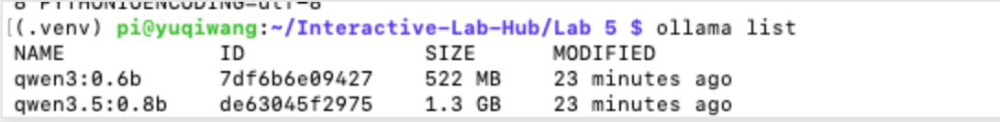


## Part B. 
\*\*\***Include a short video or screenshots of the person detection.**\*\*\*
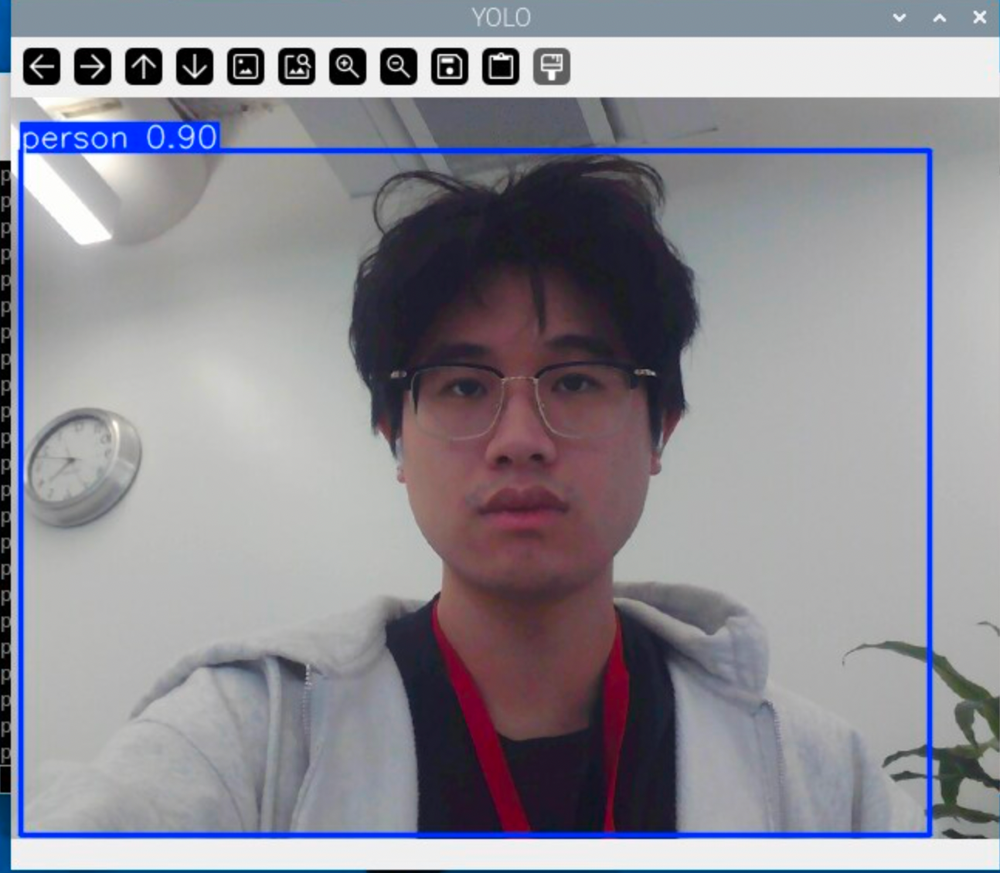
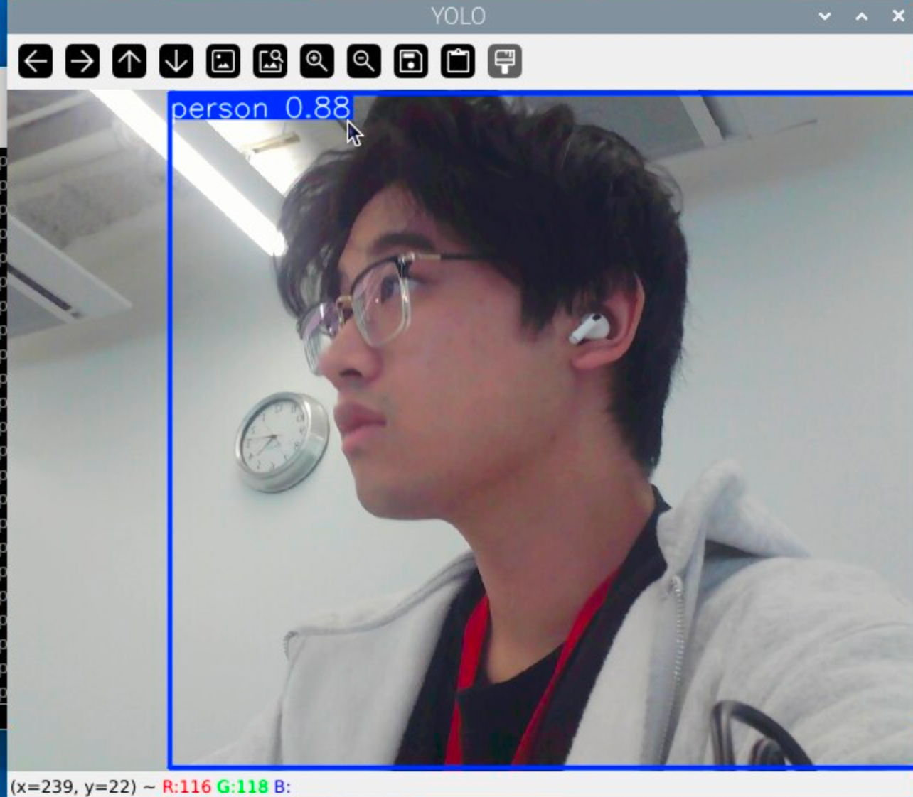
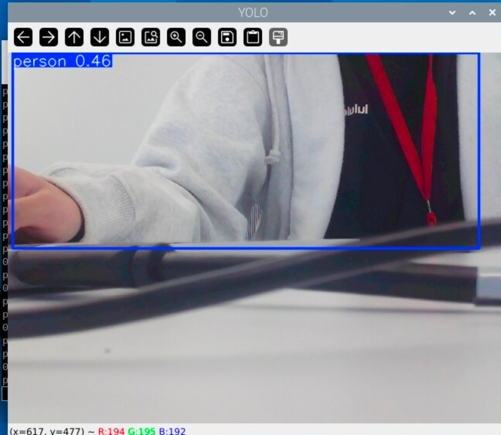
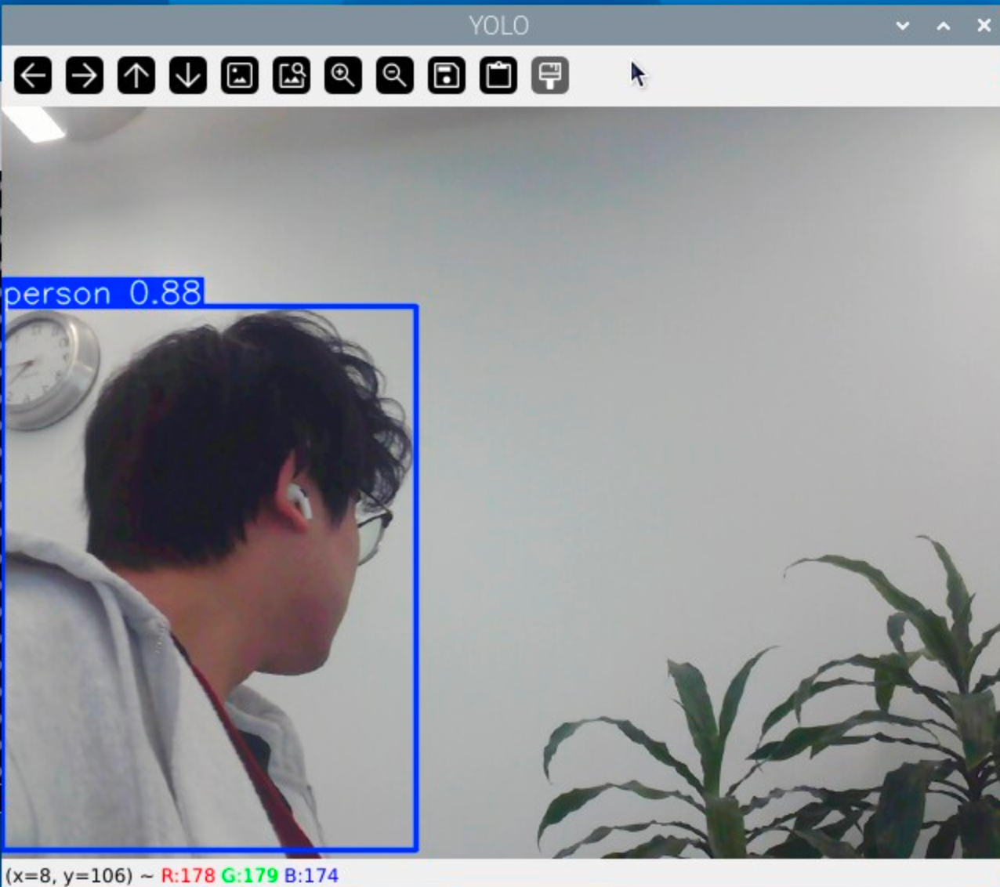

## Part C. 
\*\*\***Include a screenshot or short video of the hand pose demo, and write how you might use face, hand or body pose tracking in your observant system.**\*\*\*
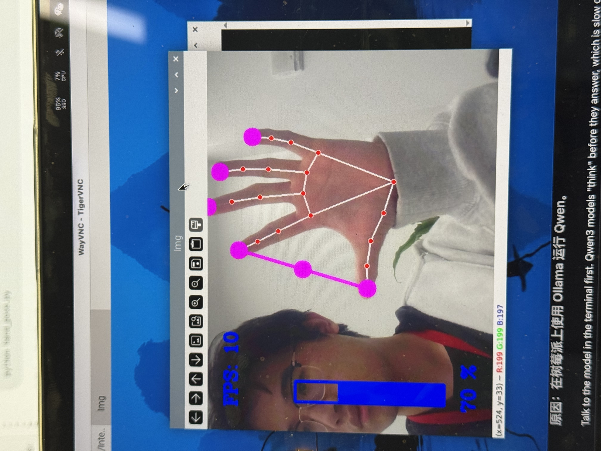
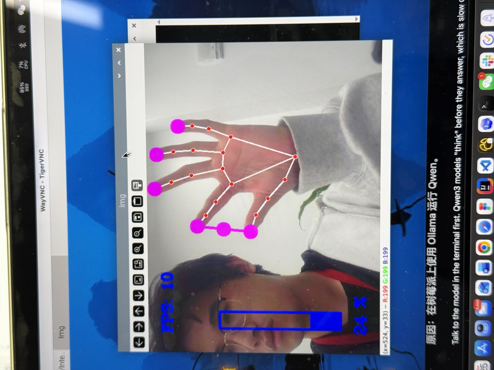
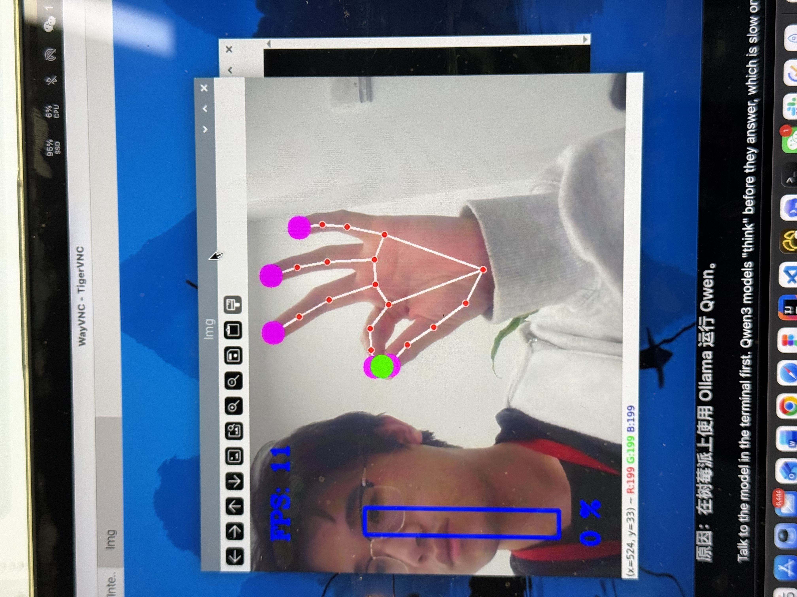
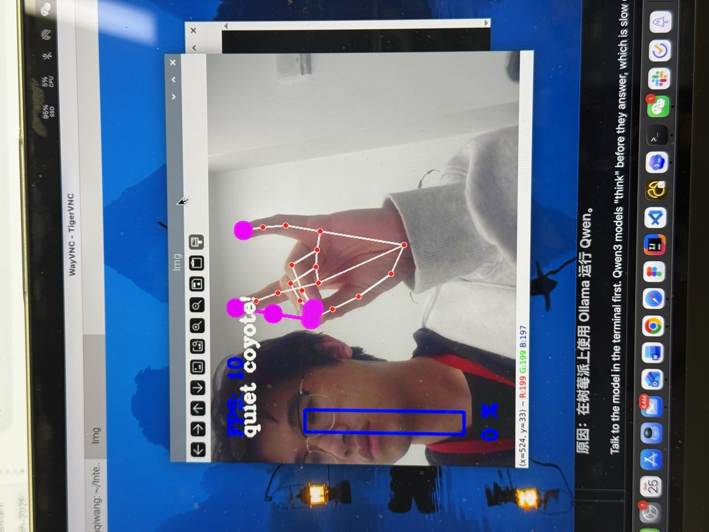

For Desk Night Watch, hand pose tracking could provide an alternative to the spoken start command. Holding an open palm steady for a short time could request monitoring, followed by an on-screen message and spoken confirmation after the first successful camera sample. Requiring a stable gesture would help prevent accidental activation during normal hand movements. I would use gesture recognition only during the bedtime hand-off, then stop tracking gestures once monitoring begins. This is a possible extension; the tested prototype currently starts with the spoken word "Hello."

## Part D.
### Reason: run Qwen on the Pi with Ollama

I asked `qwen3.5:0.8b` three questions using `ask_qwen.py`, then repeated the first question with `qwen3:0.6b`. The script requested at most three short sentences. The times below are the elapsed request times reported by the script.

#### Question 1: Roosevelt Island history

**Question:** Tell me a bit about the history of Roosevelt Island.

- **Model:** `qwen3.5:0.8b`
- **Elapsed time:** 12.9 seconds

**Original answer:**

> Roosevelt Island was originally built as a private residence for President Franklin D. Roosevelt, who lived there from 1935 to 1945. It is now a historic site and one of the most popular tourist destinations in New York City. The island's history includes its original construction by the Rockefeller family and its current status as a museum dedicated to FDR's life and work.

**Correctness check:**

The answer contains major factual errors. Roosevelt Island was not built as FDR's private residence. His principal lifelong residence was Springwood in Hyde Park, New York. The model's account of his residence on the island is incorrect. [FDR Presidential Library](https://www.fdrlibrary.org/roosevelt-homes)

The island's documented history also differs from the model's construction and museum story. It was formerly called **Blackwell's Island**, became **Welfare Island in 1921**, and was renamed **Roosevelt Island in 1973**. Its institutional history includes prisons and hospitals. [National Park Service](https://www.nps.gov/places/blackwell-s-island-new-york-city.htm)

Another relevant milestone is the opening of Cornell Tech's Roosevelt Island campus in **2017**. The model mentioned none of the four reference facts: the Blackwell's Island name, the 1921 and 1973 name changes, or the campus opening. [Cornell Tech](https://tech.cornell.edu/news/cornell-tech-campus-opens-on-roosevelt-island-marking-transformational-mile/)

#### Question 2: Can object detection establish whether someone is asleep?

**Question:** Can a person's bounding box and confidence score alone tell whether they are asleep? Explain briefly.

- **Model:** `qwen3.5:0.8b`
- **Elapsed time:** 7.1 seconds

**Original answer:**

> Yes, but the system cannot definitively determine if someone is asleep solely based on these metrics. The user must also consider their physical state, such as breathing patterns or heart rate to confirm sleep onset.

**Correctness check:**

The answer is internally contradictory: it begins with "Yes," but immediately explains that these metrics alone cannot determine whether someone is asleep. The direct answer should be **No**.

Object detection produces bounding boxes, class labels, and confidence scores. In this experiment, the box describes the detected person's location and size, while the score expresses confidence in the detection. These outputs do not establish sleep state. A high confidence score for "person" is not a probability that the person is asleep. This interpretation follows from the documented detection outputs. [Ultralytics object detection documentation](https://docs.ultralytics.com/tasks/detect)

Breathing and heart rate were not measured in this experiment. The model's suggestion should therefore not be presented as a tested sleep-detection method.

#### Question 3: Describe an image

**Question:** How many people are in this photo, and what are they wearing?

**Input:** The `zidane.jpg` image used in Part A, supplied with `--image zidane.jpg`.

- **Model:** `qwen3.5:0.8b`
- **Elapsed time:** 116.0 seconds

**Original answer:**

> There are two men in the photo. The man on the left is bald and wearing a black suit with a white shirt and black tie. The man on the right has gray hair and is also wearing a black suit with a white shirt and dark tie.

**Correctness check:**

The person count and main clothing description match the image: there are two people wearing dark suits, light-colored shirts, and ties. The left person is bald, and the right person has gray hair.

The exact color descriptions are less precise; for example, the right person's tie appears blue. Overall, the answer addresses the requested count and clothing reasonably well. This image request took substantially longer than either text-only request in this run.

#### Comparison with `qwen3:0.6b`

I repeated the history question with the smaller model.

**Question:** Tell me a bit about the history of Roosevelt Island.

- **Model:** `qwen3:0.6b`
- **Elapsed time:** 6.9 seconds

**Original answer:**

> Roosevelt Island is a small island located in the Pacific Ocean, off the coast of the state of New York. It was originally a military base during World War II, and it became a significant site for the United States Navy. The island was later used as a research and development center for the United States Department of Defense. Today, it remains a popular destination for outdoor activities and is a symbol of the United States' commitment to the Pacific.

**Correctness check:**

The location is incorrect: Roosevelt Island is in New York City's **East River**, not the Pacific Ocean. The military-base, Navy, and Department of Defense narrative is unsupported by the official history checked, which instead describes institutional uses including prisons, hospitals, and an asylum. [National Park Service](https://www.nps.gov/places/blackwell-s-island-new-york-city.htm)

The answer also contains four sentences, exceeding the script's request for at most three.

| Aspect | `qwen3.5:0.8b` | `qwen3:0.6b` |
|---|---|---|
| Time for the same history question | 12.9 seconds | 6.9 seconds |
| Main factual problems | Incorrect FDR residence and island history | Incorrect location and unsupported military history |
| Answer length | 3 sentences | 4 sentences |
| Covered the four reference facts | 0 of 4 | 0 of 4 |

The smaller model completed this request **6.0 seconds sooner**, using approximately **46.5% less elapsed time**. However, both models produced unreliable historical answers. The larger model followed the sentence limit, while the smaller model did not.

These are single-request measurements, not a controlled performance benchmark. Model loading, caching, and answer length can affect elapsed time. For Desk Night Watch, the results support asking narrow questions, supplying recorded observations, and checking model claims against those observations before presenting a report.

## Part E. 
### Connect: from YOLO readings to Qwen reasoning

An observant system is a pipeline: a **detector** turns pixels into boxes, an **interpreter** turns boxes into readings in words ("one person, left, close"), the readings pile up in a **log**, and a **reasoner** answers a question about the log. The language model never sees pixels, only the words you chose in the interpreter. That makes the interpreter the most important design decision in the system.

`yolo_to_qwen.py` is the pipeline in one file, one function per stage. Read it before you run it:

* `interpret(r)` is the interpreter. It takes one YOLO result and returns one reading. A person is *left*, *center* or *right* by which third of the frame the middle of their box is in, and *close* if the box is taller than 60% of the frame, *far* otherwise. The reading is a string like `1 person(s) at center/close`, or `nobody`. Fifteen lines, and they decide everything the model can know.
* `watch(seconds)` is the detector and the log. Twice a second it reads a frame, runs YOLO on it and calls `interpret()`. A time-stamped reading goes into the log **only when it differs from the previous one**, so a minute of sitting still is one line, not 120.
* `ask(log, question)` is the reasoner. It pastes the log and your question into one prompt, tells Qwen to answer in at most three sentences using only what is in the log, and sends it to Ollama with thinking off.

Run it through VNC and a window opens with YOLO's boxes, the current reading and the seconds left. Press q to stop watching early. Over plain ssh add `--headless` and you get the same thing minus the window.

```
(.venv) pi@raspberrypi:~/Interactive-Lab-Hub/Lab 5 $ python yolo_to_qwen.py
```

It watches for a minute, saves the log to `watch_log.txt` and asks Qwen the default question. The terminal looks something like this:

```
14:02:11 nobody
14:02:19 1 person(s) at right/far
14:02:24 1 person(s) at center/close
14:02:51 nobody

4 lines saved to watch_log.txt
asking Qwen...

Qwen (18.4 s):
One person came in from the right, moved close to the camera, and left after about half a minute. ...
```

---

# Lab 5 Part 2: Overnight Sensation

Two flavors, pick one or mix them:

* **Sense all night.** The Pi watches, listens or measures from bedtime until morning and keeps a log.
* **Process all night.** You already have the data (a day of phone photos, a long recording) and the Pi needs hours to get through it.

Two house rules. Sample rather than stream: one look every 5 to 30 seconds is plenty, and it keeps the Pi cool. And keep everything on the Pi: tell the people you live with, point the camera at things rather than at beds, and delete the snapshots after the demo.

## Part F. 
### Read Part 2 and storyboard your night-time interaction

Storyboard a night-time interaction built on your observant system, in three panels:

Before bed, I will start Desk Night Watch and receive an on-screen confirmation that monitoring has begun. 
While I sleep, the Raspberry Pi will sample the desk area with a webcam every 10 seconds and save detection records locally. 
In the morning, a short report will show the last time a person was detected, or state that no person was detected during sampling.

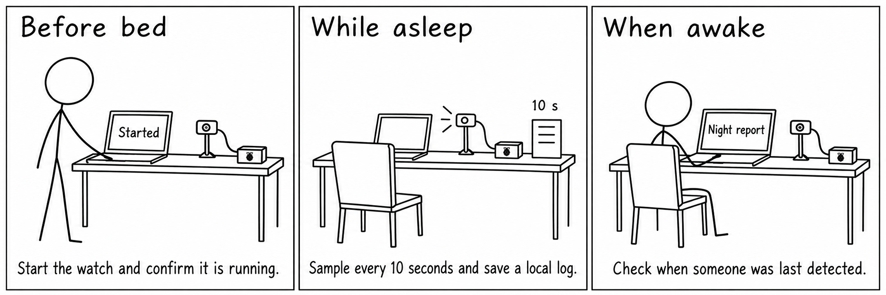


## Prep for Part 2

### Design Feedback

1. Make the hand-off clearer. Before starting, briefly check the camera framing and test detection under the intended overnight lighting. Display “Watch started” so the user knows recording has begun.
2. Separate camera failures from no detections. Continue sampling every 10 seconds, but record failed captures separately from valid samples containing no detected person. Keep timestamped detection results locally without retaining camera images.
3. Keep the morning report honest. Report the last recorded person detection and any gaps in the observations. If there are no detections, say “No person detected in valid samples,” without claiming that the desk was unused or that the user was asleep.
Revised Storyboard

The revised design adds a brief camera and lighting check before the bedtime hand-off. During the night, it will record detection results and flag camera failures. In the morning, it will present the last recorded detection alongside any missing observations, making the limits of the report visible.


### Overnight placement and agreement

For the overnight test, I placed Desk Night Watch on my own desk at home, with the webcam directed toward the desk and chair area. Before starting the overnight run, I completed a 30-second test at home to check voice activation, camera sampling, and log saving.

The people sharing my home were informed and agreed to the test before it began. During monitoring, timestamped detection records were stored locally on the Pi without retaining camera images. The microphone was used for the startup command and was not used to record audio during the overnight watch.

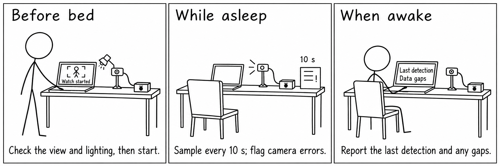


## Part G.
### Design the interaction before bed

Desk Night Watch uses a short voice interaction to begin monitoring. The question for the morning is: "When was a person last detected in the desk area?"

My original startup command was "Start night watch," but speech recognition repeatedly misinterpreted it. I simplified the command to "Hello," which was successfully recognized in the test.

### Bedtime interaction

1. The small display shows "READY" and then "LISTENING," prompting the user to say "Hello."
2. After recognizing the command, the system checks the camera and starts the observation process.
3. Only after the first successful camera sample has been saved does the display show "WATCHING" and "Watch started."
4. The speaker says "Night watch started" to confirm that monitoring has begun.
5. Microphone recording remains off during monitoring. The screen turns off shortly after confirmation while camera sampling continues.

The screen and spoken confirmation let the user know that the system has actually started recording observations, rather than merely recognizing the command.

### 30-second functional test

The test was conducted on November 1, 2026, with a 30-second observation period and a configured sampling interval of 10 seconds.

| Time | Observed result |
|---|---|
| 15:40:26 | "Hello" was recognized and accepted on the first attempt. |
| 15:40:29 | The first valid camera sample was saved, and the system confirmed that the watch had started. |
| 15:40:43 | The screen turned off while observation continued. |
| 15:41:00 | The demonstration completed normally and reported that the log had been saved. |

The log contained three valid samples: one person detected, one person detected, and no person detected. No sampling errors were recorded in this test.


## Part H. 
### Incorporate the observant system


Desk Night Watch uses the Raspberry Pi and webcam to observe the desk and chair area. After the voice hand-off, desk_watch.py runs YOLO with a configured sampling interval of 10 seconds. Each sample records a timestamp, the detected person count, and a brief description of their position in night_log.jsonl. Camera or inference failures are recorded separately from valid samples with no person detected. The system keeps text records locally without saving camera images.

Short test

I completed a 30-second test before attempting an overnight run. The log contained three valid samples:
Time	Detection
15:40:29	One person at center/close
15:40:40	One person at center/close
15:40:50	No person detected


No sampling errors were recorded, and the session ended normally. These observations show two samples containing a person, rather than two distinct people. The last recorded person detection was at 15:40:40.

Overnight setup

For the overnight test, I positioned the camera toward the desk and chair area and checked detection under the intended lighting. I ran the system inside a tmux session so it can continue after I disconnected my Mac. The Pi remained powered, and I stopped the recording the following morning.

Running-system evidence

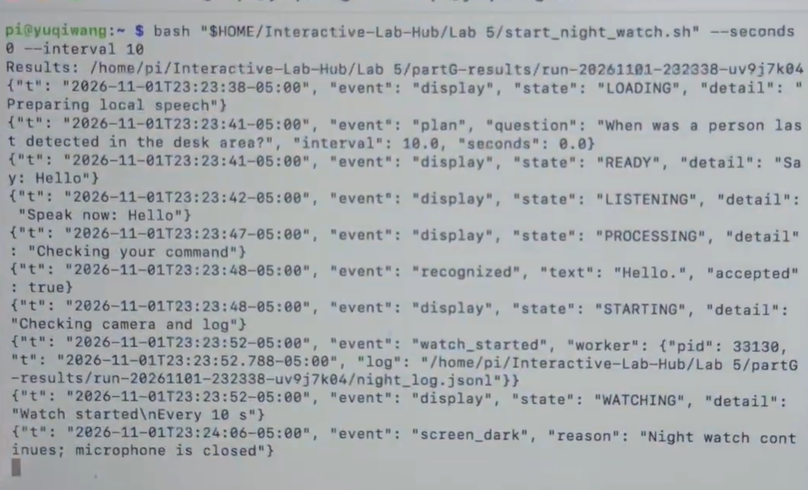
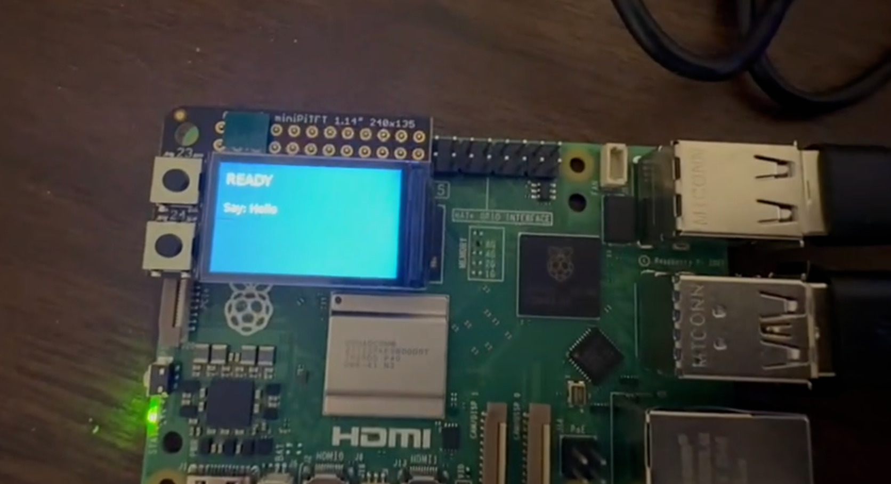
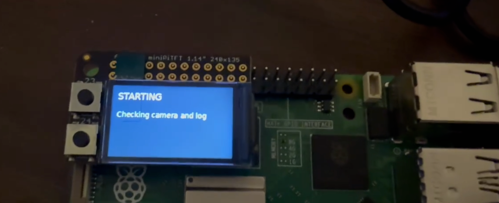
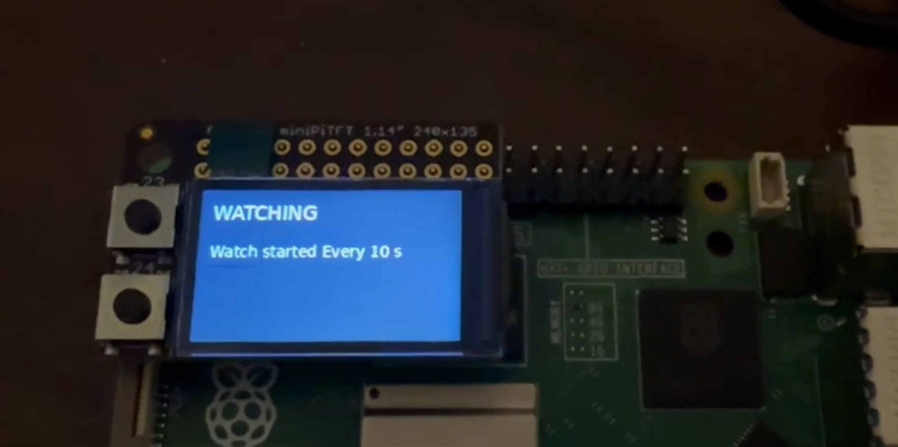
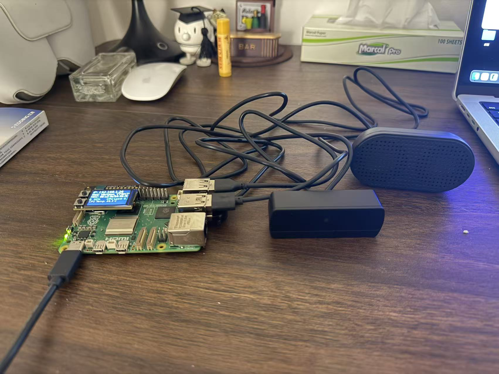
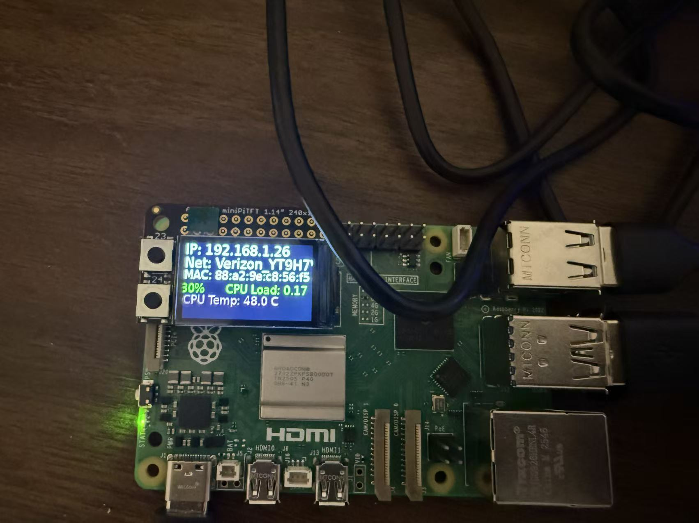


Overnight results

The overnight test ran from November 1 to November 2, 2026. All timestamps below are in Eastern Standard Time (UTC-05:00).

| Measurement | Result |
|---|---|
| First valid camera sample | November 1, 23:23:52.788 |
| Final camera sample | November 2, 09:34:13.069 |
| Recording stopped | November 2, 09:34:19.713 |
| Observation span, from first valid sample to stop | 10 hours, 10 minutes, 26.925 seconds |
| Valid samples | 3,395 |
| Samples detecting a person | 6 |
| Samples detecting no person | 3,389 |
| Maximum people detected in one sample | 1 |
| Recorded sampling errors | 0 |
| Recording gaps longer than 20 seconds | 0 |
| Last recorded person detection | November 2, 09:33:51.477 |

Each of the six positive samples detected one person. These are six detection samples, not evidence of six different people or six separate visits. The records do not establish continuous presence or sleep state.

[Download the overnight detection log](overnight-results/2026-11-01/night_log.jsonl)

[View the computed statistics](overnight-results/2026-11-01/facts.json)


## Part I. 
### Design the interaction after
The morning interaction answers one question: “When was a person last detected in the desk area?” After stopping the watch, the user runs desk_morning.py and reads a short text report in the SSH terminal. The report includes the last recorded person detection, the final sample, and any recorded errors or long gaps.

If valid samples contain no detections, the report states that no person was detected in those samples. If there are no valid observations, it states that presence cannot be assessed. Neither result establishes that the desk was unused or that someone was asleep.

Design Iteration

The original free-text report incorrectly described an hour-long observation, two people, and sleeping occupants. These claims were unsupported by the short-test log.

I revised the reporting pipeline so Python computes the facts directly from the log. Qwen receives these facts and returns structured JSON, which the program compares against the computed values. The displayed sentences come from a Python template, while Qwen’s original response and the comparison results are saved separately. This checks consistency with the log; it does not eliminate errors in the camera’s detections.

Short-Test Results

The approximately 30-second test contained three valid samples. Two samples detected a person, with a maximum of one person in any sample. The last person detection was at 15:40:40, and the final sample at 15:40:50 detected nobody. No sampling errors or long recording gaps were recorded.

The revised report matched these observations, and Qwen’s structured response passed the field-by-field comparison. This was a short functional test, not an overnight validation.

Overnight Results and Evidence

After stopping the watch on November 1, I ran `desk_morning.py` on the completed overnight log and viewed the report in the SSH terminal.

The generated report was:

> Across 36626.9 seconds of observed span, 6 of 3395 valid samples detected people (maximum 1 at once). Last person detection: 2026-11-02T09:33:51.477-05:00; last sample at 2026-11-02T09:34:13.069-05:00: 0 people. Sampling cannot prove continuous presence or sleep; errors: 0; long gaps: 0.

Python computed the statistics from the log and generated the report using a fixed template. The structured response from `qwen3.5:0.8b` matched the computed fields and passed the consistency check. The Qwen request took **38.374 seconds**.

The accepted result confirms agreement with the supplied log statistics. It does not independently verify the camera detections or establish whether anyone was asleep.

[Read the verified morning report](overnight-results/2026-11-01/verified_report.txt)

[View the Qwen consistency check](overnight-results/2026-11-01/validation.json)

[Read the original Qwen response](overnight-results/2026-11-01/qwen_raw.txt)


## Final documentation

https://github.com/user-attachments/assets/ecbb5ed5-ddd1-4a7f-a728-366e3296f740


Desk Night Watch is a Raspberry Pi system designed to answer a focused morning question: "When was a person last detected in the desk area?" It combines a brief bedtime voice interaction, periodic camera observations, and a morning report based on the recorded data.

### Looks like

The prototype consists of a Raspberry Pi 5, a small Mini PiTFT display, a webcam, a speaker, and a microphone. During the home overnight test, the device sat on my desk with the webcam directed toward the desk and chair area.

At bedtime, the display prompted the voice command and showed confirmation that monitoring had started. The screen then turned off while camera sampling continued. In the morning, I viewed the report in the SSH terminal on my Mac.

### Works like

The observation pipeline is:

Webcam → YOLO person detection → interpreted readings → timestamped local log → computed facts → Qwen JSON consistency check → morning report.

The watch uses a configured sampling interval of 10 seconds. Each valid sample records the person count and a brief description of position. Camera or inference failures are recorded separately from successful samples containing no detected person. The overnight watch saves text records without retaining camera images.

For the morning report, Python computes facts directly from the log, including the last recorded person detection, the final sample, and any errors or long gaps. Qwen receives these facts and returns structured JSON, which is compared with the computed values. The displayed report is generated from a Python template.

An accepted Qwen response means that its fields match the supplied facts. It does not independently verify the camera detections. Sampling also cannot establish continuous presence, identity, or whether someone was asleep.

### Acts like

Before the overnight run, I said “Hello” when the device prompted me to speak. After recognizing the command and saving the first valid camera sample, the display showed “Watch started” and the speaker provided a spoken confirmation.

The microphone was no longer used during monitoring, and the screen turned off shortly after confirmation. The watch continued collecting timestamped detection records inside the tmux session.

In the morning, I stopped the watch with Ctrl+C and ran the reporting script. The report identified the last recorded person detection, described the final sample, and stated the recorded errors and gaps. The last person detection was at 09:33:51 on November 2, and the final sample at 09:34:13 detected nobody.

### Prototypes and iterations

- **Initial and revised storyboards:** The initial storyboard established the bedtime, overnight, and morning stages. The revision added a camera and lighting check, clearer startup confirmation, and explicit handling of missing observations.
- **Voice command:** "Start night watch" was repeatedly misrecognized. Changing the command to "Hello" produced a successful startup in the functional test.
- **Morning report:** The original free-text response invented an hour-long observation, two people, and sleeping occupants. The revised pipeline computes facts from the log and generates the displayed report from a fixed template, while preserving Qwen's response and its validation result.

### Validation results

The initial 30-second functional tests verified the startup interaction, camera sampling, and log saving before the overnight experiment.

The completed overnight test recorded **3,395 valid samples** across an observation span of approximately **10 hours and 10 minutes**. Six samples each detected one person, while 3,389 samples detected nobody. No sampling errors or recording gaps longer than 20 seconds were recorded.

The last recorded person detection was at **09:33:51 on November 2, 2026**. The final sample at **09:34:13** detected nobody. The morning report matched the recorded statistics, and Qwen’s structured response passed the consistency check in **38.374 seconds**.

These results demonstrate operation across this overnight test and successful generation of a report from the saved log. They do not establish that the detector identified every person present, that someone occupied the desk continuously, or that anyone was asleep.

