# Observant Systems: Overnight Sensation

**Team:**

**Members:** Xiaowei David Zhang Chen (xz2229, davidzhanggg), Ziqiao Gao (zg375, zg375)

**Project name:**

<details>
	<summary><strong>Instructions for Students (Click to Expand)</strong></summary>
  
	**Submission Cleanup Reminder:**
	- This README.md contains extra instructional text for guidance.
	- Before submitting, remove all instructional text and example prompts from this file.
	- You may delete these sections or use the toggle/hide feature in VS Code to collapse them for a cleaner look.
	- Your final submission should be neat, focused on your own work, and easy to read for grading.
  
	This helps ensure your README.md is clear, professional, and uniquely yours!
</details>


For lab this week, we focus on creating interactive systems that can detect and respond to events or stimuli in the environment of the Pi, like the Boat Detector we mentioned in lecture. 
Your **observant device** could, for example, count items, find objects, recognize an event or continuously monitor a room.

This lab will help you think through the design of observant systems, particularly corner cases that the algorithms need to be aware of.

**New this year: the AI runs on the Pi.** Your Pi 5 can run an object detector ([YOLO](https://docs.ultralytics.com/)) and a small language model ([Qwen](https://ollama.com/library/qwen3.5) through [Ollama](https://ollama.com)) completely offline. In Part 1 you get both running and connect them: YOLO *sees*, Qwen *reasons* about what was seen. These models are slow, but they have all night. In Part 2 you use them to design a **night-time interaction**: what you tell the device before bed, what it does while you sleep, and what it shows you when you wake up.

**Please indicate anyone that helped with this Lab here.**
Be generous in acknowledging their contributions! And also recognizing any other influences (e.g. from YouTube, Github, Twitter) that informed your design. 

## Overview

**Part 1: the tools**

A) [Set up your Pi for on-device AI](#part-a)

B) [See: recognize people in real time with YOLO](#part-b)

C) [See more: hands and pose with MediaPipe](#part-c)

D) [Reason: run Qwen on the Pi with Ollama](#part-d)

E) [Connect: from YOLO readings to Qwen reasoning](#part-e)

**Part 2: Overnight Sensation**

F) [Read Part 2 and storyboard your night-time interaction](#part-f)

G) [Design the interaction before bed](#part-g)

H) [Incorporate the observant system during sleep](#part-h)

I) [Design the interaction when awake](#part-i)

The tools from earlier versions of this lab (MobileNet, Teachable Machine, Moondream, audio analysis, classic OpenCV) live in the [legacy folder](legacy/README.md). They are optional, but any of them can be the sensor in your Part 2 system.


## Prep for Part 1

Please check the instructions in [prep.md](prep.md) and complete them before lab. The installs in Part A take a while, so prep.md also tells you how to get a head start.

## The Report

This readme.md page in your own repository should be edited to include the work you have done. You can delete everything but the headers and the sections between the \*\*\***stars**\*\*\*. Write the answers to the questions under the starred sentences. Include any material that explains what you did in this lab hub folder, and link it in the readme.

---

# Part 1

## Part A. 

<details>
	<summary><strong>Part A Details (Click to Expand)</strong></summary>
	
### Set up your Pi for on-device AI

Create a virtual environment and install the requirements. They include `ultralytics` (YOLO), which pulls in torch, so this takes a while:

```
pi@raspberrypi:~$ cd Interactive-Lab-Hub/Lab\ 5
pi@raspberrypi:~/Interactive-Lab-Hub/Lab 5 $ python3 -m venv .venv
pi@raspberrypi:~/Interactive-Lab-Hub/Lab 5 $ source .venv/bin/activate
(.venv) pi@raspberrypi:~/Interactive-Lab-Hub/Lab 5 $ pip install -r requirements.txt
```

As in Lab 3, [`uv`](https://docs.astral.sh/uv/) is a much faster drop-in for `pip`: `pip install uv && uv pip install -r requirements.txt`.

### YOLO: download the nano model and export it for the Pi

We use the nano model of [YOLO26](https://docs.ultralytics.com/models/yolo26/), exported once to NCNN, the format that runs fastest on the Pi. This downloads the weights:

```
(.venv) pi@raspberrypi:~/Interactive-Lab-Hub/Lab 5 $ python -c "from ultralytics import YOLO; YOLO('yolo26n.pt').export(format='ncnn')"
(.venv) pi@raspberrypi:~/Interactive-Lab-Hub/Lab 5 $ yolo export model=yolo26n.pt format=ncnn
```
If every ultralytics message is followed by a `--- Logging error ---` traceback ending in `UnicodeEncodeError: 'latin-1' codec can't encode character`, fix your shell's locale once::

```
echo 'export LANG=C.UTF-8' >> ~/.bashrc
echo 'export LC_ALL=C.UTF-8' >> ~/.bashrc
echo 'export PYTHONIOENCODING=utf-8' >> ~/.bashrc
source ~/.bashrc
```

The second command converts the .pt model to a .ncnn model.

Test it on an image from the internet. `project="$PWD"` keeps the output in `predict` in the current lab folder; without it, ultralytics writes to a `runs/` folder at the top of your git repo, where you will not think to look.

```
(.venv) pi@raspberrypi:~/Interactive-Lab-Hub/Lab 5 $ yolo predict model=yolo26n_ncnn_model source=https://ultralytics.com/images/bus.jpg project="$PWD"
```

The result is in `predict/bus.jpg`: boxes around the people and the bus.

Now a photo of your own. Plug in the webcam and take one with `snap.py` (`--delay 3` gives you three seconds to get into the frame), or choose any picture you downloaded from the internet and put under this folder. Put your selected picture after the `source=` Then run the same command on it:

```
(.venv) pi@raspberrypi:~/Interactive-Lab-Hub/Lab 5 $ python snap.py --delay 3
(.venv) pi@raspberrypi:~/Interactive-Lab-Hub/Lab 5 $ yolo predict model=yolo26n_ncnn_model source=snap.jpg project=runs
```

Every run gets its own numbered folder, so this one is in `runs/predict2/snap.jpg`; the command prints where it saved. Keep `snap.jpg`, you will show it to Qwen in Part D.

### Ollama: install it and pull Qwen

[Ollama](https://ollama.com) runs language models locally. Nothing leaves the Pi: no API key, no internet after the download.

```
pi@raspberrypi:~ $ curl -fsSL https://ollama.com/install.sh | sh
pi@raspberrypi:~ $ ollama pull qwen3.5:0.8b
pi@raspberrypi:~ $ ollama pull qwen3:0.6b
pi@raspberrypi:~ $ ollama list
```

| model | download | what it does |
|---|---|---|
| `qwen3.5:0.8b` | ~1.3 GB | text **and images**; the one we use in this lab |
| `qwen3:0.6b` | ~0.5 GB | text only, smaller and faster (~16 tokens/s on a Pi 5) |

</details>

\*\*\***Include a screenshot of `ollama list` showing your models.**\*\*\*

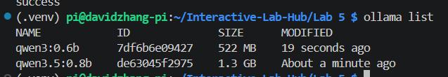

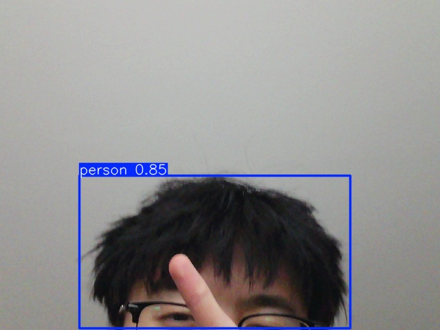

## Part B. 

<details>
	<summary><strong>Part B Details (Click to Expand)</strong></summary>
	
### See: recognize people in real time with YOLO

YOLO is an *object detector*: it finds every person, cup, cat and so on (the 80 [COCO](https://cocodataset.org/) classes), draws a box around each, and gives a confidence. For an observant system that is exactly what you want: *how many*, *where*, *how sure*.

Connect your webcam, connect to your Pi through **VNC** (the script opens a window), and run the person detector. Read `yolo_person.py` first; the loop at the bottom is the whole idea.

```
(.venv) pi@raspberrypi:~/Interactive-Lab-Hub/Lab 5 $ python yolo_person.py
```

While it runs, walk in and out of the frame, sit down, turn your back, hold up a photo of a person on your phone. Watch the confidence number on the box change with each.

Then press q to quit and run it again with a flag. Each one changes a single thing:

```
(.venv) pi@raspberrypi:~/Interactive-Lab-Hub/Lab 5 $ python yolo_person.py --conf 0.2     # lower the bar: see what the model is unsure about
(.venv) pi@raspberrypi:~/Interactive-Lab-Hub/Lab 5 $ python yolo_person.py --conf 0.7     # raise the bar: see what you lose
(.venv) pi@raspberrypi:~/Interactive-Lab-Hub/Lab 5 $ python yolo_person.py --all          # all 80 classes, not only people: what else is on your desk, and what does it get wrong?
(.venv) pi@raspberrypi:~/Interactive-Lab-Hub/Lab 5 $ python yolo_person.py --headless     # no window, only the printed readings: how it runs over ssh, and at night
```

</details> 

\*\*\***Include a short video or screenshots of your experiments with the person detection. Write down three situations where it did not see you, or saw a person who was not there, and what you think the cause was.**\*\*\*


A short video of the person detection can be seen here: https://drive.google.com/file/d/1II1FLSGtrvXep6s0cweG1ObZwnJPvIXq/view?usp=sharing

We tested three different situations to test the reliability of the person detection:
- When turning off the lights, the model had more difficulty detecting people, as the camera could not capture enough visual details to reliably recognize human features.
- When moving partially outside the camera frame, the model sometimes failed to recognize the person. This could be because there was not enough information about the person's body shape for accurate detection.
- When showing a photograph of a person on a phone screen, the model could detect the person in the image as if someone were physically present. This happens because YOLO recognizes visual patterns rather than determining whether a person is physically present in the room.

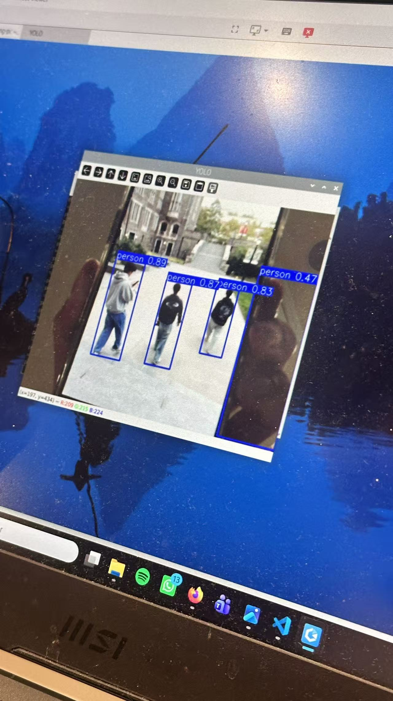


## Part C. 

<details>
	<summary><strong>Part C Details (Click to Expand)</strong></summary>
	
### See more: hands and pose with MediaPipe

YOLO tells you that a person is there. Google's [MediaPipe](https://mediapipe.dev/) tells you what their hands and body are doing: face, hand and body pose detection, fast on the Pi.


The demo plays a looping audio file, so make the helper script executable first:

```
(.venv) pi@raspberrypi:~/Interactive-Lab-Hub/Lab 5 $ chmod +x loop_audio.sh
```

Connect your webcam, connect to your Pi through **VNC**, and run the hand pose script:
(***it will not work if you use ssh from your laptop***)

```
(.venv) pi@raspberrypi:~/Interactive-Lab-Hub/Lab 5 $ python hand_pose.py
```

Try the two main features of this script: 1) pinching for percentage control (the thumb-to-index distance sets the volume), and 2) "[Quiet Coyote](https://www.youtube.com/watch?v=qsKlNVpY7zg)" for instant percentage setting (the gesture mutes it). Notice how this example uses hardcoded positions and relates those positions with a desired set of events, in `hand_pose.py`: a hand is 21 landmark coordinates, and an *event* is a rule you write over them. That is the same job as `interpret()` in Part E.

Consider how you might use this position based approach to create an interaction, and write how you might use it on either face, hand or body pose tracking.

</details>

\*\*\***Include a screenshot or short video of the hand pose demo, and write how you might use face, hand or body pose tracking in your observant system.**\*\*\*

We tested both the volume control and the Quiet Coyote functions of the script. Some screenshots of these interactions are attached below, and a short video demo can be seen here: https://drive.google.com/file/d/1wnjsfQrUTy4oALpYatzacbZTKukACG33/view?usp=sharing

One possible application would be using the webcam to monitor the user's body posture. So it tracks the user shoulders, neck and torso positioning, and the device detects whether the user is sitting in a bad posture, so if the user leans forward for an extended period, the device reminds them to correct their posture. Another possible interaction would be playing instruments using hand tracking, so different finger positionings could correspond to different musical notes. By this way, users can play music by just moving their fingers in front of a camera.  

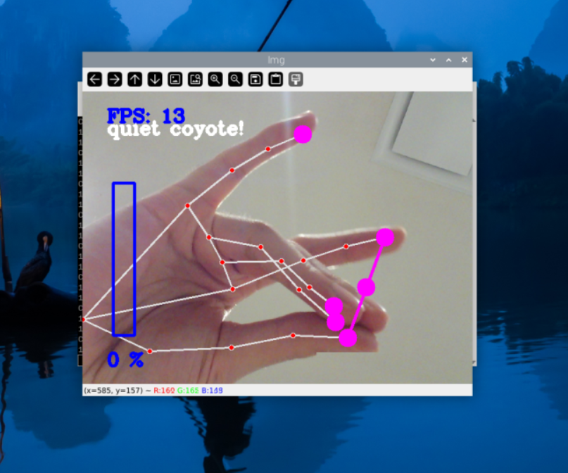
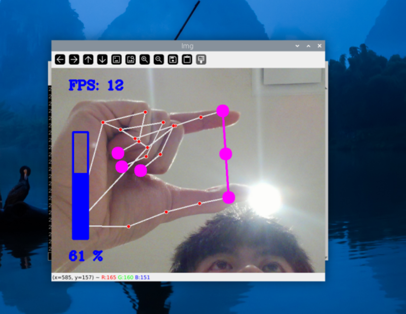


## Part D. 

<details>
	<summary><strong>Part D Details (Click to Expand)</strong></summary>
	
### Reason: run Qwen on the Pi with Ollama

Talk to the model in the terminal first. Qwen3 models "think" before they answer, which is slow on a Pi, so turn it off. Then ask about something you can check:

```
pi@raspberrypi:~ $ ollama run qwen3.5:0.8b
>>> /set nothink
>>> Tell me a bit about the history of Roosevelt Island. Three sentences.
>>> /bye
```

Roosevelt Island is a good first question because you know the ground truth: it was Blackwell's Island, then Welfare Island, got its current name in 1973, and Cornell Tech opened on it in 2017. Count how many of the model's facts are true.

From Python, qwen requests can be triggered by the `ask_qwen.py` script. It turns thinking off, tells the model to answer in at most three sentences, and cuts it off after 120 tokens (`--max-tokens` changes that), because a small model left alone writes an essay. Read the script, then run:

```
(.venv) pi@raspberrypi:~/Interactive-Lab-Hub/Lab 5 $ python ask_qwen.py "Tell me a bit about the history of Roosevelt Island."
(.venv) pi@raspberrypi:~/Interactive-Lab-Hub/Lab 5 $ python ask_qwen.py --model qwen3:0.6b "Tell me a bit about the history of Roosevelt Island."
(.venv) pi@raspberrypi:~/Interactive-Lab-Hub/Lab 5 $ python ask_qwen.py --image snap.jpg "What is in this photo?"
```

Things in the [Ollama API](https://github.com/ollama/ollama/blob/main/docs/api.md) worth knowing:

* `think: false` skips the reasoning trace. Always, on a Pi. `ask_qwen.py` sends it on every request; `--think` turns the trace back on for one question, so you can see what you are skipping and how long it takes.
* `format` makes the model answer as JSON with the fields you name (`--json`). Handy when a display or a servo has to read the answer.
* `images` sends a photo along with the prompt (`--image snap.jpg`, the photo from Part A). `qwen3.5:0.8b` can look at pictures.

A 0.8B model is slow and sometimes wrong. It will invent events that are not in the data and agree with a wrong premise. Give it the data, keep its job narrow, and decide what the device does when the model is unsure.

</details>

\*\*\***Ask Qwen three questions to answer. Paste the questions, the answers and how long each took. Try one of them with `qwen3:0.6b` and compare.**\*\*\*

### Test 1: Historical Question (Qwen3.5:0.8b)

**Question:** Tell me a bit about the history of Roosevelt Island.

**Model:** `qwen3.5:0.8b`

**Response:**
> Roosevelt Island is an island located on Manhattan, New York City, originally built as part of the Great Wall of Manhattan to protect the harbor from pirates and storms. It was first developed in 1857 by John Quincy Adams and later became a significant landmark for American immigration and political history during the late 19th century.

**Response Time:** 65.6 seconds

### Test 2: Same Question with a Smaller Model (Qwen3:0.6b)

**Question:** Tell me a bit about the history of Roosevelt Island.

**Model:** `qwen3:0.6b`

**Response:**
> Roosevelt Island, located in the United States, was established in the 19th century as a residential area for the Roosevelt family. It played a significant role in the development of New York City and became a hub for the American West. The island is known for its historic architecture and the Roosevelt family's influence on the region.

**Response Time:** 43.5 seconds

### Test 3: Image Understanding (Qwen3.5:0.8b)

**Question:** What is in this photo?

**Image:** `snap.jpg`

**Model:** `qwen3.5:0.8b`

**Response:**
> This photo features a young Asian man with dark hair and glasses, wearing a blue shirt. He is looking directly at the camera with a slight smile. In the background, there are two white wall plates and a black water bottle on a table.

**Response Time:** 99.0 seconds

### Reflection

The smaller Qwen3:0.6b model responded faster (43.5 seconds) than Qwen3.5:0.8b (65.6 seconds) when answering the same historical question. However, both models generated inaccurate historical information, showing that language models can produce confident but incorrect responses.

For the image understanding task, Qwen3.5:0.8b took 99.0 seconds and generated a detailed description of the photo. Compared with YOLO's object detection, Qwen provided a more descriptive natural-language response.

Overall, the experiments demonstrated the trade-offs between response speed, factual accuracy, and multimodal capabilities when running AI models locally on a Raspberry Pi.


## Part E. 

<details>
	<summary><strong>Part E Details (Click to Expand)</strong></summary>
	
### Connect: from YOLO readings to Qwen reasoning

An observant system is a pipeline: a **detector** turns pixels into boxes, an **interpreter** turns boxes into readings in words ("one person, left, close"), the readings pile up in a **log**, and a **reasoner** answers a question about the log. The language model never sees pixels, only the words you chose in the interpreter. That makes the interpreter the most important design decision in the system.

`yolo_to_qwen.py` is the pipeline in one file, one function per stage. Read it before you run it:

* `interpret(r)` is the interpreter. It takes one YOLO result and returns one reading. A person is *left*, *center* or *right* by which third of the frame the middle of their box is in, and *close* if the box is taller than 60% of the frame, *far* otherwise. The reading is a string like `1 person(s) at center/close`, or `nobody`. Fifteen lines, and they decide everything the model can know.
* `watch(seconds)` is the detector and the log. Twice a second it reads a frame, runs YOLO on it and calls `interpret()`. A time-stamped reading goes into the log **only when it differs from the previous one**, so a minute of sitting still is one line, not 120.
* `ask(log, question)` is the reasoner. It pastes the log and your question into one prompt, tells Qwen to answer in at most three sentences using only what is in the log, and sends it to Ollama with thinking off.

Run it through VNC and a window opens with YOLO's boxes, the current reading and the seconds left. Press q to stop watching early. Over plain ssh add `--headless` and you get the same thing minus the window.

```
(.venv) pi@raspberrypi:~/Interactive-Lab-Hub/Lab 5 $ python yolo_to_qwen.py
```

It watches for a minute, saves the log to `watch_log.txt` and asks Qwen the default question. The terminal looks something like this:

```
14:02:11 nobody
14:02:19 1 person(s) at right/far
14:02:24 1 person(s) at center/close
14:02:51 nobody

4 lines saved to watch_log.txt
asking Qwen...

Qwen (18.4 s):
One person came in from the right, moved close to the camera, and left after about half a minute. ...
```

</details>

---

# Lab 5 Part 2: Overnight Sensation

<details>
	<summary><strong>Part 2 Details (Click to Expand)</strong></summary>

For Part 2, you will use the observant system from Part 1 to design a night-time interaction. On-device AI is slow, so let it work while you sleep. The person meets the device twice: **before bed**, when they hand the night over, and **when awake**, when the device gives something back. In between, the pipeline from Part E runs on its own.

Two flavors, pick one or mix them:

* **Sense all night.** The Pi watches, listens or measures from bedtime until morning and keeps a log.
* **Process all night.** You already have the data (a day of phone photos, a long recording) and the Pi needs hours to get through it.

Two house rules. Sample rather than stream: one look every 5 to 30 seconds is plenty, and it keeps the Pi cool. And keep everything on the Pi: tell the people you live with, point the camera at things rather than at beds, and delete the snapshots after the demo.

</details>

## Part F. 
### Read Part 2 and storyboard your night-time interaction

<details>
	<summary><strong>Part F Details (Click to Expand)</strong></summary>

Storyboard a night-time interaction built on your observant system, in three panels:

1. **Before bed.** How does the person hand the night over, and how does the device acknowledge it?
2. **While asleep.** What does the device watch or work through?
3. **When awake.** What is the one thing the person learns, and in what medium?

Stuck? A kitchen that tells you who raided the fridge. A desk that reports whether you actually went to bed. A window that names the quietest hour. A plant that describes its night. Find something better.

Use storyboards and/or [Verplank diagrams](https://ccrma.stanford.edu/courses/250a-fall-2004/IDSketchbok.pdf).

</details>

\*\*\***Insert ideas, sketches, Verplank diagrams and storyboards for your night-time interaction here.**\*\*\*

We brainstormed several ideas, including:
- **Notification tracker**: The user places their phone in front of the camera before sleeping, and the device will monitor when the screen lights up overnight. It will try to count and categorize notifications by app (e.g., WeChat, Calendar, etc). In the morning, it gives a summary of the notifications received and how frequently the phone was activated.
- **Night digital processor**: The user uploads a folder of unsorted photos before going to bed. Overnight, YOLO analyzes the images and categorizes them based on detected objects, such as people, animals, food, or vehicles. In the morning, the user receives an organized photo collection and a summary of its contents.
- **AI Dream Machine**: Before bed, the user uploads photos from their day, then YOLO analyzes them overnight and identifies objects, while Qwen uses these observations to come up with a creative, dream-like story. In the morning, the device reveals and narrates the dream using text-to-speech.

We ended up choosing our third idea, AI Dream Machine, and this is our initial storyboard and verplank diagram: 

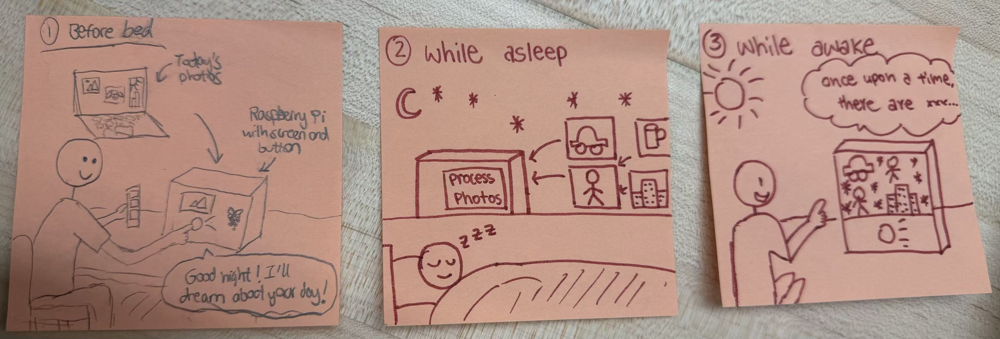

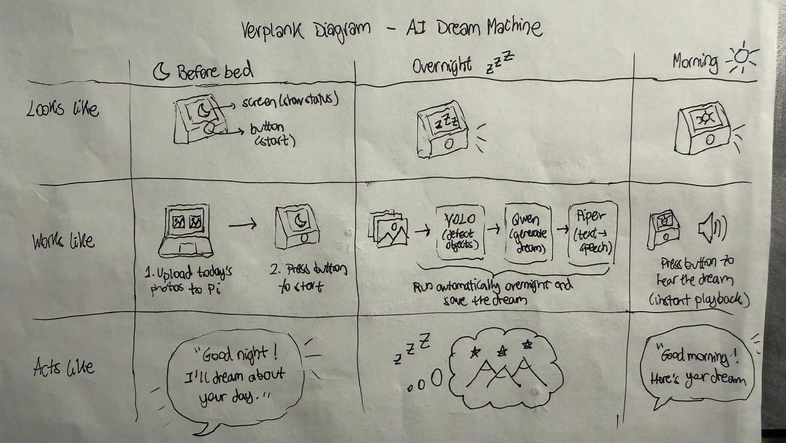


## Prep for Part 2

<details>
	<summary><strong>Prep for Part 2 Details (Click to Expand)</strong></summary>

1. Look at and give feedback on the Part F storyboards.
   **Put the feedback for your ideas here.**
2. [Update your Lab Hub](prep.md#get-the-latest-content) to get the latest content for Part 2.
3. Decide where the device will spend the night and who else lives there. Get their OK before the first run.
4. Revise your storyboard with the feedback and with what you learned in Part E about where the pipeline breaks.

</details>

\*\*\***Post your revised storyboard here.**\*\*\*

Some of the feedback we received was that it was not clear how the user would provide the Raspberry Pi with photos or what the morning interaction would look like. It was also unclear how the user would know when the device had started processing, so we were encouraged to add a physical button and clearer feedback to make the interaction more intuitive. There were also concerns about the privacy of the uploaded photos.

From Part E, we learned about several technical limitations of our system. YOLO can detect people and objects, but it cannot fully understand the context or meaning behind a photo. It can also miss or incorrectly identify objects, meaning the generated dream might not accurately reflect the uploaded images. Additionally, Qwen cannot see the images directly and relies entirely on the textual descriptions produced by the interpreter. We also noticed that Qwen takes a considerable amount of time to generate a story on the Raspberry Pi.

Based on this feedback and our observations, we decided to improve our design by:
- Moving dream generation overnight, so the user doesn't have to wait for Qwen and Piper in the morning.
- Using a single physical button to start the process before bed and reveal the dream in the morning.
- Providing clear screen and voice feedback so users know when processing has started and when their dream is ready.
- Improving the interpreter to include more useful details from YOLO detections, helping Qwen generate more meaningful stories.
- Keeping all processing local on the Raspberry Pi to protect the privacy of the user's photos.

Our improved storyboard taking into account the feedback can be seen below:


## Part G. 
### Design the interaction before

<details>
	<summary><strong>Part G Details (Click to Expand)</strong></summary>

The hand-off: the person tells the device what to watch tonight, and the device acknowledges it. Keep it to a thirty-second ritual. A button or a touch (Lab 4), a spoken sentence (Lab 3), a wave or a Quiet Coyote at the camera (Part C). The acknowledgement can be a line on the display, a tone, or an LED that dims rather than lights up. At its simplest, the hand-off just sets the question that the morning will answer.

</details>

\*\*\***Describe the interaction before.**\*\*\*

Before going to bed, the user uploads 50 photos of their day/week into a designated folder on the Raspberry Pi. Once the photos are ready, they press a physical button to activate the AI Dream Machine. The device acknowledges the hand-off with a short audio message: “Good night! I'll dream about your day.”
The Raspberry Pi then begins processing the photos in the background using YOLO and Qwen. The user does not need to interact with the device again until the next morning. The entire hand-off takes less than 30 seconds, assuming the photos have already been transferred. The next day, the user presses the button again and the Pi will narrate the generated dream through the speaker.

## Part H. 
### Incorporate the observant system

<details>
	<summary><strong>Part H Details (Click to Expand)</strong></summary>

The Part E pipeline becomes the night shift. `overnight.py` runs your `interpret()` from `yolo_to_qwen.py` every few seconds, people only unless you pass `--all`, and writes the readings to `night_log.jsonl`; the reasoning waits for the morning. Start it inside `tmux` so it keeps running after you close your laptop, and stop it with Ctrl-C in the morning:

```
(.venv) pi@raspberrypi:~/Interactive-Lab-Hub/Lab 5 $ tmux new -s night
(.venv) pi@raspberrypi:~/Interactive-Lab-Hub/Lab 5 $ python overnight.py
```

Fake a night first: run it for thirty seconds while you walk around, stop it, and run `morning.py` from Part I. When that looks right, run a real night. If your storyboard needs a sensor rather than the camera, swap in the Lab 4 example code and log its reading the same way.

</details>

\*\*\***Screenshots or videos of the running system.**\*\*\*

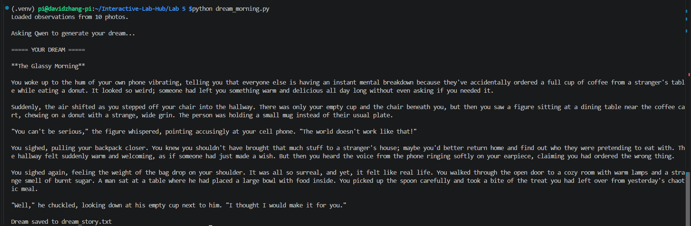
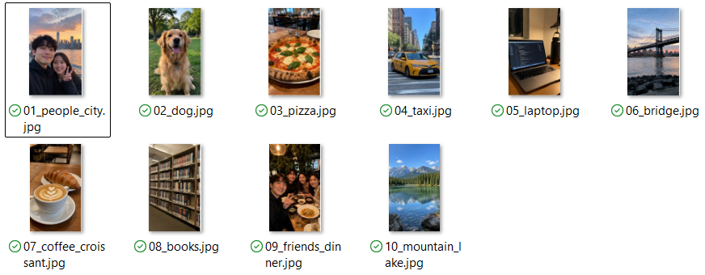
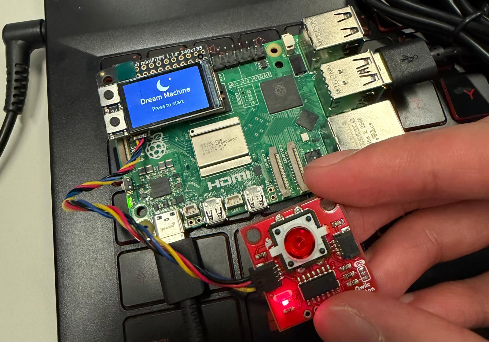


## Part I. 
### Design the interaction after

<details>
	<summary><strong>Part I Details (Click to Expand)</strong></summary>

The reveal. The night produced a log; the morning turns it into something a half-awake person can take in. `morning.py` is the smallest version: it asks Qwen for a three-sentence report.

```
(.venv) pi@raspberrypi:~/Interactive-Lab-Hub/Lab 5 $ python morning.py
```

Make it yours: show the report on the Mini PiTFT, read it aloud with Piper from Lab 3, plot the night as a timeline, or ask for JSON (`--json`, Part D) and move a servo. Whatever you pick, make sure it is honest about a night in which nothing happened.

</details>


For our AI Dream Machine, we wanted the morning interaction to be simple and enjoyable, without requiring the user to wait for the AI to generate the dream.
After processing the uploaded photos overnight, YOLO saves the detected objects into a log. Qwen then uses these observations to generate a short, creative dream story, and Piper converts it into audio. Both the story and narration are saved locally on the Raspberry Pi.
In the morning, the user presses again the button to reveal their dream. The device plays the saved dream through a speaker, allowing the user to listen to it without having to read anything or interact with a computer.

We also considered situations where no objects were detected or no photos were uploaded. In these cases, the device informs the user rather than generate a dream that appears to be based on observations that were never made.

## Final documentation

<details>
	<summary><strong> Details (Click to Expand)</strong></summary>

Document all the prototypes and iterations you have designed and worked on. The deliverables for this lab are writings, sketches, photos, and videos that show what your system:

* "Looks like": how the device sits in the room at night, and what it looks like at bedtime and in the morning.
* "Works like": the pipeline from detector to interpreter to log to reasoner, with a real night's data.
* "Acts like": how a person hands the night over and what they get back.

</details>

\*\*\***Include a short video of the whole system**\*\*\*

Throughout the development of our AI Dream Machine, we made several improvements based on feedback and testing. Initially, Qwen generated the dream after the user pressed the button in the morning, but this took considerable time, so we moved the entire process overnight, so the dream and its narration are ready when the user wakes up. We also added visual feedback to the Pi screen to make the interaction clearer.

### Looks like
The device sits on a desk next to the user's bed, with a physical button, a Mini PiTFT screen, and a speaker. The screen displays different icons and messages depending on the current state.

### Works like
After the user uploads their photos and presses the button, YOLO detects objects, the interpreter converts them into text descriptions, and the observations are saved in a log. Qwen then generates a creative dream, and Piper converts it into audio. Everything is processed locally while the user sleeps. The code files are the following: dream_display.py, dream_machine.py, dream_morning.py, dream_overnight.py.

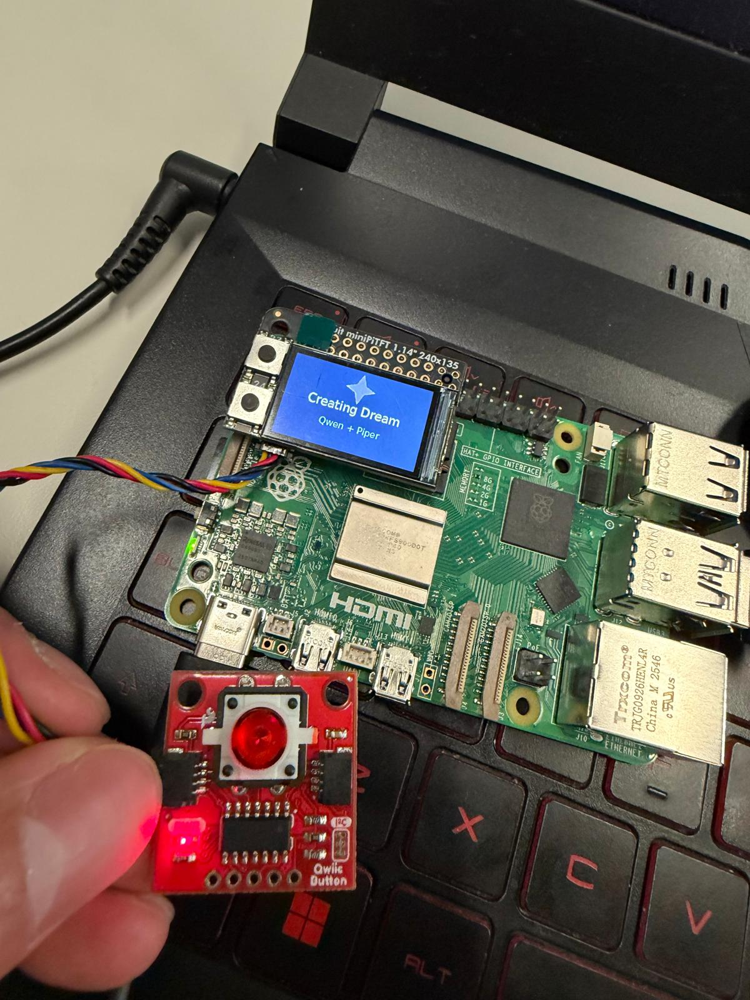
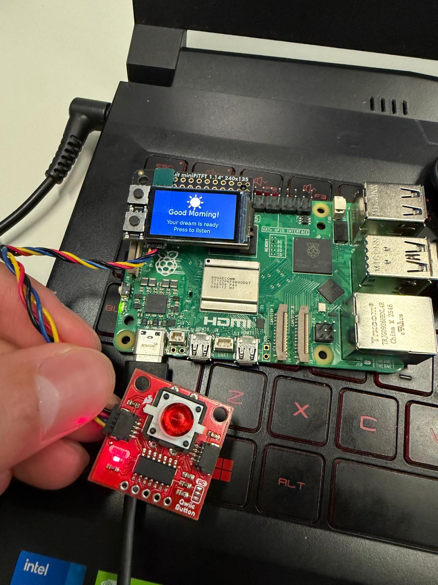

### Acts Like
Before bed, the user uploads their photos and presses the button to start the process. The screen confirms that the device is working. In the morning, the user presses the same button to immediately hear their personalized dream, starting with a greeting and the dream's title. They can press it again to replay the narration.

A demo video of our AI Dream Machine can be seen here: 

https://drive.google.com/file/d/1R7dZj2wLami1X_ppWY9Ht1EsQm6G5xZF/view?usp=sharing
