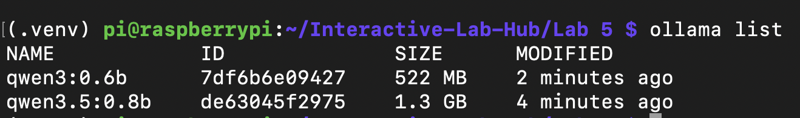
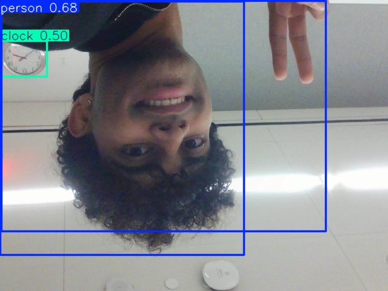
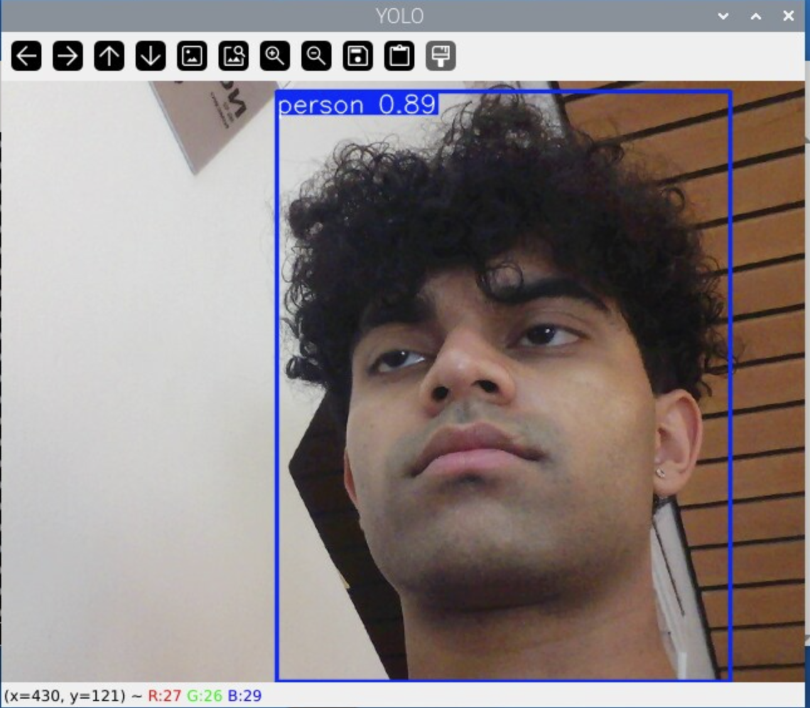
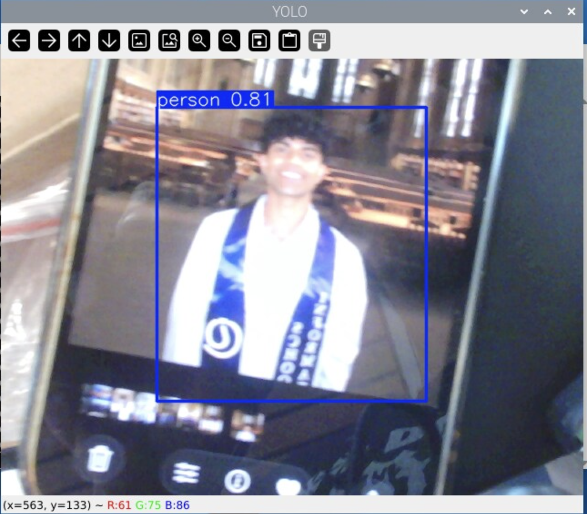
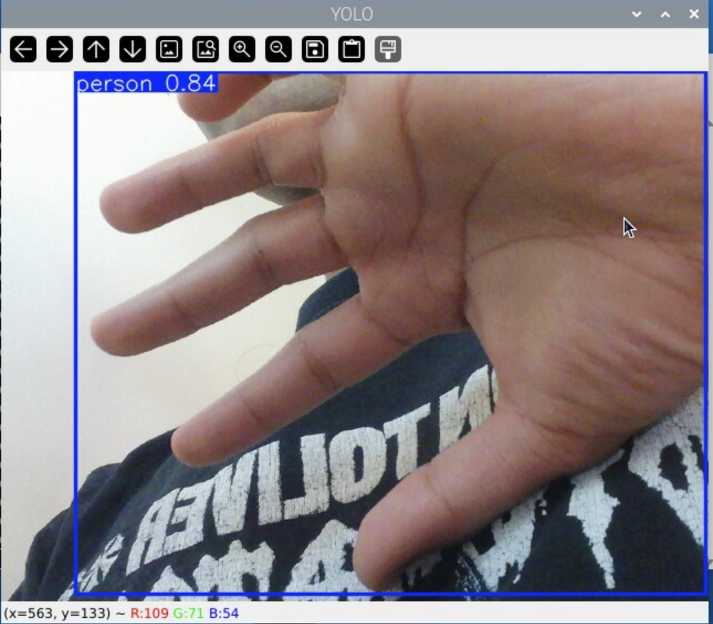
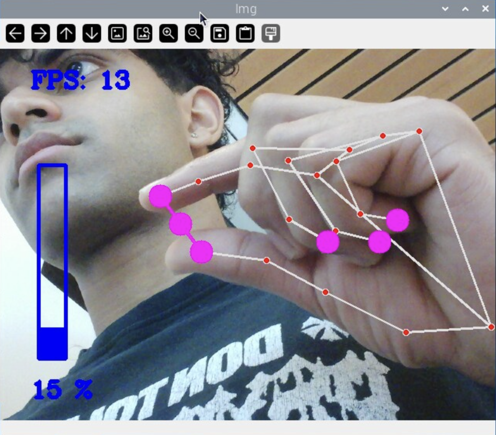
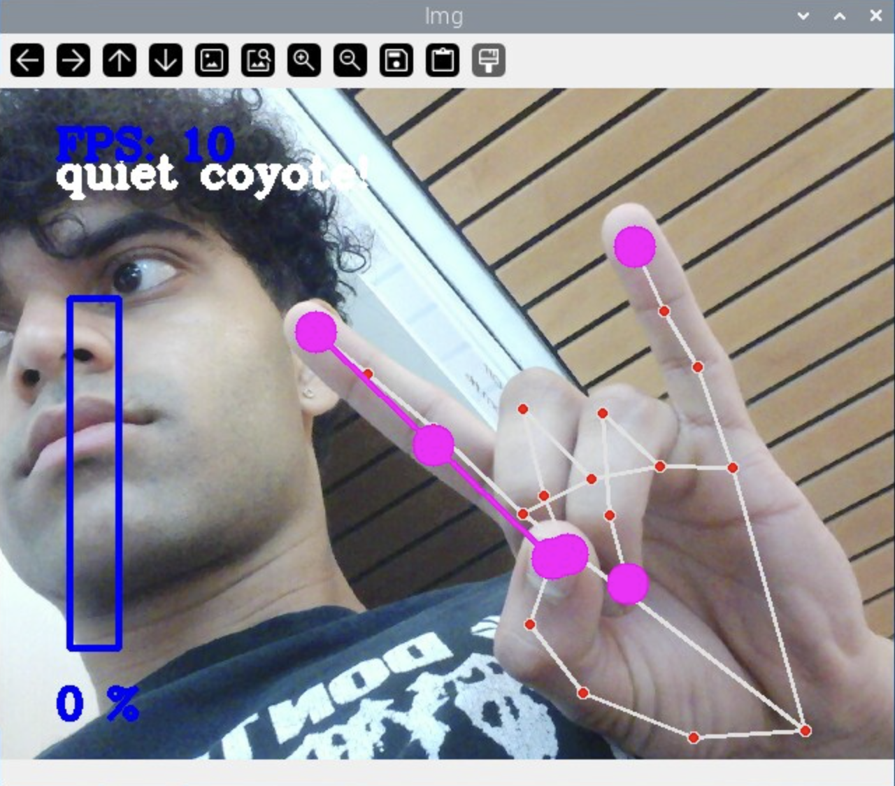
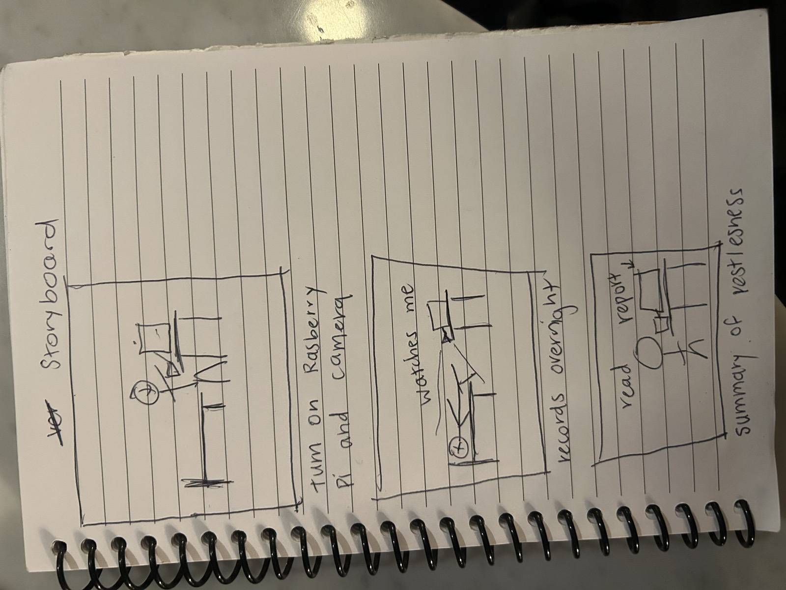

# Observant Systems: Overnight Sensation

**Aryan Palave (ap2578)**

Interaction Video: https://youtu.be/f2TG2skf9kc

For lab this week, we focus on creating interactive systems that can detect and respond to events or stimuli in the environment of the Pi, like the Boat Detector we mentioned in lecture. 
Your **observant device** could, for example, count items, find objects, recognize an event or continuously monitor a room.

This lab will help you think through the design of observant systems, particularly corner cases that the algorithms need to be aware of.

**New this year: the AI runs on the Pi.** Your Pi 5 can run an object detector ([YOLO](https://docs.ultralytics.com/)) and a small language model ([Qwen](https://ollama.com/library/qwen3.5) through [Ollama](https://ollama.com)) completely offline. In Part 1 you get both running and connect them: YOLO *sees*, Qwen *reasons* about what was seen. These models are slow, but they have all night. In Part 2 you use them to design a **night-time interaction**: what you tell the device before bed, what it does while you sleep, and what it shows you when you wake up.

**Please indicate anyone you collaborated with on this Lab here.**
Be generous in acknowledging their contributions! And also recognizing any other influences (e.g. from YouTube, Github, Twitter) that informed your design. 

## Overview

**Part 1: the tools**

A) [Set up your Pi for on-device AI](#part-a)

B) [See: recognize people in real time with YOLO](#part-b)

C) [See more: hands and pose with MediaPipe](#part-c)

D) [Reason: run Qwen on the Pi with Ollama](#part-d)

E) [Connect: from YOLO readings to Qwen reasoning](#part-e)

**Part 2: Overnight Sensation**

F) [Read Part 2 and storyboard your night-time interaction](#part-f)

G) [Design the interaction before bed](#part-g)

H) [Incorporate the observant system during sleep](#part-h)

I) [Design the interaction when awake](#part-i)

The tools from earlier versions of this lab (MobileNet, Teachable Machine, Moondream, audio analysis, classic OpenCV) live in the [legacy folder](legacy/README.md). They are optional, but any of them can be the sensor in your Part 2 system.


## Prep for Part 1

Please check the instructions in [prep.md](prep.md) and complete them before lab. The installs in Part A take a while, so prep.md also tells you how to get a head start.

## The Report

This readme.md page in your own repository should be edited to include the work you have done. You can delete everything but the headers and the sections between the \*\*\***stars**\*\*\*. Write the answers to the questions under the starred sentences. Include any material that explains what you did in this lab hub folder, and link it in the readme.

---

# Part 1

## Part A. 
### Set up your Pi for on-device AI

Create a virtual environment and install the requirements. They include `ultralytics` (YOLO), which pulls in torch, so this takes a while:

```
pi@raspberrypi:~$ cd Interactive-Lab-Hub/Lab\ 5
pi@raspberrypi:~/Interactive-Lab-Hub/Lab 5 $ python3 -m venv .venv
pi@raspberrypi:~/Interactive-Lab-Hub/Lab 5 $ source .venv/bin/activate
(.venv) pi@raspberrypi:~/Interactive-Lab-Hub/Lab 5 $ pip install -r requirements.txt
```

As in Lab 3, [`uv`](https://docs.astral.sh/uv/) is a much faster drop-in for `pip`: `pip install uv && uv pip install -r requirements.txt`.

### YOLO: download the nano model and export it for the Pi

We use the nano model of [YOLO26](https://docs.ultralytics.com/models/yolo26/), exported once to NCNN, the format that runs fastest on the Pi. This downloads the weights, so you need internet:

```
(.venv) pi@raspberrypi:~/Interactive-Lab-Hub/Lab 5 $ python -c "from ultralytics import YOLO; YOLO('yolo26n.pt').export(format='ncnn')"
```

Test it on an image from the internet. `project=runs` keeps the output in this folder; without it, ultralytics writes to a `runs/` folder at the top of your git repo, where you will not think to look.

```
(.venv) pi@raspberrypi:~/Interactive-Lab-Hub/Lab 5 $ yolo predict model=yolo26n_ncnn_model source=https://ultralytics.com/images/bus.jpg project=runs
```

The result is in `runs/predict/bus.jpg`: boxes around the people and the bus.

Now a photo of your own. Plug in the webcam and take one with `snap.py` (`--delay 3` gives you three seconds to get into the frame), or copy a photo from your phone to the Pi with `scp`. Then run the same command on it:

```
(.venv) pi@raspberrypi:~/Interactive-Lab-Hub/Lab 5 $ python snap.py --delay 3
(.venv) pi@raspberrypi:~/Interactive-Lab-Hub/Lab 5 $ yolo predict model=yolo26n_ncnn_model source=snap.jpg project=runs
```

Every run gets its own numbered folder, so this one is in `runs/predict2/snap.jpg`; the command prints where it saved. Keep `snap.jpg`, you will show it to Qwen in Part D.

### Ollama: install it and pull Qwen

[Ollama](https://ollama.com) runs language models locally. Nothing leaves the Pi: no API key, no internet after the download.

```
pi@raspberrypi:~ $ curl -fsSL https://ollama.com/install.sh | sh
pi@raspberrypi:~ $ ollama pull qwen3.5:0.8b
pi@raspberrypi:~ $ ollama pull qwen3:0.6b
pi@raspberrypi:~ $ ollama list
```

| model | download | what it does |
|---|---|---|
| `qwen3.5:0.8b` | ~1.3 GB | text **and images**; the one we use in this lab |
| `qwen3:0.6b` | ~0.5 GB | text only, smaller and faster (~16 tokens/s on a Pi 5) |

\*\*\***Include a screenshot of `ollama list` showing your models, and the `bus.jpg` result and your own photo with their boxes.**\*\*\*

Both Qwen models pulled and running on the Pi:



`yolo26n` exported to NCNN, run on the test image. It finds the bus (0.90) and four people, including the one cut off at the left edge (0.56). Inference took about 90 ms on the Pi 5.


My own photo from the webcam with `snap.py`. The camera was mounted upside down, and YOLO still found me (0.68) and the wall clock (0.50), but with lower confidence than the people in the bus photo.




## Part B. 
### See: recognize people in real time with YOLO

YOLO is an *object detector*: it finds every person, cup, cat and so on (the 80 [COCO](https://cocodataset.org/) classes), draws a box around each, and gives a confidence. For an observant system that is exactly what you want: *how many*, *where*, *how sure*.

Connect your webcam, connect to your Pi through **VNC** (the script opens a window), and run the person detector. Read `yolo_person.py` first; the loop at the bottom is the whole idea.

```
(.venv) pi@raspberrypi:~/Interactive-Lab-Hub/Lab 5 $ python yolo_person.py
```

While it runs, walk in and out of the frame, sit down, turn your back, turn the lights off, hold up a photo of a person on your phone. Watch the confidence number on the box change with each.

Then press q to quit and run it again with a flag. Each one changes a single thing:

```
(.venv) pi@raspberrypi:~/Interactive-Lab-Hub/Lab 5 $ python yolo_person.py --conf 0.2     # lower the bar: see what the model is unsure about
(.venv) pi@raspberrypi:~/Interactive-Lab-Hub/Lab 5 $ python yolo_person.py --conf 0.7     # raise the bar: see what you lose
(.venv) pi@raspberrypi:~/Interactive-Lab-Hub/Lab 5 $ python yolo_person.py --all          # all 80 classes, not only people: what else is on your desk, and what does it get wrong?
(.venv) pi@raspberrypi:~/Interactive-Lab-Hub/Lab 5 $ python yolo_person.py --headless     # no window, only the printed readings: how it runs over ssh, and at night
```

\*\*\***Include a short video or screenshots of the person detection. Write down three situations where it did not see you, or saw a person who was not there, and what you think the cause was.**\*\*\*

`yolo_person.py` running live on the Pi, viewed through Raspberry Pi Connect screen sharing. Facing the camera, right side up, it detects me at about 0.9, much higher than the 0.68 from the upside-down `snap.jpg` in Part A.



**Three situations where it got it wrong:**

1. **A photo of a person on my phone (a person who is not there).** I held up a photo of myself on my phone and YOLO boxed it as `person 0.81`, almost as confident as the real me. YOLO only sees shapes and textures in a 2D frame, so a picture of a person looks the same to it as a person. For a bedside device, a poster, a TV or a phone screen on the nightstand would all count as someone in the room.

   

2. **Just my hand and shirt (a whole person from a part).** With only my hand and part of my T-shirt in frame, it still said `person 0.84` and drew the box over the whole frame. It is trained on people, not body parts, so any skin and clothing close to the camera is enough for a full "person". A hand reaching for the alarm would be counted the same as someone standing by the bed, so the box alone can't tell those apart.

   

3. **The camera upside down (less sure of a real person).** In `snap.jpg` (Part A) the webcam was mounted upside down, and the confidence dropped to 0.68 from about 0.9 when right side up. The training photos are almost all upright people, so an unusual orientation looks less like what it learned. A person lying down in bed is a similar case, and that is the main pose this device would see at night.


## Part C. 
### See more: hands and pose with MediaPipe

YOLO tells you that a person is there. Google's [MediaPipe](https://mediapipe.dev/) tells you what their hands and body are doing: face, hand and body pose detection, fast on the Pi.


The demo plays a looping audio file, so make the helper script executable first:

```
(.venv) pi@raspberrypi:~/Interactive-Lab-Hub/Lab 5 $ chmod +x loop_audio.sh
```

Connect your webcam, connect to your Pi through **VNC**, and run the hand pose script:
(***it will not work if you use ssh from your laptop***)

```
(.venv) pi@raspberrypi:~/Interactive-Lab-Hub/Lab 5 $ python hand_pose.py
```

Try the two main features of this script: 1) pinching for percentage control (the thumb-to-index distance sets the volume), and 2) "[Quiet Coyote](https://www.youtube.com/watch?v=qsKlNVpY7zg)" for instant percentage setting (the gesture mutes it). Notice how this example uses hardcoded positions and relates those positions with a desired set of events, in `hand_pose.py`: a hand is 21 landmark coordinates, and an *event* is a rule you write over them. That is the same job as `interpret()` in Part E.

Consider how you might use this position based approach to create an interaction, and write how you might use it on either face, hand or body pose tracking.

\*\*\***Include a screenshot or short video of the hand pose demo, and write how you might use face, hand or body pose tracking in your observant system.**\*\*\*

`hand_pose.py` running on the Pi at 10–13 FPS. On the left, a pinch: the distance between thumb and index fingertips sets the volume to 15%. On the right, the "quiet coyote" gesture is recognized and mutes it to 0%.

| Pinch to set volume | Quiet coyote to mute |
|---|---|
|  |  |

**How I would use it: body pose to measure restlessness.** YOLO can tell me *that* someone is in bed, but not *how* they are sleeping. MediaPipe's body pose gives me the positions of my shoulders and hips, so the device could track how they move through the night. The event rule would work like the pinch rule in `hand_pose.py`: if the angle of the line between my shoulders changes by more than about 45° and stays changed for a few seconds, that counts as one turn. A few small shifts are normal, but a cluster of turns in a short window means a restless stretch. In the morning, the device would report how many times I turned over and when the restless stretches were, for example "you tossed and turned a lot between 3 and 4am".

What I would need to handle:
- **The dark.** Pose tracking needs to see me, and the webcam is close to blind with the lights off. I would need a dim night light, or an IR camera.
- **The blanket.** It hides my hips and sometimes my shoulders. I would only count frames where MediaPipe is confident about the shoulder landmarks.
- **The camera angle.** The camera would have to look down at the bed from the side, not face me like in the screenshots, because pose models are trained mostly on upright people (the same problem as the upside-down `snap.jpg` in Part A).


## Part D. 
### Reason: run Qwen on the Pi with Ollama

Talk to the model in the terminal first. Qwen3 models "think" before they answer, which is slow on a Pi, so turn it off. Then ask about something you can check:

```
pi@raspberrypi:~ $ ollama run qwen3.5:0.8b
>>> /set nothink
>>> Tell me a bit about the history of Roosevelt Island. Three sentences.
>>> /bye
```

Roosevelt Island is a good first question because you know the ground truth: it was Blackwell's Island, then Welfare Island, got its current name in 1973, and Cornell Tech opened on it in 2017. Count how many of the model's facts are true.

From Python it is a dozen lines with `requests`; `ask_qwen.py` is that script. It turns thinking off, tells the model to answer in at most three sentences, and cuts it off after 120 tokens (`--max-tokens` changes that), because a small model left alone writes an essay. Read it, then run:

```
(.venv) pi@raspberrypi:~/Interactive-Lab-Hub/Lab 5 $ python ask_qwen.py "Tell me a bit about the history of Roosevelt Island."
(.venv) pi@raspberrypi:~/Interactive-Lab-Hub/Lab 5 $ python ask_qwen.py --model qwen3:0.6b "Tell me a bit about the history of Roosevelt Island."
(.venv) pi@raspberrypi:~/Interactive-Lab-Hub/Lab 5 $ python ask_qwen.py --image snap.jpg "What is in this photo?"
```

Four things in the [Ollama API](https://github.com/ollama/ollama/blob/main/docs/api.md) worth knowing:

* `think: false` skips the reasoning trace. Always, on a Pi. `ask_qwen.py` sends it on every request; `--think` turns the trace back on for one question, so you can see what you are skipping and how long it takes.
* `options.num_predict` is a hard cap on the answer length, in tokens. The model does not know about it, so it may stop mid-sentence; the `system` prompt is what asks it to be brief in the first place. `ask_qwen.py` uses both.
* `format` makes the model answer as JSON with the fields you name (`--json`). Handy when a display or a servo has to read the answer.
* `images` sends a photo along with the prompt (`--image snap.jpg`, the photo from Part A). `qwen3.5:0.8b` can look at pictures.

A 0.8B model is slow and sometimes wrong. It will invent events that are not in the data and agree with a wrong premise. Give it the data, keep its job narrow, and decide what the device does when the model is unsure.

\*\*\***Ask Qwen three questions a bedside device might need to answer. Paste the questions, the answers and how long each took. Try one of them with `qwen3:0.6b` and compare.**\*\*\*

All run with `ask_qwen.py` (thinking off, 120-token cap) on the Pi 5.

**Warm-up: Roosevelt Island (`qwen3.5:0.8b`, 81.7 s).** The first call includes loading the model.

> Roosevelt Island is a historic district on Long Island, New York, known for its rich architectural heritage and vibrant community life. It was originally built as a military installation during World War II, which later became the home to the U.S. Navy's flagship ship *USS Roosevelt*. Today, it serves as a popular tourist destination featuring iconic landmarks like the USS Constitution, the National Museum of the American Revolution, and a thriving arts scene.

Zero true facts. It is not on Long Island, was never a military base, and none of those landmarks are there. It never mentions Blackwell's Island, Welfare Island, the 1973 renaming or Cornell Tech. Everything sounds confident and is invented.

**Bedside question 1 (`qwen3.5:0.8b`, 29.0 s)**

> **Q:** I went to bed at 1am and have to be up at 8. How much sleep will I get, and is that enough?
>
> You would likely only get about 2 hours of restful sleep during your night shift, which is insufficient for a full day of work. You should aim for 7–9 hours of quality sleep to feel rested and productive.

**Wrong.** 1am to 8am is 7 hours, which is inside the 7–9 hours it recommends itself. It can't do simple time arithmetic, and it invented a "night shift". The device should do the math in code and only give the model the result.

**Bedside question 2 (`qwen3.5:0.8b`, 41.2 s)**

> **Q:** I woke up at 3am and cannot fall back asleep. What should I do?
>
> Try to listen to white noise or gentle music to help your brain settle. If that fails, try a warm bath with hot water for ten minutes before bed. Do not lie down until you feel completely comfortable.

**Partly right.** White noise is reasonable, but a warm bath "before bed" doesn't help when you're already in bed at 3am, and "do not lie down" makes no sense for someone lying in bed.

**Bedside question 3 (`qwen3.5:0.8b`, 31.5 s).** This is the kind of summary my restlessness device would need.

> **Q:** Last night the sensor counted 14 turns between 3am and 4am and only 3 turns the rest of the night. Write a one-line morning summary for me.
>
> The sensor shows a sharp drop in activity, suggesting the day ended early or there was a significant event at 4am that stopped the counting.

**Wrong, and this is the one that matters most.** The point of the data was a restless hour from 3 to 4am. The model read the change after 4am as a "drop in activity" and guessed the sensor stopped. For Part 2 the summary can't be left to the model: the code should find the restless window itself and give Qwen only the wording job, for example "Write one friendly sentence saying the restless period was 3–4am."

**Comparison: question 2 with `qwen3:0.6b` (18.2 s vs 41.2 s)**

> Try to stay active and move around to help your body release the tension. If this is a common issue, consider speaking with a healthcare professional.

The smaller model was more than twice as fast and its answer was vaguer, but less wrong: it didn't contradict the situation the way "do not lie down" did. Moving around is still questionable advice at 3am. For short, fixed-format text the 0.6b model is probably good enough and saves time; neither model should be trusted with facts or numbers.

**Speed note.** The Pi has no fan, and after these runs it was at 84.5 °C and throttling (`vcgencmd get_throttled` = `0xe0008`, the soft temperature limit). Some of these times are slower than they would be on a cooled Pi.


## Part E. 
### Connect: from YOLO readings to Qwen reasoning

An observant system is a pipeline: a **detector** turns pixels into boxes, an **interpreter** turns boxes into readings in words ("one person, left, close"), the readings pile up in a **log**, and a **reasoner** answers a question about the log. The language model never sees pixels, only the words you chose in the interpreter. That makes the interpreter the most important design decision in the system.

`yolo_to_qwen.py` is the pipeline in one file, one function per stage. Read it before you run it:

* `interpret(r)` is the interpreter. It takes one YOLO result and returns one reading. A person is *left*, *center* or *right* by which third of the frame the middle of their box is in, and *close* if the box is taller than 60% of the frame, *far* otherwise. The reading is a string like `1 person(s) at center/close`, or `nobody`. Fifteen lines, and they decide everything the model can know.
* `watch(seconds)` is the detector and the log. Twice a second it reads a frame, runs YOLO on it and calls `interpret()`. A time-stamped reading goes into the log **only when it differs from the previous one**, so a minute of sitting still is one line, not 120.
* `ask(log, question)` is the reasoner. It pastes the log and your question into one prompt, tells Qwen to answer in at most three sentences using only what is in the log, and sends it to Ollama with thinking off.

Run it through VNC and a window opens with YOLO's boxes, the current reading and the seconds left. Press q to stop watching early. Over plain ssh add `--headless` and you get the same thing minus the window.

```
(.venv) pi@raspberrypi:~/Interactive-Lab-Hub/Lab 5 $ python yolo_to_qwen.py
```

It watches for a minute, saves the log to `watch_log.txt` and asks Qwen the default question. The terminal looks something like this:

```
14:02:11 nobody
14:02:19 1 person(s) at right/far
14:02:24 1 person(s) at center/close
14:02:51 nobody

4 lines saved to watch_log.txt
asking Qwen...

Qwen (18.4 s):
One person came in from the right, moved close to the camera, and left after about half a minute. ...
```

Those four lines are the whole of what Qwen knows about the minute. If YOLO lost you for one frame, the log says you left and came back, and the report will say so too.

Run it with a partner: have them walk in, sit down, leave. Compare the log with what Qwen concluded. Then change one thing at a time:

* **The question.** `--question "Did anyone leave?"`, `--question "Should I be worried?"`, `--question "Write one sentence a sleepy person would want to hear."` Same log, different job for the reasoner.
* **The interpreter.** Edit `interpret()`: drop the positions, add "standing" versus "sitting" (a sitting person's box is shorter and squarer), count only people who are close. Qwen's answers change because its world changed.
* **The other objects.** By default the detector is told to look for people only. With `--all` it reports all 80 classes and the interpreter adds them to the reading, as in `1 person(s) at center/close; also chair, cup`. Look closely at what it names: at 320 pixels a white chair, a bucket or a sink is a "toilet" often enough, and Qwen will faithfully report the toilet in your bedroom. Deciding which objects deserve a mention is interpreter work.
* **The log.** Every run saves `watch_log.txt`. Edit it so it contradicts itself and feed it back with `--log watch_log.txt`: the camera is skipped and Qwen reasons over your edited file. Does it notice?
* **The format.** `--json` gets `{"people": 1, "activity": "...", "unusual": false}` back, which is what you will want in Part 2 to drive a display or a sound.
* **The timing.** `--seconds 300` watches longer. `--every` logs every reading instead of only changes, so the log grows to hundreds of lines and Qwen has to find the changes itself. See whether it still can.

\*\*\***Document the pipeline: at least three runs with the log, the question, Qwen's answer, and whether it was right. Include one case where Qwen got it wrong, and say what you changed in the interpreter and why.**\*\*\*

All runs were headless over SSH, 60 seconds each, with me and some friends moving in and out of frame.

**Run 1: the default question.** Log (`watch_log_run1.txt`, 21 lines):

```
12:34:22 nobody
12:34:25 1 person(s) at left/far
12:34:26 nobody
12:34:27 1 person(s) at left/far
12:34:29 nobody
12:34:31 1 person(s) at right/far
12:34:32 nobody
12:34:55 1 person(s) at right/close
12:34:55 1 person(s) at center/close
12:34:56 nobody
12:35:04 1 person(s) at right/close
12:35:05 nobody
12:35:06 2 person(s) at right/close, center/close
12:35:06 nobody
12:35:07 2 person(s) at center/close, right/close
12:35:08 1 person(s) at center/close
12:35:09 nobody
12:35:10 1 person(s) at left/close
12:35:11 nobody
12:35:15 1 person(s) at center/close
12:35:17 1 person(s) at right/close
```

> **Q:** How many people were there, what were they doing, and did anything change?
>
> **Qwen (24.0 s):** There were a total of 6 people visible in the room during the 61-second observation. The activity varied significantly: initially, only one person was present at left and far distances; later, two individuals appeared at right/close and center/close locations simultaneously. Finally, the scene changed to show three people now located at center/close and right/close positions. No other changes occurred in this specific log entry.

**Partly right.** The order is right: one person far away first, then two people close together. But "three people" at the end is not in the log, which never shows more than two at once. The total of 6 looks like it counted log lines with a person in them rather than people.

**Run 2: same log, different question.** (`--log watch_log_run1.txt`)

> **Q:** Did anyone leave the room? If so, when?
>
> **Qwen (10.4 s):** Yes, someone left the room around 12:35:06, as indicated by two people appearing at right/close and center/close simultaneously. No one was seen leaving earlier in the recorded timeframe.

**Wrong.** Its evidence for someone leaving is two people *appearing*, and it says no one left earlier even though the log goes to `nobody` 9 times. The log has too many changes for it to follow: the reading flips between `nobody` and a person every second or two, because YOLO drops people for single frames, especially at the edge of the frame. With 21 changes in a minute, Qwen can't tell which ones are real.

**What I changed in `interpret()` and why.** The problem is not the model; it is that the log is too noisy for the model. Three changes in `yolo_to_qwen.py`:

1. **Hold a person for 2 seconds.** If YOLO sees nobody less than `HOLD = 2.0` seconds after it saw someone, the reading stays the same. A one-frame dropout is not someone leaving.
2. **Merge overlapping boxes.** If two person boxes overlap by more than 60% of the smaller one, they count as one person, because YOLO sometimes boxes the same body twice. The tradeoff is that two people sitting shoulder to shoulder could be merged, which I accept for a device that watches one person in bed.
3. **Drop left/center/right, keep close/far.** Every small move sideways was a new log line. My Part 2 idea (restlessness) needs to know whether someone is there and close, not which third of the frame they are in.

**Run 3: the default question with the new interpreter.** Same kind of minute, people coming and going. Log (`watch_log_run3.txt`, 5 lines instead of 21):

```
12:40:45 nobody
12:40:48 1 person(s), close
12:41:03 nobody
12:41:10 1 person(s), close
12:41:29 nobody
```

> **Q:** How many people were there, what were they doing, and did anything change?
>
> **Qwen (14.8 s):** There was only one person present in the room throughout the entire 61-second observation period. They were standing close to each other and remained stationary for the duration of the camera's view. No changes occurred to their location or activity during this time.

**The log is now right; Qwen is still wrong.** The interpreter fix worked: the log is a clean story of someone arriving, leaving, coming back and leaving again, and it was faster to reason over (14.8 s vs 24.0 s). Qwen got "one person" right, but "throughout the entire period" and "no changes" ignore the three `nobody` lines, and "standing close to each other" makes no sense for one person.

**What I take from this for Part 2.** Cleaning up the interpreter fixed the input, but a 0.8B model still can't reliably read even five lines. So in my overnight system the code will do the counting: how many times I turned, when the restless stretches were, and how long the room was empty. Qwen will only turn those numbers into a friendly morning sentence, which is the one job it did reasonably well in Part D.

---

# Lab 5 Part 2: Overnight Sensation

For Part 2, you will use the observant system from Part 1 to design a night-time interaction. On-device AI is slow, so let it work while you sleep. The person meets the device twice: **before bed**, when they hand the night over, and **when awake**, when the device gives something back. In between, the pipeline from Part E runs on its own.

Two flavors, pick one or mix them:

* **Sense all night.** The Pi watches, listens or measures from bedtime until morning and keeps a log.
* **Process all night.** You already have the data (a day of phone photos, a long recording) and the Pi needs hours to get through it.

Two house rules. Sample rather than stream: one look every 5 to 30 seconds is plenty, and it keeps the Pi cool. And keep everything on the Pi: tell the people you live with, point the camera at things rather than at beds, and delete the snapshots after the demo.

## Part F. 
### Read Part 2 and storyboard your night-time interaction

Storyboard a night-time interaction built on your observant system, in three panels:

1. **Before bed.** How does the person hand the night over, and how does the device acknowledge it?
2. **While asleep.** What does the device watch or work through?
3. **When awake.** What is the one thing the person learns, and in what medium?

Stuck? A kitchen that tells you who raided the fridge. A desk that reports whether you actually went to bed. A window that names the quietest hour. A plant that describes its night. Find something better.

Use storyboards and/or [Verplank diagrams](https://ccrma.stanford.edu/courses/250a-fall-2004/IDSketchbok.pdf).

\*\*\***Insert ideas, sketches, Verplank diagrams and storyboards for your night-time interaction here.**\*\*\*

**Idea: a restlessness monitor.** The Pi sits on my desk with the camera pointed across the room at my bed. It watches overnight, and in the morning it tells me how restless my night was.



1. **Before bed: turn on the Raspberry Pi and camera.** I'm at my desk, I start the device, and then I go to bed.
2. **While asleep: it watches me and records overnight.** The camera on the desk looks at the bed. `overnight.py` logs a reading every few seconds using the de-flickered `interpret()` from Part E.
3. **When awake: I read the report.** At the desk in the morning, the screen shows a summary of my restlessness.

This builds on what I learned in Part E. The code does the counting: how many times I moved, when the restless stretches were, and how long the bed was empty. Qwen only turns those numbers into a short morning summary, because it couldn't reliably read even a five-line log on its own.

## Prep for Part 2

1. Look at and give feedback on the Part F storyboards.
   **Put the feedback for your ideas here.**

   Feedback from classmates on my storyboard:

   * **The camera may not see anything in the dark.** With the lights off, YOLO will probably see a black frame and log `nobody` all night. I need to test this in my room before building anything else on it.
   * **The log can't show restlessness yet.** My Part E interpreter only logs whether someone is there and whether they're close or far, so a person in bed reads "1 person, close" all night. To count movement I need to log how the person's box or pose changes.
   * **The bedtime hand-off is just "turn it on."** There's no ritual and no acknowledgement that the device is now watching.
   * **The camera points at a bed,** which goes against the lab's house rule. I need to justify it: it's my own bed, I have my roommate's OK, and no images are saved.
   * **The morning panel is vague.** It should show what the summary actually says, not just "summary of restlessness."
2. [Update your Lab Hub](prep.md#get-the-latest-content) to get the latest content for Part 2.
3. Decide where the device will spend the night and who else lives there. Get their OK before the first run.
4. Revise your storyboard with the feedback and with what you learned in Part E about where the pipeline breaks.

\*\*\***Post your revised storyboard here.**\*\*\*

<!-- TODO: draw storyboard_v2 and add it here as report_images/storyboard_v2.jpg -->

What changed after the feedback and after testing in my room:

1. **Before bed: I wave goodnight at the camera.** Instead of just turning the Pi on, I start `restless_night.py`, stand in front of the desk and wave. MediaPipe picks up an open hand swinging side to side, the Pi says goodnight, and it waits two minutes before watching so that walking to bed isn't logged as restlessness. This answers the "just turn it on" feedback.
2. **While asleep: it logs where my body is, not just whether I'm there.** Every 5 seconds YOLO finds the biggest person box and the script writes its corners to `restless_log.jsonl`. No images are saved, only four numbers per look, which is how I justify pointing a camera at a bed: it's my own bed, nothing leaves the Pi, and there is no picture to leak. My roommate is also OK with it.
3. **When awake: the code reports, Qwen only says good morning.** `restless_morning.py` turns the boxes into moves, restless stretches and time out of bed, then prints those facts and an hour-by-hour bar chart. Qwen writes one greeting and never sees the facts, because it got them wrong when I let it (see Part I). A quiet night is reported as quiet without asking Qwen at all.

The darkness worry turned out half right. The wave hand-off worked with the room lights off (logged at 20:08:48), but my first test night (`test_night.jsonl`) logged nobody once I lay down. Every box it did log touched the top of the frame, which means the camera was only seeing me while I stood near the desk. The camera has to be aimed at the bed itself, so I re-aimed it and measured the confidence threshold with me lying in bed. The numbers are in Part H.

## Part G. 
### Design the interaction before bed

The hand-off: the person tells the device what to watch tonight, and the device acknowledges it. Keep it to a thirty-second ritual. A button or a touch (Lab 4), a spoken sentence (Lab 3), a wave or a Quiet Coyote at the camera (Part C). The acknowledgement can be a line on the display, a tone, or an LED that dims rather than lights up. At its simplest, the hand-off just sets the question that the morning will answer.

Interaction Video: https://youtu.be/f2TG2skf9kc

**The ritual: wave goodnight.** I stand in front of the desk and wave at the camera. That's the whole hand-off, and it takes about five seconds. I picked a wave over a button because the camera is already watching, and it's the gesture I'd use to say goodnight to a person anyway.

**How the wave is detected.** `wait_for_wave()` in `restless_night.py` uses MediaPipe hands from Part C. A hand only counts when it's open (all four fingertips above their middle joints), so a hand reaching for the light switch doesn't trigger it. Then the wrist has to change direction at least twice within 3 seconds, swinging more than 8% of the frame width each way. Small wobbles are ignored.

**The acknowledgement.** With `--preview`, the script opens a window with the camera feed and writes on it: `wave to start the night`, then `goodnight. watching in 120 s` the moment the wave lands, then `night shift: watching`. That way I can see myself and the goodnight in one place, which a line in the terminal didn't give me. It also writes a `{"handoff": "wave"}` line in the log. Nothing from the window is saved. The two minutes of settling time is part of the acknowledgement too: the device doesn't start judging me until I've had time to get into bed. For the video I shortened it to 10 seconds with `--settle 10`.


## Part H. 
### Incorporate the observant system during sleep

The Part E pipeline becomes the night shift. `overnight.py` runs your `interpret()` from `yolo_to_qwen.py` every few seconds, people only unless you pass `--all`, and writes the readings to `night_log.jsonl`; the reasoning waits for the morning. Start it inside `tmux` so it keeps running after you close your laptop, and stop it with Ctrl-C in the morning:

```
(.venv) pi@raspberrypi:~/Interactive-Lab-Hub/Lab 5 $ tmux new -s night
(.venv) pi@raspberrypi:~/Interactive-Lab-Hub/Lab 5 $ python overnight.py
```

Fake a night first: run it for thirty seconds while you walk around, stop it, and run `morning.py` from Part I. When that looks right, run a real night. If your storyboard needs a sensor rather than the camera, swap in the Lab 4 example code and log its reading the same way.

\*\*\***Run the system for at least one real night. Include the log (or an excerpt) and a few sentences on what broke or surprised you.**\*\*\*

I run my own version, `restless_night.py`, instead of `overnight.py`. `overnight.py` only writes a line when the reading changes, and a person lying in bed reads "1 person, close" all night, so it would never see me turn over. Mine logs the box on every look and leaves deciding what counts as a move to the morning, so I can tune the threshold on a real night without running it again.

```
(.venv) pi@raspberrypi:~/Interactive-Lab-Hub/Lab 5 $ python restless_night.py --preview
```

`tmux` isn't installed on my Pi, so I run this in a terminal on the Pi's own desktop through Raspberry Pi Connect. It keeps running if my laptop disconnects, which matters because my Pi dropped off the network more than once while I was testing.

**What broke on the first test night:** the camera never saw me in bed (see the revised storyboard above).

**Aiming the camera, and what that showed.** I aimed the webcam at the bed, lay down, and logged every box YOLO found down to a confidence of 0.2. I expected that a person under a blanket would need a lower threshold. The opposite was true. Across about 240 frames of me in bed, a second box kept appearing at low confidence (0.2 to 0.44). It was bigger than the real one, so it won "biggest person" and made it look like I was jumping around:

| `--conf` | Frames with me detected | Times the box jumped more than the 5% move threshold |
|---|---|---|
| 0.2 | 100% | 136 |
| 0.3 | 98% | 118 |
| 0.4 | 96% | 18 |
| 0.5 | 90% | 3 |
| 0.6 | 78% | 1 |
| 0.7 | 57% | 0 |

Lowering the threshold would have reported a terrible night for someone lying in bed. I changed the default to 0.5, which keeps most frames and nearly all of the false jumps go away. The frames it misses are short, at most 5 in a row, and the morning script already ignores gaps under a minute. This was a short test, so a real night still has to show whether it holds for hours in the dark.

**A real night is still to do.** I haven't run a full night with the camera aimed at the bed, so I don't have a real overnight log yet. <!-- TODO: run a real night and paste a log excerpt here -->

**Generated night (not a real run).** Until I have a real night, I generated one with [`generate_night.py`](generate_night.py) to see what a log should look like and to test the morning script on it. It looks every 5 to 6 seconds, adds YOLO's jitter, sometimes catches a turn halfway through, misses me for single looks, and includes a trip out of bed. The full log is [`generated_night.jsonl`](generated_night.jsonl). An excerpt:

```
{"t": "2026-10-30T23:52:14", "handoff": "wave"}
{"t": "2026-10-30T23:54:14", "box": [0.178, 0.407, 0.823, 0.788]}      <- watching starts 2 min after the wave
...
{"t": "2026-10-31T03:08:45", "box": [0.22, 0.379, 0.882, 0.808]}
{"t": "2026-10-31T03:08:50", "box": [0.215, 0.37, 0.885, 0.805]}
{"t": "2026-10-31T03:08:55", "box": [0.161, 0.428, 0.839, 0.805]}     <- caught halfway through turning over
{"t": "2026-10-31T03:09:00", "box": [0.161, 0.447, 0.795, 0.757]}     <- settled on the other side
{"t": "2026-10-31T03:09:05", "box": [0.148, 0.433, 0.775, 0.781]}
...
{"t": "2026-10-31T03:44:58", "box": [0.151, 0.44, 0.776, 0.775]}
{"t": "2026-10-31T03:45:03", "box": null}                              <- out of bed
...
{"t": "2026-10-31T03:49:05", "box": null}
{"t": "2026-10-31T03:49:10", "box": [0.146, 0.437, 0.789, 0.771]}     <- back in bed
...
{"t": "2026-10-31T07:04:49", "box": [0.159, 0.416, 0.829, 0.796]}
```

The turn at 03:08:55 is the case I was worried about. Here the halfway box moved 0.054 from the last one and the next box only 0.048, so it counted as one move, but with the default threshold of 0.05 that is close. A real night will show whether real turns land on the same side of the line.

## Part I. 
### Design the interaction when awake

The reveal. The night produced a log; the morning turns it into something a half-awake person can take in. `morning.py` is the smallest version: it asks Qwen for a three-sentence report.

```
(.venv) pi@raspberrypi:~/Interactive-Lab-Hub/Lab 5 $ python morning.py
```

Make it yours: show the report on the Mini PiTFT, read it aloud with Piper from Lab 3, plot the night as a timeline, or ask for JSON (`--json`, Part D) and move a servo. Whatever you pick, make sure it is honest about a night in which nothing happened.

**My morning reveal: numbers, a timeline, then two sentences.** `restless_morning.py` reads `restless_log.jsonl` and does all the counting in plain code:

* **A move** is when any edge of my box shifts more than 5% of the frame (`--threshold`) from the last place I was seen. Small jitter from YOLO stays under that.
* **Out of bed** is when nobody is in view for at least 60 seconds (`--away`). Shorter gaps are YOLO losing me for a look or two, and coming back to bed is not counted as a move.
* **A restless stretch** is at least 3 moves (`--min-moves`), each within 10 minutes (`--window`) of the one before.

It prints those facts and a moves-per-hour bar chart, then asks Qwen for one greeting. If I didn't move and never left the bed, it skips Qwen completely, so a quiet night can't be dressed up as an eventful one.

**Checking the logic before a real night.** Since the camera wasn't aimed yet, I tested the counting on generated logs (made up by a script, not real data). A 7-hour night with planted turning around 1 am, a 6-minute trip out of bed at 2:30, and random single looks where YOLO drops me came out like this:

```
$ python restless_morning.py --log fake_night.jsonl --no-llm
Watched from 23:42 to 06:41 (7.0 hours, 5040 looks).
Moved 24 times.
Restless from 00:56 to 01:20 (12 moves).
Restless from 02:43 to 02:58 (3 moves).
Out of bed from 02:30 to 02:36 (6 min).
Longest still stretch: 01:20 to 02:43.

moves per hour:
  23:00
  00:00 ##
  01:00 ###########
  02:00 ###
  03:00 #
  04:00 ###
  05:00 ###
  06:00 #
```

The planted restless hour and the trip out of bed both show up, and the dropped looks don't count as leaving. A night where the box never moves prints `Moved 0 times. No restless stretches.` and stops there, and a log with nobody in it prints `Nobody was in view the whole time.` What this can't tell me is whether one real turn over shows up as one move. With a look every 5 seconds, a slow turn might get caught halfway and count twice, so `--threshold` still has to be tuned on a real night.

**On the generated night** the morning script prints:

```
$ python restless_morning.py --log generated_night.jsonl
Watched from 23:54 to 07:04 (7.2 hours, 4917 looks).
Moved 23 times.
Restless from 01:18 to 01:26 (4 moves).
Restless from 03:08 to 03:20 (3 moves).
Restless from 06:01 to 06:08 (4 moves).
Out of bed from 03:45 to 03:49 (4 min).
Longest still stretch: 01:26 to 02:18.

moves per hour:
  23:00
  00:00 ##
  01:00 ####
  02:00 ###
  03:00 ######
  04:00 #
  05:00 #
  06:00 ######
  07:00
```

**Why Qwen doesn't summarize the night anymore.** My first version gave Qwen those exact facts and asked for a two-sentence summary using the exact times. I ran it on the Pi, and these are real outputs for the generated night above:

> The night was marked by significant restlessness, with the most intense episodes occurring from 01:18 to 01:26, 03:08 to 03:20, and 06:01 to 06:08, where they moved around 4 times each. Additionally, a longer period of restlessness lasted from 01:26 to 02:18, lasting over an hour, before the day began.

01:26 to 02:18 was my *stillest* stretch, and it lasted 52 minutes. One of the stretches had 3 moves, not 4.

> The night was remarkably restless, with frequent movements and stretches lasting up to 4 minutes between waking moments. Despite resting for several hours, the individual remained awake throughout the day.

Nothing in the facts says that. Part E showed Qwen can't count from a log, and this showed that it can't be trusted to repeat finished numbers either. I also tried giving it a worked example, which kept the times but then described a restless stretch as "you were still from 03:08 to 03:20". Half-awake, I would believe whichever sentence I read, so wrong sentences are worse than none.

So the facts and the chart now come straight from the code, and Qwen writes one greeting from the overall tone without seeing any numbers. If the greeting has a digit in it, the script prints `Good morning.` instead. These are real outputs from `qwen3:0.6b` when told the night was somewhat restless and that I got up once:

> Good morning, and I hope you're having a peaceful start to your day.

> Good morning, and I hope you're doing well!

`qwen3.5:0.8b` is the bigger model, but it was worse at this ("Good morning, you are so kind for waking up just now."), so the greeting uses the smaller one. That is a much smaller job than the lab imagined for the language model, and it's the honest result of testing it on this device. The report is shown in the terminal for now.

<!-- TODO: the morning report and Qwen's greeting from the real night -->

## Final documentation

Document all the prototypes and iterations you have designed and worked on. The deliverables for this lab are writings, sketches, photos, and videos that show what your system:

* "Looks like": how the device sits in the room at night, and what it looks like at bedtime and in the morning.
* "Works like": the pipeline from detector to interpreter to log to reasoner, with a real night's data.
* "Acts like": how a person hands the night over and what they get back.

\*\*\***Include a short video of the whole system: the bedtime hand-off, a log excerpt or timelapse of the night, and the morning reveal from a real overnight run.**\*\*\*

As always, make sure you document contributions and ideas from others (and AI) explicitly in your writeup.

**Where things are:**

* **Video of the bedtime hand-off:** https://youtu.be/f2TG2skf9kc
* **Code:** [`restless_night.py`](restless_night.py) (hand-off and night log), [`restless_morning.py`](restless_morning.py) (morning report), [`generate_night.py`](generate_night.py) (generates a test night)
* **Night log:** only the generated one so far, [`generated_night.jsonl`](generated_night.jsonl)

<!-- TODO: whole-system video with the morning reveal from a real night -->

**Contributions:** The feedback under Prep for Part 2 came from classmates, and it's what pushed me to log box positions, add a real hand-off and test the camera in the dark. I used Claude Code (Anthropic's AI coding tool) to help write and debug `restless_night.py`, `restless_morning.py` and `generate_night.py`, to run the threshold and Qwen tests on the Pi, and to draft parts of this write-up. The generated night is made up by a script, not real data, and is labeled that way above.

You are permitted (but not required) to work in groups and share a turn in; you are expected to make equal contribution on any group work you do, and N people's group project should look like N times the work of a single person's lab. Make sure the page for the group turn in is linked to your personal Interactive Lab Hub page.

## Deliverables & Submission for Lab 5

For submission, the readme.md page for this lab should be edited to include the work you have done:
* Upload any materials that explain what you did, including your code and night log, into your Lab 5 repository, and link them in your Lab 5 readme.md.
* Link your Lab 5 readme.md in your main Interactive-Lab-Hub readme.md.
* Labs are due on Mondays, make sure to submit your Lab 5 readme.md to Canvas.

<details>
  <summary><strong>Submission Cleanup Reminder (Click to Expand)</strong></summary>

  **Before submitting your README.md:**
  - This readme.md file has a lot of extra text for guidance.
  - Remove all instructional text and example prompts from this file.
  - You may either delete these sections or use the toggle/hide feature in VS Code to collapse them for a cleaner look.
  - Your final submission should be neat, focused on your own work, and easy to read for grading.
</details>
