# Lab 5 — On-device observation

**Student:** Sina Liu
**Platform:** Raspberry Pi 5, USB webcam, Raspberry Pi Connect

For this lab, I set up an on-device observation pipeline: YOLO detects people from a webcam, an interpreter turns detections into short readings, and Qwen summarizes the resulting log. All inference ran locally on the Raspberry Pi.

## Part A — Set up on-device AI

I created a Python virtual environment, installed the Lab 5 requirements, exported `yolo26n` to NCNN for Raspberry Pi inference, and tested the model on an internet image and a webcam photo.

### YOLO tests

The NCNN model identified people and a bus in the provided test image.


I then captured a webcam image using `snap.py` and ran the same model. It detected one person with 0.90 confidence.

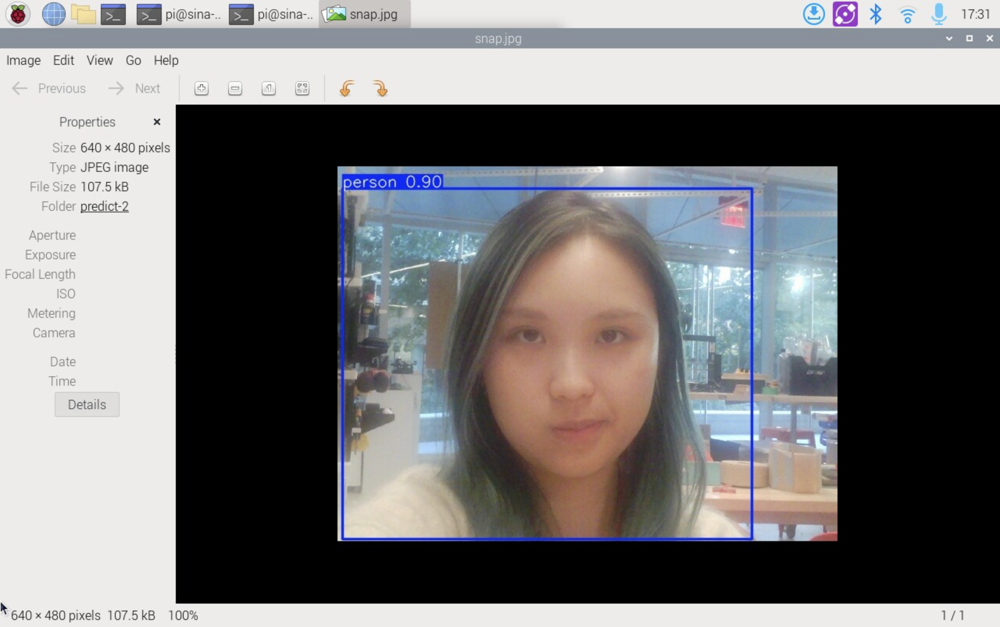

### Ollama models

I installed the two local Qwen models required for the lab: `qwen3.5:0.8b` for image and text understanding, and `qwen3:0.6b` for faster text-only responses.

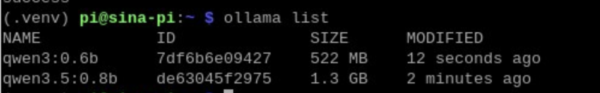

## Part B — Real-time person detection with YOLO

I ran `yolo_person.py` through Raspberry Pi Connect and tested the detector while moving into and out of frame, standing near and far from the camera, and showing different numbers of people. The detector drew boxes and confidence scores around each detected person.

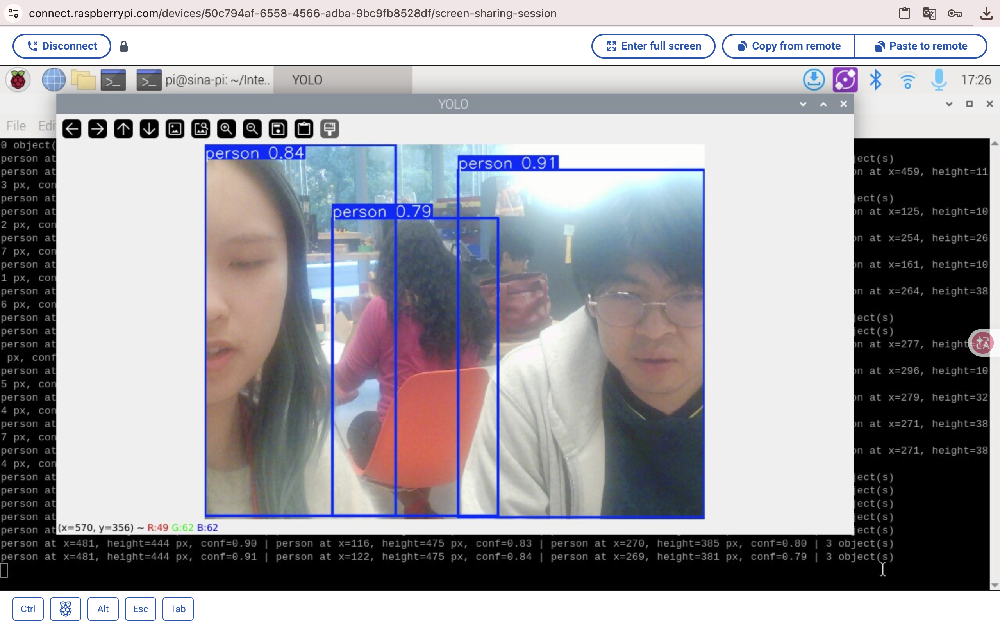

I also tested the headless mode, which prints the x-position, height, confidence, and number of detected people without opening a display window.

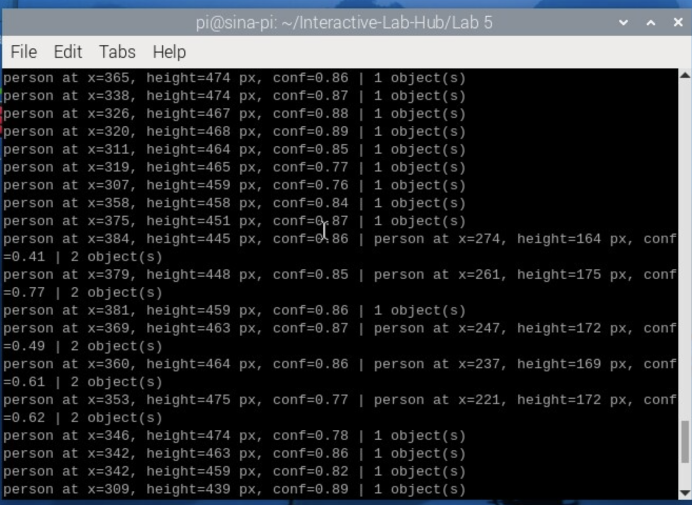

### Experiment recordings

| Recording | Command | What I tested |
| --- | --- | --- |
| [1](media/yolo-experiment-1.mp4) | `python yolo_person.py` | Baseline live person detection while moving close to, away from, and across the camera. |
| [2](media/yolo-experiment-2.mp4) | `python yolo_person.py --conf 0.2` | A lower confidence threshold, including a phone image with people in its background. |
| [3](media/yolo-experiment-3.mp4) | `python yolo_person.py --conf 0.7` | A higher confidence threshold and the difference between strong and weak detections. |
| [4](media/yolo-experiment-4.mp4) | `python yolo_person.py --headless` | The terminal-only output used when no display window is available. |

### Limits and errors I observed

1. In the baseline recording, moving extremely close to the camera left only a blurred, partial body in the frame. The detector could miss that view or draw a less stable box because there was not enough visible body shape for a reliable classification.
2. With `--conf 0.2`, the lowered threshold accepted weak detections. When I held up a phone image, YOLO also labeled the people inside the phone image/background as `person`, including low-confidence boxes around 0.20–0.39. This is a false positive for a system that needs to count physical people in the room.
3. With `--conf 0.7`, only stronger detections survived, so uncertain people were more likely to disappear. The phone itself was also recognized as a separate object in the experiment. This shows the tradeoff: a higher threshold reduces weak false positives but can hide real people, while object labels still depend on the visual context.

## Part C — Hand pose with MediaPipe

I ran `hand_pose.py` with the webcam. MediaPipe detected the 21 landmarks of my hand. The distance between my thumb and index finger controlled a percentage value; the screenshot below shows the value at 37%.

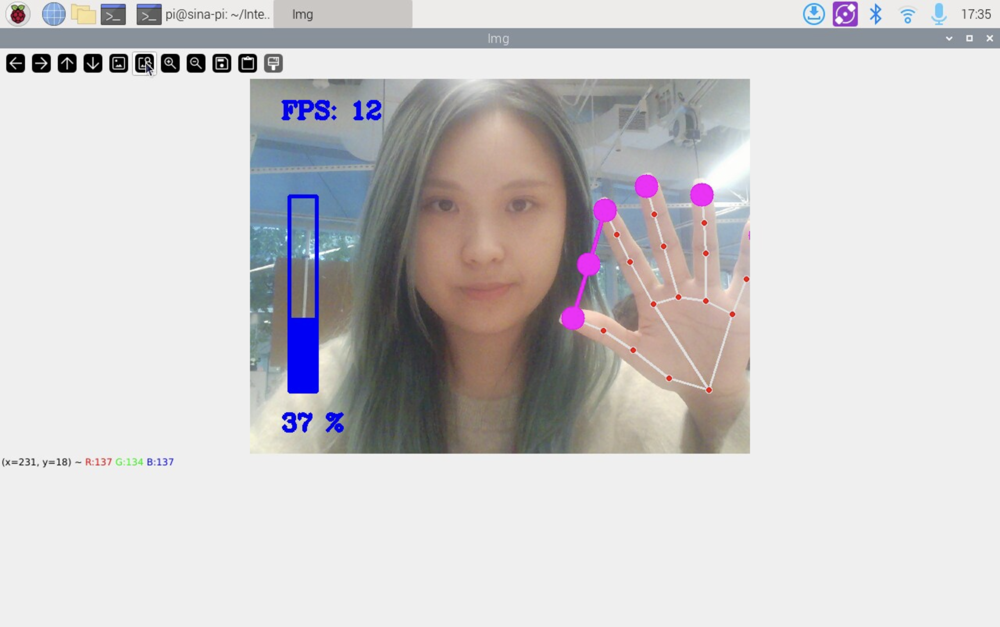

I then tested the gesture controls. Pinching my thumb and index finger adjusted the value from 0% to 84%. With the Quiet Coyote pose—index finger and pinky extended, middle and ring fingers folded, and thumb held against them—the program displayed `quiet coyote!` and set the value to 0%.

#### Pinch at 0%

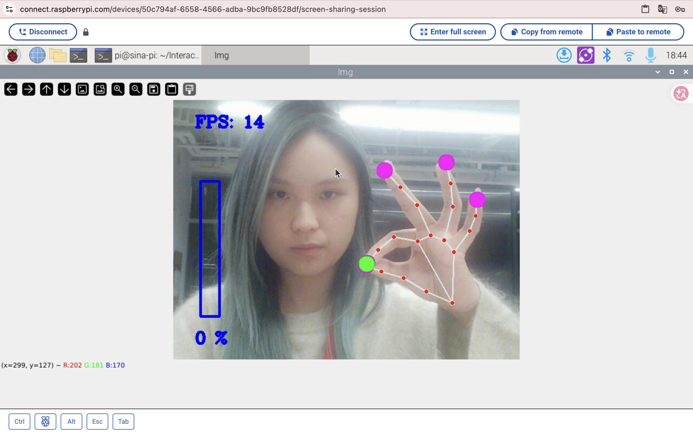

#### Pinch at 84%

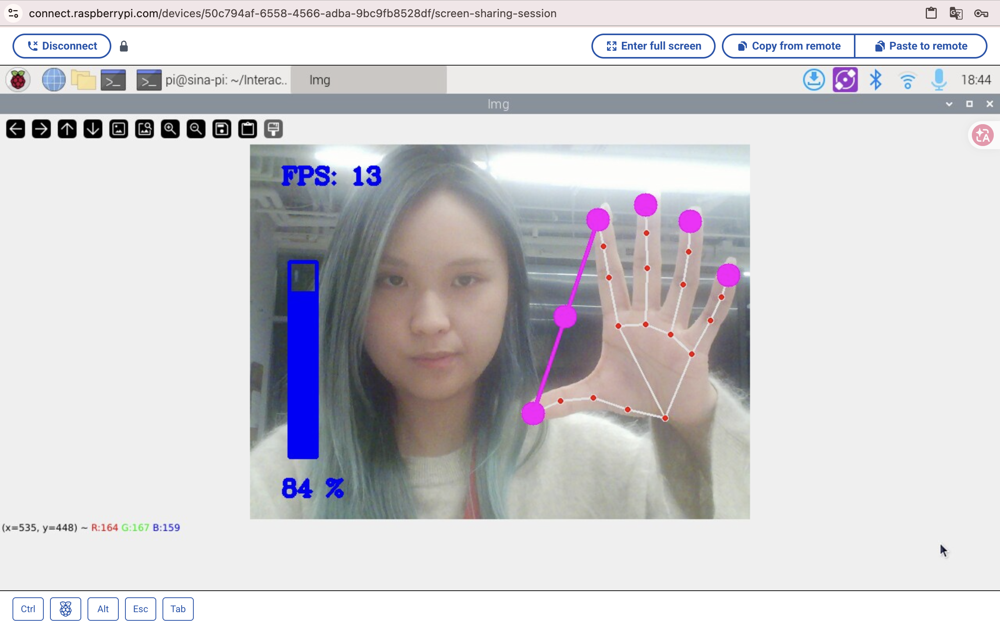

#### Quiet Coyote at 0%

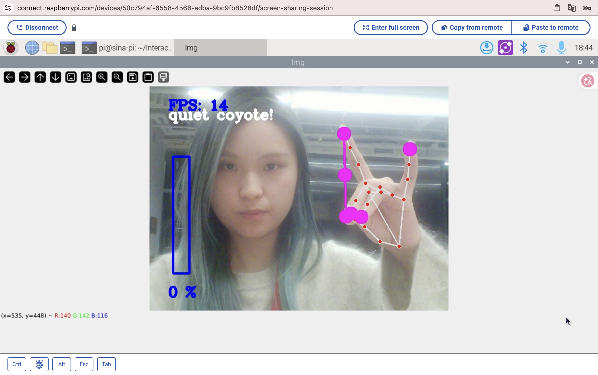

For an overnight interaction, this gesture could act as the hand-off ritual before bed: it mutes the device and starts the overnight observation mode. The morning report could require a second deliberate gesture before it is shown.

## Part D — Qwen reasoning on the Pi

I used `ask_qwen.py` to send my webcam image to the local `qwen3.5:0.8b` model with the question: **“What is in this photo?”** The model described a person in a workshop/studio setting and completed the request in 58.6 seconds.

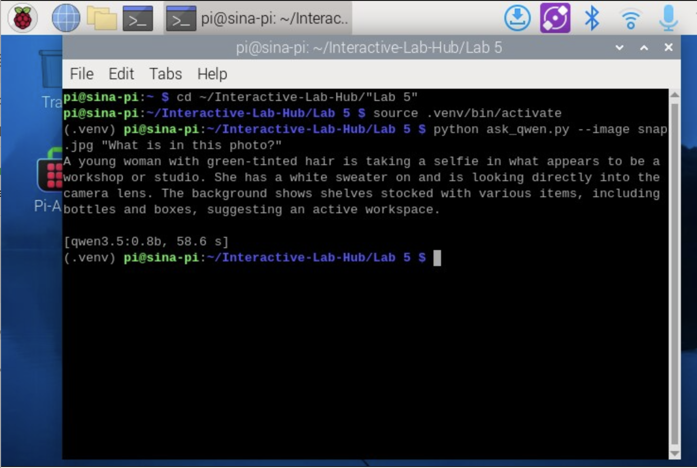

### Three text questions

I also asked the local `qwen3.5:0.8b` model three text questions:

| Question | Response summary | Time |
| --- | --- | --- |
| “When is Chinese Lunar New Year 2027?” | It answered “February 12, 2028,” which does not answer the requested year and is an example of the small model producing an incorrect factual response. | 10.4 s |
| “What is the color of rose?” | “The color of a rose is red.” | 1.6 s |
| “How to make a unagi don?” | It gave a short cooking procedure, but incorrectly suggested boiling the fish before slicing and frying it. | 8.0 s |

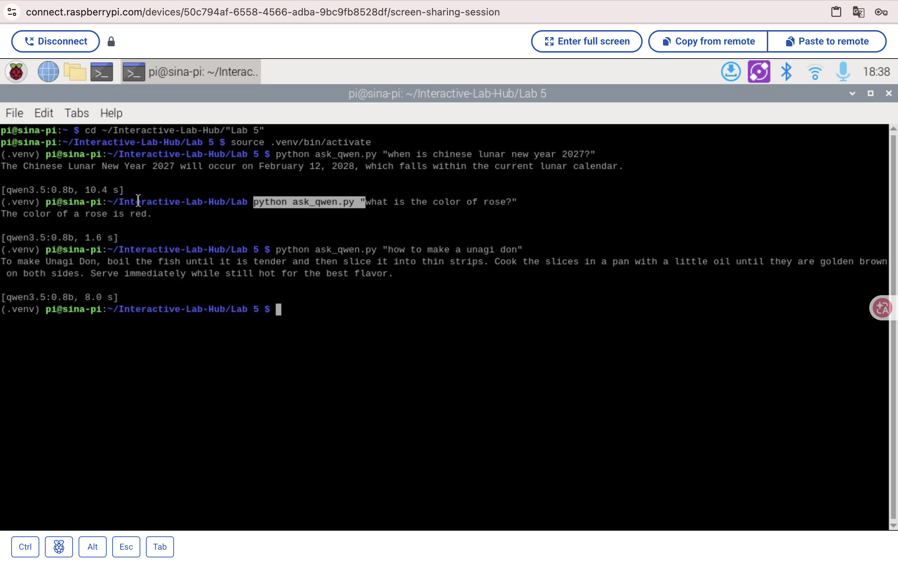

The answers show why an observant device should keep the model's task narrow and verify important claims against its input data rather than treating every answer as ground truth.

### Model comparison

I repeated the Lunar New Year question using `qwen3:0.6b`. The two small local models took almost the same amount of time, but neither response gave a reliable Gregorian date.

| Model | Result | Time |
| --- | --- | --- |
| `qwen3.5:0.8b` | Said Lunar New Year 2027 would be February 12, 2028, which is the wrong year. | 10.4 s |
| `qwen3:0.6b` | Gave a lunar-month description and incorrectly equated it with New Year's Day. | 10.3 s |

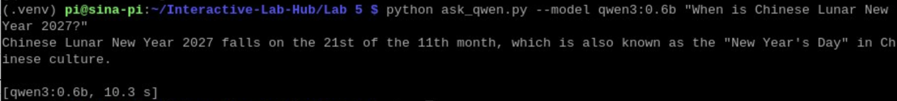

This comparison was only 0.1 seconds faster with the smaller model, and accuracy did not improve. For factual questions, a local model's answer should be checked against a reliable source before it is used in an interactive system.

## Part E — YOLO to Qwen pipeline

I ran `yolo_to_qwen.py` for 61 seconds. The script converted YOLO detections into time-stamped readings such as `1 person(s) at center/close`, saved 25 lines to `watch_log.txt`, and sent the log to Qwen for a summary.

Qwen reported that two people were initially near the center of the frame, that one later moved left/far, and that no new people appeared or disappeared during the observation interval. This result also shows a limitation: the summary is only as reliable as the detector log, so changes in camera framing and detector confidence can affect its account.

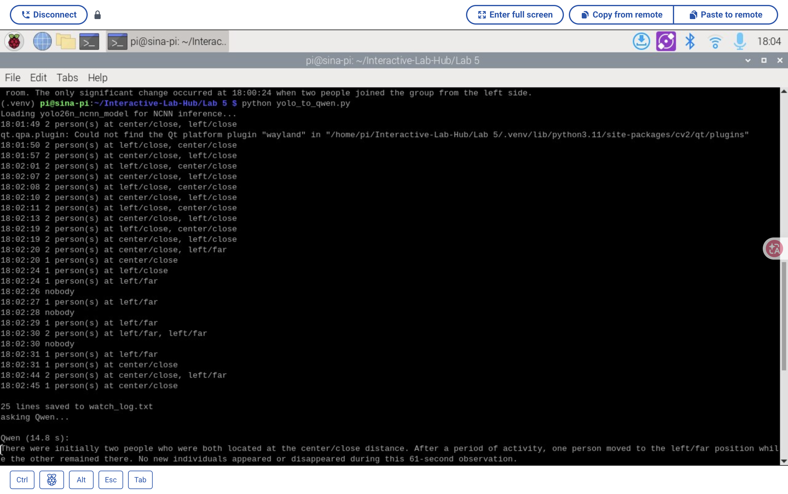

## Reflection

This lab helped me understand how the whole pipeline connects. YOLO first turns what the camera sees into boxes, then the script turns those boxes into short text readings, and Qwen only sees that text log rather than the original video. I was surprised that the live person detection still worked reasonably well on the Pi, while asking Qwen about an image took much longer.

The tests also made the limitations feel very clear. Changing the confidence threshold could either create extra detections or make a real person disappear, and Qwen gave wrong answers to some simple factual questions. I also realized that small choices in `interpret()`—for example, what counts as left, center, close, or far—change the story that Qwen receives. If I build this into an overnight project, I would need to keep the camera framing stable and treat the final AI summary as a helpful interpretation, not as unquestionable truth.

## Contributions

I performed the Raspberry Pi setup, webcam experiments, recordings, and on-device model runs. I used ChatGPT/Codex to troubleshoot installation issues and organize this documentation.

# Lab 5 Part 2: Overnight Sensation

For Part 2, you will use the observant system from Part 1 to design a night-time interaction. On-device AI is slow, so let it work while you sleep. The person meets the device twice: **before bed**, when they hand the night over, and **when awake**, when the device gives something back. In between, the pipeline from Part E runs on its own.

Two flavors, pick one or mix them:

* **Sense all night.** The Pi watches, listens or measures from bedtime until morning and keeps a log.
* **Process all night.** You already have the data (a day of phone photos, a long recording) and the Pi needs hours to get through it.

Two house rules. Sample rather than stream: one look every 5 to 30 seconds is plenty, and it keeps the Pi cool. And keep everything on the Pi: tell the people you live with, point the camera at things rather than at beds, and delete the snapshots after the demo.

## Part F. 
### Read Part 2 and storyboard your night-time interaction

Project Idea — Pet Night Diary

For Part 2, We want to design a Pet Night Diary that helps pet owners understand their dog's nighttime activity without having to check on them during the night. The device uses a Raspberry Pi, Mini PiTFT, and a webcam to observe the dog's resting area and record when the dog is detected.

Before going to bed, the owner can press a button to start monitoring. During the night, the device uses YOLO to check for the dog at regular intervals and records the detection results. The next morning, the owner can view a short summary of when their dog was detected near its resting area. I want the interaction to be simple and quiet, so it can work in the background without disturbing the owner or the dog.

**Sketch**


## Prep for Part 2

### feedback on the Part F storyboards.

The current sketch clearly shows the physical setup and makes it easy to understand that the webcam observes a fixed resting area. The Raspberry Pi and Mini PiTFT are positioned close to the dog’s bed, and the camera is directed toward the pet rather than toward a human sleeping area. This supports privacy and makes the purpose of the system clear.

However, the sketch currently explains what the system looks like more clearly than how the interaction unfolds over time. The revised storyboard should show three stages: the owner starting the system before bed, the device observing and logging changes during the night, and the owner receiving one short summary in the morning.

The bedtime hand-off should also include clear acknowledgement. After the owner presses the button, the Mini PiTFT could briefly display “Monitoring started” and then dim so that it does not disturb the dog or owner.

A possible technical problem is that YOLO may fail to detect the dog for a single frame, especially in low light. This could create a false event in which the log says that the dog left and immediately returned. To reduce this error, the system should confirm the same reading across several samples before recording a change.

The morning report should remain simple and honest. Instead of displaying the entire log, it should answer one useful question, such as whether the dog left the resting area, how many times it left, and the longest amount of time it was away. If nothing happened, the report should clearly state that no unusual activity was detected.

### Device Placement and Consent

The device will spend the night beside the dog’s resting area in the living room. The webcam will be positioned so that its field of view includes only the dog bed and the surrounding floor, not any human sleeping area.

Everyone who lives in the space will be informed about the experiment before the first overnight run, and monitoring will begin only after they agree. All detection results will remain on the Raspberry Pi. The system will sample one frame every ten seconds, and any temporary images will be deleted after the demonstration.


### Revisions After Feedback

Based on the feedback, we revised the original setup sketch into a six-panel storyboard that shows the complete interaction over time. The first two panels show the owner positioning the camera, pressing the start button, and receiving a “Monitoring started” acknowledgement. The middle panels show the system sampling the resting area every ten seconds and recording when the dog leaves and returns. The final panels show the owner checking the device in the morning and receiving one short summary.

Part E showed that a single missed detection can create a false event and that Qwen may summarize a log incorrectly. To reduce this problem, the revised design will require the same detection result to appear in several consecutive samples before recording a change. The morning report will be generated from the confirmed events and will remain short and honest about uncertainty.


### Revised Storyboard


## Part G. 
### Design the interaction before

The hand-off: the person tells the device what to watch tonight, and the device acknowledges it. Keep it to a thirty-second ritual. A button or a touch (Lab 4), a spoken sentence (Lab 3), a wave or a Quiet Coyote at the camera (Part C). The acknowledgement can be a line on the display, a tone, or an LED that dims rather than lights up. At its simplest, the hand-off just sets the question that the morning will answer.

\*\*\***Interaction before.**\*\*\*

The intended bedtime interaction is a simple button press: the owner positions the webcam, presses Button A, receives a readiness confirmation, and lets the display turn off during monitoring. The code includes this Mini PiTFT interface.
For the documented overnight experiment, I used the terminal interface over SSH. I started the program inside tmux and checked for the “Camera + YOLO ready” message before detaching the session. This allowed the Raspberry Pi to continue monitoring after I disconnected my laptop. The button and display interaction was not evaluated in this overnight run.


## Part H. 
### Incorporate the observant system

The Part E pipeline becomes the night shift. `overnight.py` runs your `interpret()` from `yolo_to_qwen.py` every few seconds, people only unless you pass `--all`, and writes the readings to `night_log.jsonl`; the reasoning waits for the morning. Start it inside `tmux` so it keeps running after you close your laptop, and stop it with Ctrl-C in the morning:

```
(.venv) pi@raspberrypi:~/Interactive-Lab-Hub/Lab 5 $ tmux new -s night
(.venv) pi@raspberrypi:~/Interactive-Lab-Hub/Lab 5 $ python overnight.py
```

Fake a night first: run it for thirty seconds while you walk around, stop it, and run `morning.py` from Part I. When that looks right, run a real night. If your storyboard needs a sensor rather than the camera, swap in the Lab 4 example code and log its reading the same way.

\*\*\***Screenshots or videos of the running system.**\*\*\*


Jindi: I used a Raspberry Pi 5 and a USB webcam with the existing YOLO26 Nano NCNN model, filtering for the dog class. The sampling interval was configured to ten seconds, and a state change required three consecutive matching valid observations. Raw detections and confirmed states were recorded separately.
Although the program supports a configurable region of interest, this experiment used the full camera frame. Guiyuan was free to move around the home; I did not restrict her movement. The system stored detection metadata locally rather than saving photos or continuous video.

Before the overnight run, I tested the system for 60 seconds and then for three minutes. The first test recorded five camera-access failures before recovering; these samples were correctly labeled as unknown. In the three-minute test, the camera produced valid samples throughout, and three consecutive positive detections successfully changed the confirmed state. Isolated negative detections did not immediately reverse that state.

All timestamps use the Raspberry Pi’s local time, UTC−04:00. The session continued through the night and into the following afternoon.

## Part I. 
### Design the interaction after

The reveal. The night produced a log; the morning turns it into something a half-awake person can take in. `morning.py` is the smallest version: it asks Qwen for a three-sentence report.

```
(.venv) pi@raspberrypi:~/Interactive-Lab-Hub/Lab 5 $ python morning.py
```

Make it yours: show the report on the Mini PiTFT, read it aloud with Piper from Lab 3, plot the night as a timeline, or ask for JSON (`--json`, Part D) and move a servo. Whatever you pick, make sure it is honest about a night in which nothing happened.


Pet Night Diary answers one question: **When was a dog last detected within the camera’s view?** After stopping the overnight session, we reviewed a short report in the terminal. The Mini PiTFT interface was not evaluated in this run.

The initial report was generated by Python. We then processed the same saved log with local Qwen (`qwen3.5:0.8b`), without repeating the overnight recording. Python calculated the statistics, and Qwen reproduced three verified factual sentences. The output was labeled `qwen-verified`, indicating that it passed validation.

The last confirmed detection was at **13:35:49 on October 31**. Supported sampled intervals totaled approximately **1 hour 59 minutes of detection** and **14 hours 19 minutes of non-detection**, with **54 minutes unclassified**.

These are detection estimates, not sleep measurements. Guiyuan could move freely around the home, so non-detection could reflect her being elsewhere, poor lighting, occlusion, or missed detections. The report cannot distinguish these causes.


## Final documentation

Document all the prototypes and iterations you have designed and worked on. The deliverables for this lab are writings, sketches, photos, and videos that show what your system:

* "Looks like": how the device sits in the room at night, and what it looks like at bedtime and in the morning.
* "Works like": the pipeline from detector to interpreter to log to reasoner, with a real night's data.
* "Acts like": how a person hands the night over and what they get back.

Youtube link: https://youtu.be/cTSQHLFZ3P4

The experiment showed that the prototype could collect timestamped observations across a long unattended session and generate a reproducible report. However, continuous logging does not guarantee accurate interpretation of the dog’s behavior.

Guiyuan was free to rest or play elsewhere in the home. A non-detection could therefore mean that she was outside the camera view, but it could also result from low light, occlusion, or a missed detection. The logs cannot distinguish these explanations. I did not collect independent ground-truth observations, so I cannot calculate detection accuracy from this session alone.

This changed how I understand the project: its value is in showing when the detector observed a dog in a particular view, rather than making claims about sleep quality or movements throughout the home. Future improvements would include a calibrated resting-area ROI, controlled tests under nighttime lighting, and separate evaluation of the Mini PiTFT interaction.

### Contributions and AI Acknowledgement

- **Yilin Wu:** Led the early planning, scenario design, and storyboard creation.
- **Jindi Chai:** Tested the program, set up the physical monitoring environment, and conducted the overnight experiment.
- **Sina Liu:** Organized the project documentation and created and edited the demo video.

We used ChatGPT/Codex to assist with code development and debugging. Our implementation also builds on the course’s Lab 5 examples.

<details>
  <summary><strong>Submission Cleanup Reminder (Click to Expand)</strong></summary>

  **Before submitting your README.md:**
  - This readme.md file has a lot of extra text for guidance.
  - Remove all instructional text and example prompts from this file.
  - You may either delete these sections or use the toggle/hide feature in VS Code to collapse them for a cleaner look.
  - Your final submission should be neat, focused on your own work, and easy to read for grading.
</details>
