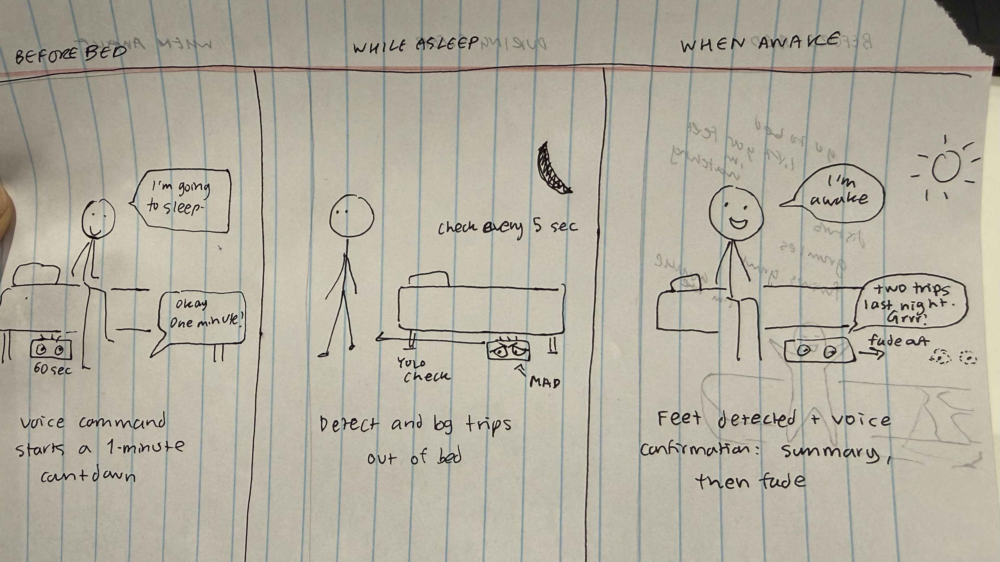
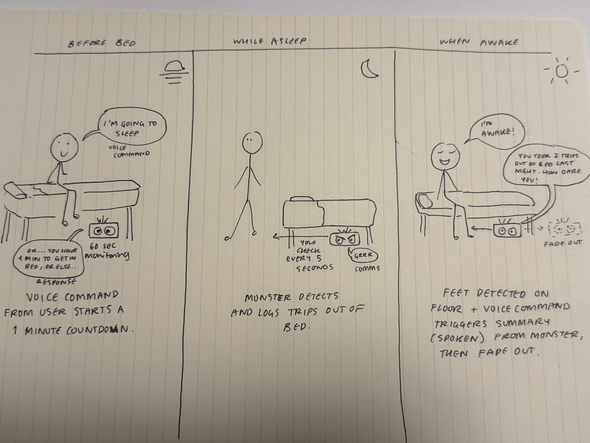

# Observant Systems: Overnight Sensation

**Team:**

**Members:** [Neeha Ravula](https://github.com/neeharavula/Interactive-Lab-Hub/tree/Fall2026) (nr485), [Gaurav Patel](https://github.com/Gtpatel02/Interactive-Lab-Hub) (gp438), [Nishant Ray](https://github.com/Nishant-Ray/Interactive-Lab-Hub) (nr487)

**Project name:**

<details>
	<summary><strong>Instructions for Students (Click to Expand)</strong></summary>
  
	**Submission Cleanup Reminder:**
	- This README.md contains extra instructional text for guidance.
	- Before submitting, remove all instructional text and example prompts from this file.
	- You may delete these sections or use the toggle/hide feature in VS Code to collapse them for a cleaner look.
	- Your final submission should be neat, focused on your own work, and easy to read for grading.
  
	This helps ensure your README.md is clear, professional, and uniquely yours!

  ```
  pi@raspberrypi:~$ cd Interactive-Lab-Hub/Lab\ 5
  pi@raspberrypi:~/Interactive-Lab-Hub/Lab 5 $ python3 -m venv .venv
  pi@raspberrypi:~/Interactive-Lab-Hub/Lab 5 $ source .venv/bin/activate
  (.venv) pi@raspberrypi:~/Interactive-Lab-Hub/Lab 5 $ pip install -r requirements.txt
  ```
</details>
 

## Overview

**Part 1: the tools**

A) [Set up your Pi for on-device AI](#part-a)

B) [See: recognize people in real time with YOLO](#part-b)

C) [See more: hands and pose with MediaPipe](#part-c)

D) [Reason: run Qwen on the Pi with Ollama](#part-d)

E) [Connect: from YOLO readings to Qwen reasoning](#part-e)

**Part 2: Overnight Sensation**

F) [Read Part 2 and storyboard your night-time interaction](#part-f)

G) [Design the interaction before bed](#part-g)

H) [Incorporate the observant system during sleep](#part-h)

I) [Design the interaction when awake](#part-i)

---

# Part 1

## Part A. 
### Set up your Pi for on-device AI

**Downloaded Ollama models:**


## Part B. 
### See: recognize people in real time with YOLO

\*\*\***Include a short video or screenshots of your experiments with the person detection. Write down three situations where it did not see you, or saw a person who was not there, and what you think the cause was.**\*\*\*

Normal Run:

https://github.com/user-attachments/assets/1a05d733-c15a-4d1c-a962-67a4480fe0e8


Conf 0.2 Run:

https://github.com/user-attachments/assets/9067856e-9f18-48fc-8372-b3514c863c17

Conf 0.7 Run:

https://github.com/user-attachments/assets/85584b70-177f-4a23-9fba-e7f75ee74735

All Run:

https://github.com/user-attachments/assets/4f3ac2dd-5ef0-4311-a953-523dd6e1ac79

Headless Run:

https://github.com/user-attachments/assets/206a35e1-6907-4a61-a05e-ca643d327f8e


Observations:
- In the `--conf 0.2` experiment, while walking around, YOLO briefly detected a nonexistent person at the side of the frame with a confidence of 0.37. Background shapes or shadows may have resembled a person, and the lower threshold allowed this uncertain detection to appear.
- In the `--conf 0.7` experiment, for a few seconds, YOLO did not draw a box correctly. Movement, changes in pose, or partial visibility may have lowered its confidence below 0.7, causing the stricter threshold to filter out the detection.
- In headless mode, the printed readings briefly showed no person detection. Movement or an unfamiliar viewing angle may have caused a temporary detection failure. Headless mode only removes the display, rather than change the model’s accuracy, so a possible explanation is that moving or turning briefly made the body harder to recognize, lowering the model’s confidence below the detection threshold.
- In `--all` mode, YOLO correctly identified a chair but briefly labeled something at the side as a refrigerator. Background edges or rectangular shapes may have resembled features the model associates with refrigerators.


## Part C. 
### See more: hands and pose with MediaPipe

\*\*\***Include a screenshot or short video of the hand pose demo, and write how you might use face, hand or body pose tracking in your observant system.**\*\*\*

https://github.com/user-attachments/assets/feffde71-29b8-4efa-85b6-00f44571db8b

Interaction ideas:
- Hand pose as a bedtime ritual trigger: Instead of using a button or touch sensor, we could use the Quiet Coyote hand pose to trigger the bedtime interaction
- Hand pose as morning input: We could use the finger expand gesture as a rating system to rate how the night's sleep went
- Face orientation: We could use face tracking to determine whether a user is alert/awake or not (ex: the user is awake if they are facing the camera and their eyes are visibly open)
- Body pose: We could track whether a person is laying down or if they are upright to determine if they are sleeping or awake respectively


## Part D. 
### Reason: run Qwen on the Pi with Ollama

\*\*\***Ask Qwen three questions to answer. Paste the questions, the answers and how long each took. Try one of them with `qwen3:0.6b` and compare.**\*\*\*

We asked `qwen3.5:0.8b` three questions through `ask_qwen.py` (thinking off, three-sentence instruction, 120-token cap) and repeated the first with `qwen3:0.6b`.

**Q1: "Tell me a bit about the history of Roosevelt Island."** (factual recall)

**qwen3.5:0.8b (20.7 s)**
> Roosevelt Island was originally built as a private residence for President Theodore Roosevelt, who commissioned it to house his family and office. The island's development began in 1907 when the city purchased the land from the Hudson River Company, allowing the construction of the iconic "Gilded Cage" hotel complex.

**qwen3:0.6b (16.5 s)**
> Roosevelt Island, located in the United States, has a rich history dating back to the early 19th century. It was initially a military base for the Union Army during the Civil War, and it became a significant naval base in the 19th and early 20th centuries. The island played a crucial role in the Pacific War and was home to several important military personnel, including notable figures like Admiral Nelson. Today, Roosevelt Island is a peaceful and historic site, preserving the legacy of those who once called it home.

| Ground-truth fact | 0.8b | 0.6b |
|---|---|---|
| Formerly Blackwell's Island | ❌ | ❌ |
| Then Welfare Island | ❌ | ❌ |
| Renamed in 1973 | ❌ | ❌ |
| Cornell Tech opened in 2017 | ❌ | ❌ |

Both models scored 0/4 and confidently invented a history. The 0.8b model named the wrong Roosevelt (the island is named for FDR), put the island on the Hudson (it is in the East River), and made up a "Hudson River Company" and a "Gilded Cage" hotel. The 0.6b model was faster but no more accurate: it invented a Civil War Union Army base, a naval base, a role in the Pacific War and Admiral Nelson (a British admiral who died in 1805), and it ignored the three-sentence limit. Its only roughly true claim was that the island's history goes back to the early 19th century.

**Q2: "What is in this photo?"**

> A man with glasses and a beard is taking a selfie in a dimly lit room.

Correct, including the selfie: the photo was taken holding up the webcam. This was the slowest question because the model also has to process the image, but it was the only fully accurate answer. The difference from Q1 is that here the model had real data to describe instead of recalling facts from memory.

**Q3: "Why did Cornell Tech move off Roosevelt Island in 2010?"** (false premise, 7.8 s)

> Cornell Tech moved to Roosevelt Island in 2010 because the city's zoning laws made it impossible for a new university campus to be built there, forcing them to relocate to nearby areas.

The model accepted the false premise instead of correcting it. Cornell Tech never moved off the island; it opened there in 2017. The answer also contradicts itself (it "moved to" the island because it was impossible to build there) and invents a zoning law. This was the fastest answer (7.8 s) because the model was already loaded and the reply was short, which suggests the earlier times include model loading.

**Takeaways**
- On a Pi 5, answers take roughly 8–33 s depending on whether the model is already loaded, how long the answer is, and whether there is an image.
- The smaller `qwen3:0.6b` was a little faster but no more accurate, and it followed the length instruction less well.
- Asked to recall facts, both models invent confidently; given a false premise, the model plays along. Given actual data (the photo), it was accurate.
- For our observant system this means Qwen should never answer from its own knowledge. It should only summarize the data we give it (the YOLO log), with a narrow job and a fallback for when the data is empty or unclear.


## Part E. 
### Connect: from YOLO readings to Qwen reasoning


---

# Lab 5 Part 2: Overnight Sensation

## Part F. 
### Read Part 2 and storyboard your night-time interaction

\*\*\***Insert ideas, sketches, Verplank diagrams and storyboards for your night-time interaction here.**\*\*\*



## Prep for Part 2
   
**Feedback for Part F ideas (from [Abiola Bolaji](https://github.com/9JAyemi/Interactive-Lab-Hub)):**
Overall, I think your idea is super useful as sleep walking is a common issue with not as many known solutions and can cause harm to the person or others. I think placing the device under the bed is a good idea, as it avoids directly facing the user. However, it's important to consider how the device will communicate data gathered to the user and how that information can be presented in a meaningful and understandable way.

\*\*\***Revised storyboard here.**\*\*\*


## Part G. 
### Design the interaction before

\*\*\***Describe the interaction before.**\*\*\*

The user says, “I am going to sleep,” into the microphone. The monster opens its eyes and replies, “Confirmed. You have one minute to get into bed.” After the countdown, it triggers the sleeping animation and begins monitoring the floor beside the bed for nighttime trips.

## Part H. 
### Incorporate the observant system

\*\*\***Screenshots or videos of the running system.**\*\*\*

https://youtube.com/shorts/d9Vm54slTE4?feature=share

https://youtube.com/shorts/_9P8Tlk00P0?feature=share

## Part I. 
### Design the interaction after

https://youtu.be/r1zNssYrjeo


## Final documentation

\*\*\***Include a short video of the whole system**\*\*\*

View final video here: https://youtu.be/ptJK-fh7R5w
