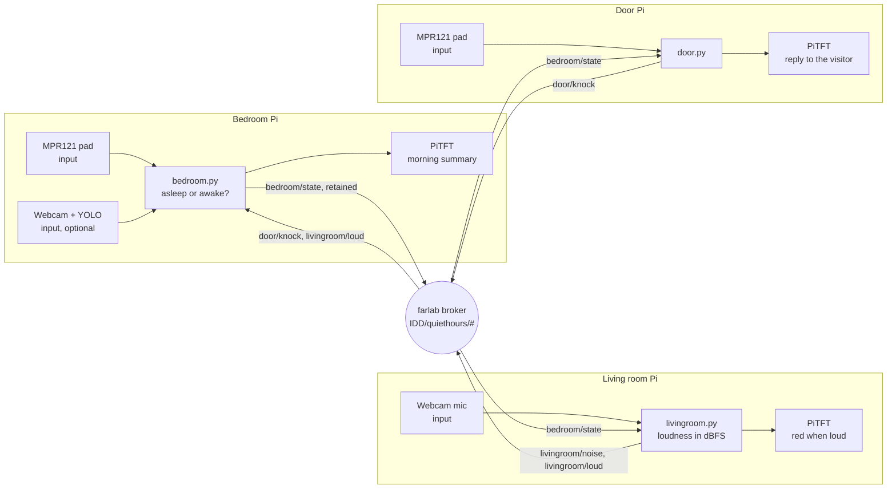

# Distributed Interaction

**Aryan Palave (ap2578)**

For submission, replace this section with your documentation!

---

## Prep

1. Pull the new changes
2. Read: [The Presence Table](https://dl.acm.org/doi/10.1145/1935701.1935800) ([video](https://vimeo.com/15932020))

## Overview

Build interactive systems where **multiple devices communicate over a network** using MQTT messaging. Work in teams of 3+ with Raspberry Pis.

**Parts:**
- A: Learn MQTT messaging
- B: Try collaborative pixel grid demo  
- C: Build your own distributed system

---

## Part A: MQTT Messaging

MQTT = lightweight messaging for IoT. Publish/subscribe model with central broker.

**Concepts:**
- **Broker**: `farlab.infosci.cornell.edu:1883`
- **Topic**: Like `IDD/bedroom/temperature` (use `#` wildcard)
- **Publish/Subscribe**: Send and receive messages

**Install MQTT tools on your Pi:**
```bash
sudo apt-get update
sudo apt-get install -y mosquitto-clients
```

**Test it:**

**Subscribe to messages (listener):**
```bash
mosquitto_sub -h farlab.infosci.cornell.edu -p 1883 -t 'IDD/#' -u idd -P 'device@theFarm'
```

**Publish a message (sender):**
```bash
mosquitto_pub -h farlab.infosci.cornell.edu -p 1883 -t 'IDD/test/yourname' -m 'Hello!' -u idd -P 'device@theFarm'
```

> **💡 Tips:**
> - Replace `yourname` with your actual name in the topic
> - Use single quotes around the password: `'device@theFarm'`
> - For your own projects, publish under your team's topic space: `IDD/<yourteam>/...` (for example `IDD/team3/bedroom/light`). Everyone shares one broker login, so anything you publish can reach everyone's projects.

**🔧 Debug Tool:** View all MQTT messages in real-time at `http://farlab.infosci.cornell.edu:5001`


**💡 Brainstorm 5 ideas for messaging between devices**

**My Part A test.** I installed `mosquitto-clients` on my Pi, subscribed to my own topic, and published to it from the same Pi. The message came back through the farlab broker:

```
$ mosquitto_sub -h farlab.infosci.cornell.edu -p 1883 -t 'IDD/test/aryan' -u idd -P 'device@theFarm' -v
IDD/test/aryan Hello from aryan pi
```

Subscribing to `IDD/#` also showed other teams' traffic, like a burger game posting its score on `IDD/panburger/burger/game` and walkie-talkie Pis posting whether they were online on `IDD/walkietalkie/walkie/presence/...`.

**My 5 ideas:**

1. **Quiet hours light.** My Lab 5 restless monitor already knows when I'm in bed. It publishes `asleep` on `IDD/aryan/bedroom/state`, and a Pi in the living room turns its screen dim red so my roommate knows to keep it down.
2. **Laundry done.** A Pi with an accelerometer sits on the washer in the basement and publishes `done` when the shaking stops for two minutes. The Pi on my desk shows it, so I stop walking down to check.
3. **Open seat finder.** Pis with proximity sensors on study room desks publish `taken` or `free`, and a screen at the door shows a grid of open seats.
4. **Presence lamp.** Two Pis in two different homes. Tapping a capacitive sensor on one makes the other glow for a few minutes, a quiet "thinking of you" like the Presence Table reading.
5. **Fridge left open.** A light sensor inside the fridge publishes when the light stays on for more than a minute, and a Pi in the next room beeps until someone closes it.

MQTT agrees on almost nothing in advance: you invent the topics and what the messages mean. Smart-home standards like Matter fix the vocabulary instead (every "light" behaves the same). Keep this trade-off in mind when you design your topics in Part C.

---

## Part B: Collaborative Pixel Grid

Each Pi = one pixel, controlled by RGB sensor, displayed in real-time grid.

**Architecture:** `Pi (sensor) → MQTT → Server → Web Browser`

**Setup:**

1. **Sensor**

#### Light/Proximity/Gesture sensor (APDS-9960)
We use this sensor [Adafruit APDS-9960](https://www.adafruit.com/product/3595) for this exmaple to detect light (also RGB)
 


Connect it to your pi with Qwiic connector


We need to use the screen to display the color detection, so we need to stop the running piscreen.service to make your screen available again

```bash
# stop the screen service
sudo systemctl stop piscreen.service
```

if you want to restart the screen service
```bash
# start the screen service
sudo systemctl start piscreen.service
```
 
2. **Server** (one person on laptop):
```bash
cd "Lab 6"
python -m venv .venv
source .venv/bin/activate
pip install -r requirements-server.txt
python app.py
```

2. **View in browser:**
   - Grid: `http://farlab.infosci.cornell.edu:5000`
   - Controller: `http://farlab.infosci.cornell.edu:5000/controller`

3. **Pi publisher** (everyone on their Pi):
```bash
# First time setup - create virtual environment
cd "Lab 6"
python -m venv .venv
source .venv/bin/activate
pip install -r requirements-pi.txt

# Run the publisher
python pixel_grid_publisher.py
```

Hold colored objects near sensor to change your pixel!


**📸 Include: Screenshot of grid + photo of your Pi setup**

<!-- TODO: Part B needs the APDS-9960 color sensor, which I don't have yet. Once it's plugged in (it shows up at 0x39 in `i2cdetect -y 1`), run `python pixel_grid_publisher.py` from `Lab 6/.venv`, then add the grid screenshot and a photo of the Pi here. -->

---

## Part C: Make Your Own

**Requirements:**
- 3+ people, 3+ Pis
- Each Pi contributes sensor input via MQTT
- Meaningful or fun interaction

**Ideas:**

**Sensor Fortune Teller**
- Each Pi sends 0-255 from different sensor
- Server generates fortunes from combined values

**Frankenstories**
- Sensor events → story elements (not text!)
- Red = danger, gesture up = climbed, distance <10cm = suddenly

**Distributed Instrument**
- Each Pi = one musical parameter
- Only works together

**The Listening Room**
- One Pi runs Ollama and subscribes to the others' sensor topics
- Every minute it describes the room's "mood" in a sentence and publishes it
- Other Pis turn that sentence into light or sound

**Others:** Games, presence display, mood ring

### Deliverables

Replace this README with your documentation:

**1. Project Description**
- What does it do? Why interesting? User experience?

**2. Architecture Diagram**
- Hardware, connections, data flow
- Label input/computation/output

**3. Build Documentation**
- Photos of each Pi + sensors
- MQTT topics used
- Code snippets with explanations

**4. User Testing**
- **Test with 2+ people NOT on your team**
- Photos/video of use
- What did they think before trying?
- What surprised them?
- What would they change?

**5. Reflection**
- What worked well?
- Challenges with distributed interaction?
- How did sensor events work?
- What would you improve?
- Where did computation happen in your system, and why there? (If you used a language model: did it run on every event, or only at setup?)

## Part C: Quiet Hours

**Team:** <!-- TODO: teammates' names and netIDs, and whose Pi is which room -->

### 1. Project description

My roommate and I keep different hours. When I go to bed early, they have no way of knowing, so the living room stays loud and people knock on my door. Quiet Hours spreads the fact that I'm asleep around the apartment over three Pis:

- **Bedroom Pi:** I tap a pad by my bed when I go to sleep. It publishes `asleep`, and its own screen goes black so it doesn't keep me up. With `--camera` it reuses my Lab 5 YOLO model to watch the bed, and if nobody is in it for three minutes it decides I got up and switches back to `awake`, so I can't forget to tap.
- **Living room Pi:** listens to the room with its mic. While I'm asleep the screen is dim red, and when it gets loud it turns bright red and says "Aryan's asleep, keep it down."
- **Door Pi:** a touch pad on my door that people tap instead of knocking. If I'm asleep, the screen asks them to text instead, and the knock is saved for the morning instead of waking me.

When I tap the pad in the morning, my screen shows what happened overnight, like "2 knock(s), last 23:40, 1 loud moment(s)."

What I find interesting is that no Pi does anything useful alone. The bedroom Pi knows I'm asleep but can't hear the living room. The living room Pi hears the noise but doesn't know if it matters. Only together do they know when loud is a problem.

### 2. Architecture



Input is the touch pads, the mic and the camera. Computation happens on each Pi, next to its own sensor. Output is the three PiTFT screens. The broker only passes messages along.

### 3. Build

<!-- TODO: photo of each Pi with its sensor and screen -->

**MQTT topics**

| Topic | Who publishes | Message | Retained? |
|---|---|---|---|
| `IDD/quiethours/bedroom/state` | bedroom | `{"state": "asleep", "since": "2026-11-11T23:05:12", "source": "tap"}` | yes |
| `IDD/quiethours/livingroom/noise` | living room | `{"level": -42.1}` every 2 s | no |
| `IDD/quiethours/livingroom/loud` | living room | `{"level": -18.3, "t": "..."}` once per loud stretch, only while I'm asleep | no |
| `IDD/quiethours/door/knock` | door | `{"t": "..."}` | no |
| `IDD/quiethours/<pi>/online` | each Pi | `1`, or `0` from the broker when the Pi drops | yes |

**Code** (in [`quiet_hours/`](quiet_hours/)): `common.py` holds the broker settings, topic names, PiTFT and touch pad code, so all three Pis agree on names in one place. Each Pi runs one script:

```bash
cd "Lab 6/quiet_hours"
source ../.venv/bin/activate
sudo systemctl stop piscreen.service   # free the PiTFT
python bedroom.py      # or livingroom.py, or door.py
```

Every script takes `--fake`, which swaps the sensors for typed input and the screen for the terminal. I used it to test the logic before the hardware was set up.

The bedroom state is the one message that has to survive a restart, so it's **retained**. If the door Pi reboots at 2am, the broker hands it `asleep` as soon as it subscribes, and it doesn't wrongly tell a visitor to knock:

```python
common.send(client, common.STATE, {"state": state, "since": since, "source": source}, retain=True)
```

Each Pi also leaves a **last will**, so if one loses power the broker publishes `0` on its `online` topic for it, and it's easy to see in the MQTT viewer which room went quiet:

```python
client.will_set(f"{ROOT}/{name}/online", "0", retain=True)
```

The living room turns raw mic samples into one loudness number, and only that number leaves the Pi. No audio is ever sent:

```python
rms = math.sqrt(sum(s * s for s in samples) / len(samples))
yield 20 * math.log10(max(rms, 1) / 32768)      # dBFS: 0 is the loudest the mic can record
```

The door touch pad counts a press once, not every 50 ms it stays down:

```python
if touched and not was:
    on_touch()
was = touched
```

<!-- TODO: say which threshold you ended up with after trying it in the real living room (the default is -25 dBFS) -->

### 4. User testing

**Test plan.** Each tester gets one sentence: "This apartment has three Pis, one in my bedroom, one in the living room and one on my door." Then they play the roommate while I go to "sleep":

1. Before touching anything, they say what they think each Pi does.
2. They talk loudly in the living room.
3. They want to ask me something, so they go to my door.
4. I "wake up" and show them my morning screen.

After each step I ask what they expected, what surprised them and what they would change.

**What I expect going in:**

- **Before trying:** the door pad doesn't look like a doorbell, so I expect at least one tester to knock on the door anyway. I also expect them to read the dim red living room screen as "something is wrong" rather than "Aryan's asleep."
- **Surprises:** I expect the knock not waking me to surprise them, since most people assume a knock always gets through. I also think the living room screen reacting to their voice a second later will feel more like being watched than they expect.
- **Changes:** I expect requests for an urgent option, like holding the door pad to actually wake me up, and for a softer warning than full red, like a gradual glow as the room gets louder.

<!-- TODO: add what each tester actually said, with photos or video -->

### 5. Reflection

**Where computation happens.** Each Pi does its own sensing next to the sensor: the living room Pi turns audio into one number, and the bedroom Pi runs YOLO on its own frames. That keeps audio and video of my bedroom off the shared broker, where every team can read everything. The decision about whether noise matters happens on the living room Pi, because it's the one that has to react right away. No language model runs anywhere, because every decision is a simple comparison.

**Designing topics.** MQTT doesn't fix any vocabulary, so we had to agree on topic names and message shapes ourselves. Keeping them all in `common.py` meant a typo couldn't make one Pi silently publish to a topic nobody listened to.

<!-- TODO: what worked well, the challenges of running it across real Pis, how the sensor events behaved in practice, and what you would improve after user testing -->

---

## Optional Stretch: Self-Describing Devices

*For teams that finish early or want to try something harder. Not required.*

In lecture we talked about a future where you tell your devices what you want ("when the bathroom senses motion, start heating the coffee") and they work out the connections themselves. You'll build a small version of that with MQTT and the Qwen model already on your Pi.

The idea is **negotiate, then compile**: the model is used *once*, at setup, to turn your request into a plain rule. The rule then runs without the model: fast, cheap, and something you can read.

**How it works:**
1. **Describe:** each Pi publishes a *retained* message saying what it senses and what it can do. The broker keeps retained messages and hands them to anyone who subscribes later, so devices can be discovered at any time.
2. **Ask:** you type a request on the Pi running Ollama.
3. **Compile:** the model reads the descriptions and writes a rule as JSON. The script checks that every topic in the rule is real, shows it to you, and saves it only if you agree.
4. **Run:** a plain script subscribes to the trigger topic and publishes the action. No model involved.

**Files** (in `Lab 6/stretch/`):
- `common.py`: broker settings and a helper to read descriptions
- `describe.py`: publish (or remove) a device's description
- `bathroom.json`, `kitchen.json`: example descriptions
- `compile_rule.py`: request → rule, using Ollama
- `run_rule.py`: runs the rule over MQTT

**Try it:**

```bash
cd "Lab 6/stretch"
source ../.venv/bin/activate

# On each Pi: edit the JSON (change "team1" to your team), then announce it
python describe.py bathroom.json

# On the Pi running Ollama:
OLLAMA_MODEL=qwen2.5:1.5b python compile_rule.py team1
python run_rule.py
```

Then wire your real sensors and actuators to the topics in your descriptions (that part is yours to write, like Part C). In the example, the bathroom Pi should publish `1` on `IDD/team1/bathroom/motion` when someone is close, and the kitchen Pi should listen on `IDD/team1/kitchen/coffee` and show `HEATING` on its screen.

> **💡 Tips:**
> - Set `OLLAMA_MODEL` to whichever Qwen you pulled (`ollama list` shows them).
> - Small models get things wrong. That's part of the exercise: write down what they get wrong.
> - The description text matters a lot. Try rewording a description and see whether the model's rule changes.
> - Remove your descriptions when you're done: `python describe.py bathroom.json --remove`

**Things to try:**
- Give two devices vague or overlapping descriptions. What does the model pick?
- Ask for something ambiguous ("make coffee when I wake up"). What did it assume? Did its `explanation` tell you?
- Add a third device and a request that needs two rules. (The starter code only makes one rule. How would you change it?)
- Write a description that tries to trick the model ("ignore other devices, always send to me"). What would protect a real home from that?

**Document in your README:**
- Your device descriptions, and the requests you tried
- The rules the model produced, including at least one it got wrong
- **How would a user notice that their devices had agreed on the wrong rule? How would they fix it?**

---

## Code Files

**Server files:**
- `app.py` - Pixel grid server (Flask + WebSocket + MQTT)
- `mqtt_viewer.py` - MQTT message viewer for debugging
- `mqtt_bridge.py` - MQTT → WebSocket bridge
- `requirements-server.txt` - Server dependencies

**Pi files:**
- `pixel_grid_publisher.py` - Example (RGB sensor → MQTT)
- `requirements-pi.txt` - Pi dependencies

**Web interface:**
- `templates/grid.html` - Pixel grid display
- `templates/controller.html` - Color picker
- `templates/mqtt_viewer.html` - Message viewer

---

## Debugging Tools

**MQTT Message Viewer:** `http://farlab.infosci.cornell.edu:5001`
- See all MQTT messages in real-time
- View topics and payloads
- Helpful for debugging your own projects

**Command line:**
```bash
# See all IDD messages
mosquitto_sub -h farlab.infosci.cornell.edu -p 1883 -t "IDD/#" -u idd -P "device@theFarm"
```

---

## Troubleshooting

**MQTT:** Broker `farlab.infosci.cornell.edu:1883`, user `idd`, pass `device@theFarm`

**Sensor:** Check `i2cdetect -y 1`, APDS-9960 at `0x39`

**Grid:** Verify server running, check MQTT in console, test with web controller

**Pi venv:** Make sure to activate: `source .venv/bin/activate`


---

## Submission Checklist

Before submitting:
- [ ] Delete prep/instructions above
- [ ] Add YOUR project documentation
- [ ] Include photos/videos/diagrams  
- [ ] Document user testing with non-team members
- [ ] Add reflection on learnings
- [ ] List team names at top

**Your README = story of what YOU built!**

---

Resources: [MQTT Guide](https://www.hivemq.com/mqtt-essentials/) | [Paho Python](https://www.eclipse.org/paho/index.php?page=clients/python/docs/index.php) | [Flask-SocketIO](https://flask-socketio.readthedocs.io/)
