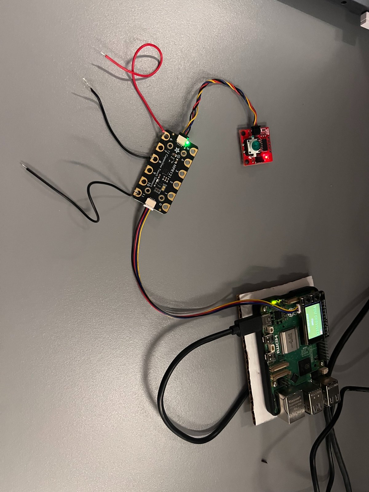
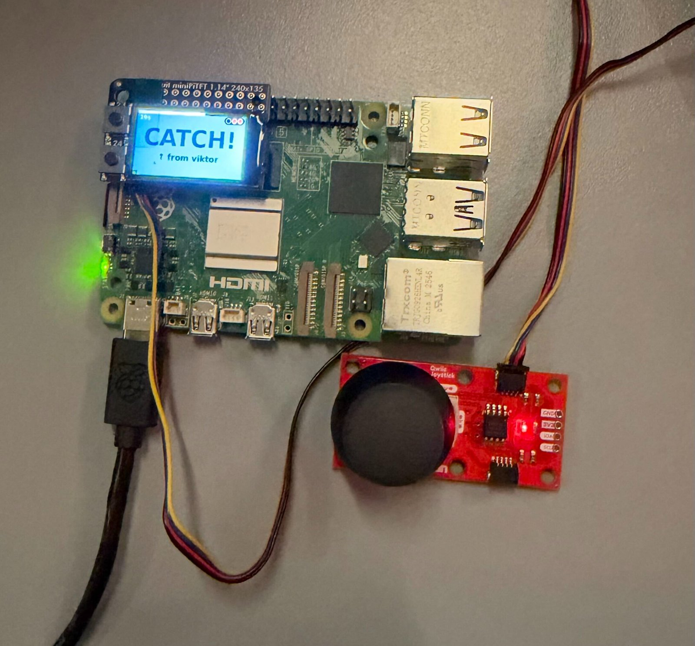
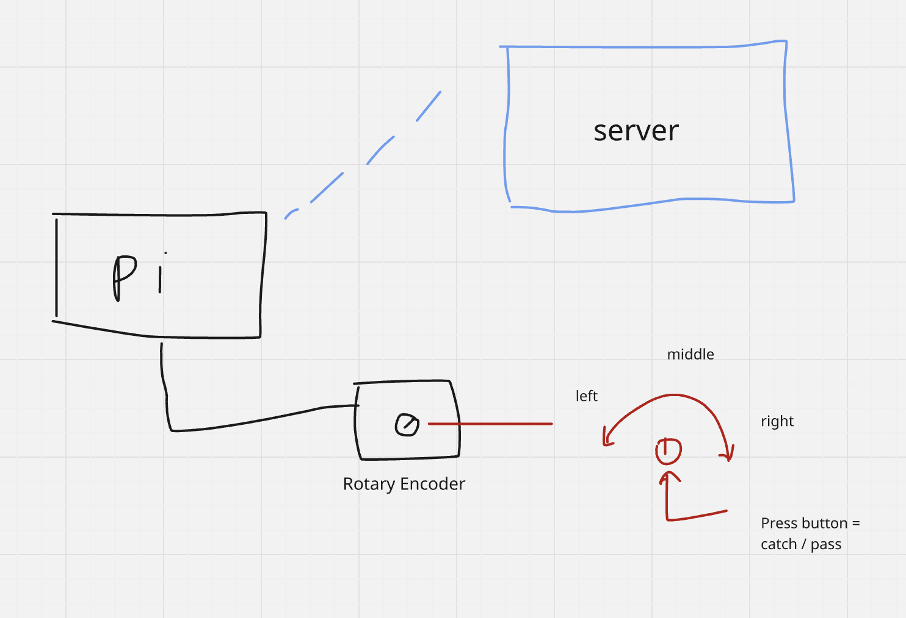
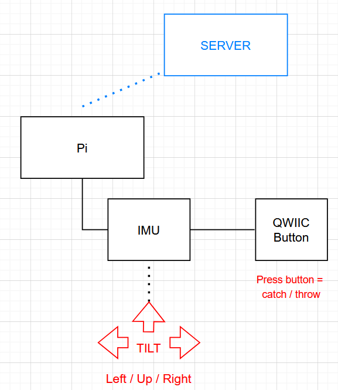
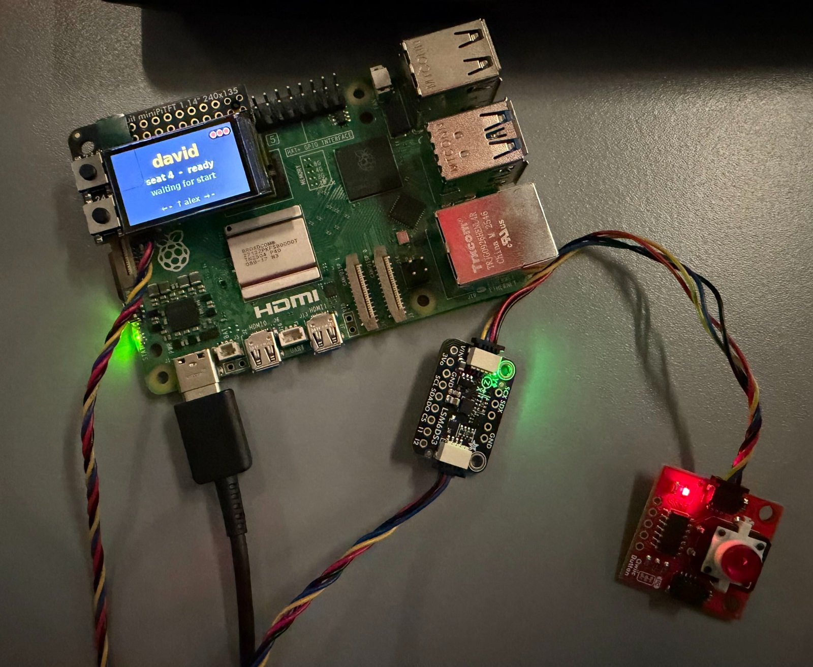

# Distributed Interaction

Viktor Radev - https://github.com/LaboriouslyExquisite/Interactive-Lab-Hub/

Alex Yen - https://github.com/Alexyen04/Alex-Yen-Interactive-Lab-Hub/

Ziqiao Gao - https://github.com/zg375/Interactive-Lab-Hub

David Zhang - https://github.com/davidzhanggg/Interactive-Lab-Hub/tree/Fall2026/Lab%206

---

## Part A: MQTT Messaging


**💡 Brainstorm 5 ideas for messaging between devices**

- Traffic Light: Pi 1 is connected to a button, so whenever an user presses it, Pi 1 sends a signal/message to Pi 2, which will then change the color of the LED from green to red to stop the traffic. Pi 3 also receives the same message and displays a walking signal for pedestrians.
- Multiplayer Game: Three Pis control a single character in a platform game. Pi 1 controls horizontal movements (left/right), Pi 2 controls jumping, and Pi 3 cnotrols throwing items or fighting enemies.
- Bomb Defusing Game: Pi1 has to detect the correct color using the APDS-9960, Pi2 has to perform the correct gesture, and Pi3 has to press the buttons in the correct sequence.
- Distributed Drawing Game: Pi1 controls the brush position, Pi2 selects the colors, and Pi3 controls brush size, drawing or erasing.
- Overcooked: Pi1 selects ingredients, Pi2 controls cooking temperature, and Pi3 controls mixing and serving.
  
---

## Part B: Collaborative Pixel Grid

**📸 Include: Screenshot of grid + photo of your Pi setup**


---

### Deliverables

Here is the final video demo: 


https://drive.google.com/file/d/168M_3YmAjhtySGfhlmyQro-HKmUeKTX4/view?usp=sharing


**1. Project Description**

For this project, we designed and built Hot Potato, a four-player multiplayer game using Raspberry Pis, physical sensors, and MQTT communication. Each player controls a different Raspberry Pi with a unique input device:

Player 1: Capacitive touch sensor and button

Player 2: Joystick

Player 3: Rotary encoder

Player 4: IMU sensor and button

The goal is simple: catch the potato when another player throws it to you, then pass it to someone else before your timer runs out. Players can throw the potato in three directions: left, forward, or right. Each player also has  small display showing their current game state, including when they need to catch, when they are holding the potato, and how much time they have left.


We choose idea because we wanted to explore how multiple physical devices could work together to create one shared interactive experience. What makes Hot Potato interesting is that all four players participate in the same game but interact with it differently. One player touches capacitive pads, another moves a joystick, another rotates a knob, and another tilts a sensor. Even though the inputs are different, they all produce the same basic game actions: selecting a direction, throwing, and catching.


User experience:

The game begins when players join through their Raspberry Pis and start a round. When a player receives the potato, they must react quickly and catch it before the catch window expires. Once they successfully catch it, they choose another player and throw it. The screen provides feedback throughout the game:

READY: Waiting for another player to throw the potato.

CATCH!: A potato is coming toward the player.

HOLDING: The player has the potato, with a countdown showing how much time remains.

BOOM!: The player held the potato too long, missed a catch, or ran out of round time.

GAME OVER: The game ends when a player reaches the maximum number of explosions.

**2. Architecture Diagram**


Those are the 4 input layer:


Computation Layer: 

The laptop runs server.py, which manages the shared game state. It determines who currently holds the potato, validates player actions, manages countdown timers, and decides when a player explodes.Each Pi handles local sensor readings and translates them into game actions. This separates hardware interaction from the central game rules.

Output Layer: 

Each Raspberry Pi uses a MiniPiTFT screen to display its current state. The laptop also provides a browser-based visualization of the four players arranged in a diamond.


Data Flow: 

- A player moves or presses their physical input device.
- The Raspberry Pi detects the sensor event.
- The Pi publishes an action through MQTT.
- The laptop server processes the action and updates the game state.
- The server publishes updated state information through MQTT.
- Each Pi receives its state and updates its display.


**3. Build Documentation**

#### Pi 1: Capacitive Touch Controller (Viktor)

<!-- SKETCH: touch controller (imgs/touch_sketch.png) -->


<!-- PHOTO: touch controller Pi (imgs/touch_pi.jpg) -->


This controller uses three components: the Adafruit MPR121 capacitive touch sensor to select another player by touching one of three pads; the SparkFun Qwiic Button to throw, catch, or start the game depending on the current game state; and the miniPiTFT display to show the game status, selected target, countdown, and feedback. Both the touch sensor and the button connect to the Pi through I2C (Qwiic cables).

We mapped three of the MPR121's twelve pads to game directions:

- Pad 6 → Left
- Pad 8 → Forward
- Pad 11 → Right
- Qwiic button → Throw, catch, or start, depending on the current game state

```python
PADS = {6: "left", 8: "forward", 11: "right"}
```

Each loop reads all twelve pads in a single I2C call. Whichever aim pad was touched most recently becomes the current aim, and it stays selected after you let go, similar to how the rotary encoder holds its knob position. The aim is re-sent to the game every loop so it is always set when the player throws.

```python
touched = touch.touched_pins            # one I2C read for all 12 pads
for pad, direction in PADS.items():
    if touched[pad]:
        current_aim = direction
if current_aim:
    game.aim(current_aim)
```

To catch wiring or numbering mistakes, the controller also prints a message whenever a pad that is not used for the game is touched.

The button works the same way as on the other controllers. An edge detector makes sure one physical press counts as one action, and `game.press()` decides what that action is from the current state.

```python
if button_edge(button.is_down()):
    game.press()
```

We ran into an issue where the Qwiic Button sometimes missed presses on the Pi's I2C bus when we also sent it LED commands. To fix this, the button is read the same way as in David's IMU controller: a plain `is_button_pressed()` check polled about 30 times per second, with no extra writes to the button. The LED is optional (`--led` flag). When it is on, it blinks when the potato is flying at you, stays solid once you've aimed, and glows dimly in the lobby.

The controller also handles hardware problems. If the Qwiic Button is not found at its default address (0x6F), the code scans the I2C bus for it. If it still cannot be found, the two small built-in PiTFT buttons are used instead, so the game stays playable. Repeated I2C read errors are reported every few seconds, which usually means a loose Qwiic cable. Running the script with `--test` prints pad touches and button presses without joining the game, which we used to check the wiring before playing.

---

#### Pi 2: Joystick Controller (Amy)

<!-- SKETCH: joystick controller (imgs/joystick_sketch.png) -->


<!-- PHOTO: joystick Pi (imgs/joystick_pi.jpg) -->


For the joystick-controlled Pi, we used a SparkFun Qwiic Joystick connected through I2C. The joystick provides horizontal and vertical values, along with a button state. We mapped three joystick movements to game directions:

- Move up → Forward
- Move left → Left
- Move right → Right
- Press joystick → Throw, catch, or start, depending on the current game state

The code below reads the joystick values and translates them into actions:

```python
x = read_register(0x03)
y = read_register(0x05)
button = read_register(0x07)

if x > 220:
    game.aim("forward")
elif y < 40:
    game.aim("left")
elif y > 220:
    game.aim("right")

if click(button == 0):
    game.press()
```

---

#### Pi 3: Rotary Encoder Controller (Alex)

<!-- SKETCH: rotary encoder controller (imgs/encoder_sketch.png) -->


<!-- PHOTO: rotary encoder Pi (imgs/encoder_pi.jpg) -->


This loop lets a person play the game using a physical knob. Turning the knob left or right aims the potato in that direction, and pressing the knob throws or catches it. The screen shows what is happening in the game. Every 10 milliseconds the loop checks the knob and button, updates the game, and only announces a change when you actually turn to a new direction.

```python
while True:
    # negate the position to make clockwise rotation positive
    raw = -encoder.position

    if last_raw is None:
        last_raw = raw

    # clamp the tracked angle so it caps at -10 (right) and 10 (left)
    angle = max(MIN_ANGLE, min(MAX_ANGLE, angle + (raw - last_raw)))
    last_raw = raw

    direction = direction_for_angle(angle)
    game.aim(direction)
    if direction != last_direction:
        last_direction = direction
        print("Direction: {}".format(direction))

    if button_edge(not knob_button.value):   # encoder button is active-low
        game.press()

    time.sleep(0.01)
```

---

#### Pi 4: IMU Controller (David)

<!-- DIAGRAM: IMU controller (imgs/imu_diagram.png) -->


<!-- PHOTO: IMU Pi (imgs/imu_pi.jpg) -->


This controller uses three components: the ST LSM6DS3 IMU to detect tilting movements to select another player; the SparkFun Qwiic Button to throw, catch, or start the game depending on the current game state; and the miniPiTFT display to show the game status, selected target, countdown, and feedback. Both the IMU and button communicate with the Pi through I2C.

We first calibrated the IMU by collecting accelerometer readings while keeping the Pi flat. For tilt detection, we used acceleration thresholds to detect four directions:

```python
def detect_tilt(x, y):
    if x > TILT_THRESHOLD:
        return "left"
    elif x < -TILT_THRESHOLD:
        return "right"
    elif y < -TILT_THRESHOLD:
        return "forward"
    elif y > TILT_THRESHOLD:
        return "down"
    return None
```

When the player is holding the potato, they select a target by tilting the Pi. Tilting down cancels the current selection.

```python
if mode == "holding":
    if direction != last_direction:
        if direction in ("left", "right", "forward"):
            game.aim(direction)
        elif direction == "down":
            game.aim_dir = None
            game.flash("selection cleared")
```

Finally, the button performs different actions depending on the game state: holding (throw the potato), incoming (catch the potato), and lobby/game over (start or restart the game):

```python
if button_edge(button.is_button_pressed()):
    game.press()
```

MQTT Communication

We used MQTT to send player actions and receive game-state updates.

- IDD/hotpotato/player//action — sent out when the player turns/presses (throw, catch, join, leave). The server listens here.
- IDD/hotpotato/player//state — received so the Pi knows what to show on screen (who holds the potato, timers, etc.).
- IDD/hotpotato/player//error — received if the server rejects a move.
- IDD/hotpotato/game — the shared game status; the server publishes it here and also listens here (e.g., for game start/stop).
- IDD/hotpotato/events — received game event announcements from the server.


**4. User Testing**
- **Test with 2+ people NOT on your team**
- Photos/video of use

https://drive.google.com/file/d/1n89saDSGryIiYQgeSSRaj4L1D7J9EEE0/view?usp=sharing
Testers: James and Allen (not on our team)
**What did they think before trying?** At first they thought the game looked complicated. They weren't sure what catching, throwing, or selecting a target meant, and they asked us what class the project was for. After we demoed one round, we handed them the controllers and they picked it up quickly: they won 2 of the 3 rounds they played.

**What surprised them?** They were surprised to see so many different controllers for one game. They were also bold enough to pick the two hardest ones, the IMU (tilting the whole Pi to aim) and the capacitive touch sensor, and still played well with them.

**What would they change?**

The game felt too simple. Once you know the rules, every turn is the same: aim, press, pass. Testers wanted more ways to make decisions during a turn.
Two kinds of throws. A fast throw and a slow throw, so players can fake each other out and make the catcher react to timing instead of just pressing when they see CATCH!.
Hide the timer. If players cannot see how long they can hold the potato, they are pushed to throw earlier instead of waiting until the last second.
Power-ups like Mario Kart. Random items that can change how a round goes.
The capacitive touch controller was finicky. The loose wire ends on the touch pads would brush the table, which registered as a touch and changed the aim. Because the last touched pad becomes the aim, a stray touch would send the potato to the wrong player.

**5. Reflection**

**- What worked well?**

One strength of our design is that it allows players to use different physical controllers in the same game. We created a shared set of game actions, allowing each Raspberry Pi to translate its own sensor input into the same commands.

**- Challenges with distributed interaction?**

 One challenge was keeping multiple Raspberry Pis synchronized. Each device needs to know when a potato is incoming, when it has been caught, and when a player has run out of time. We designed the system around one central server so that all players receive game states from the same source.

**- How did sensor events work?**

Each sensor produces different types of data. For example, the joystick produces X/Y values and a button state. We used thresholds to detect directional movement and converted those readings into shared game actions. For button presses, we used edge detection to trigger an action only when the button changes from released to pressed.

**- What would you improve?**
  
1. Adding sound or vibration feedback for incoming potatoes.
2. Making directional controls more intuitive.
3. Improving reconnection when a Raspberry Pi disconnects.
4. Adjusting the catch window based on user-testing feedback.

These improvements could make the game easier to understand and more responsive.

**- Where did computation happen in your system, and why there?**

We divided computation between the Raspberry Pis and the laptop.

- Raspberry Pis:

Read sensor values.

Detect input events.

Convert sensor events into game actions.

Display game-state feedback.

- Laptop Server:

Manage game rules.

Track the potato's location.

Validate catches and throws.

Manage countdown timers.

Update and distribute game states.

We chose this architecture because the game needs one consistent source of truth. Keeping the main game logic on the laptop helps prevent different Raspberry Pis from making conflicting decisions.

---


## Code Files

**Server files:**
- `app.py` - Pixel grid server (Flask + WebSocket + MQTT)
- `mqtt_viewer.py` - MQTT message viewer for debugging
- `mqtt_bridge.py` - MQTT → WebSocket bridge
- `requirements-server.txt` - Server dependencies

**Pi files:**
- `pixel_grid_publisher.py` - Example (RGB sensor → MQTT)
- `requirements-pi.txt` - Pi dependencies

**Web interface:**
- `templates/grid.html` - Pixel grid display
- `templates/controller.html` - Color picker
- `templates/mqtt_viewer.html` - Message viewer

---

## Debugging Tools

**MQTT Message Viewer:** `http://farlab.infosci.cornell.edu:5001`
- See all MQTT messages in real-time
- View topics and payloads
- Helpful for debugging your own projects

**Command line:**
```bash
# See all IDD messages
mosquitto_sub -h farlab.infosci.cornell.edu -p 1883 -t "IDD/#" -u idd -P "device@theFarm"
```

---

## Troubleshooting

**MQTT:** Broker `farlab.infosci.cornell.edu:1883`, user `idd`, pass `device@theFarm`

**Sensor:** Check `i2cdetect -y 1`, APDS-9960 at `0x39`

**Grid:** Verify server running, check MQTT in console, test with web controller

**Pi venv:** Make sure to activate: `source .venv/bin/activate`


---

## Submission Checklist

Before submitting:
- [ ] Delete prep/instructions above
- [ ] Add YOUR project documentation
- [ ] Include photos/videos/diagrams  
- [ ] Document user testing with non-team members
- [ ] Add reflection on learnings
- [ ] List team names at top

**Your README = story of what YOU built!**

---

Resources: [MQTT Guide](https://www.hivemq.com/mqtt-essentials/) | [Paho Python](https://www.eclipse.org/paho/index.php?page=clients/python/docs/index.php) | [Flask-SocketIO](https://flask-socketio.readthedocs.io/)
