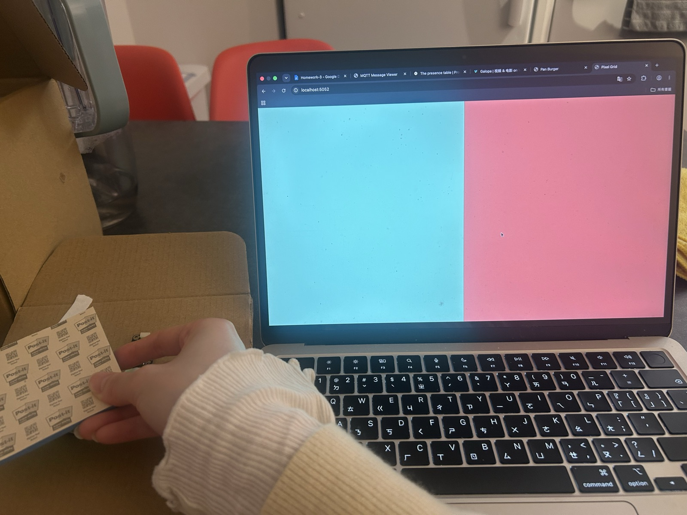
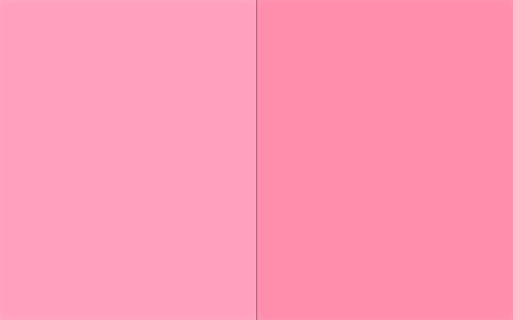
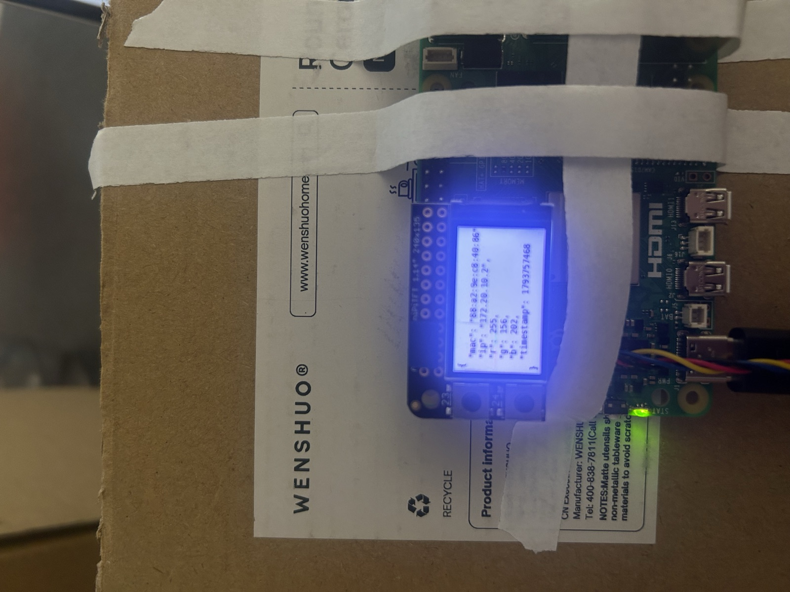
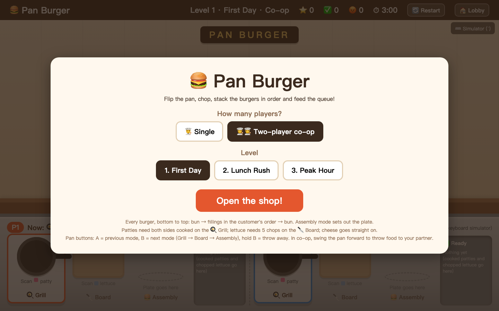
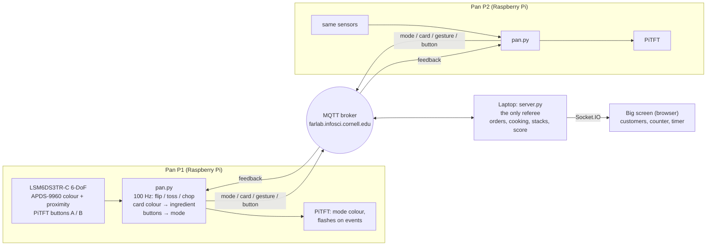
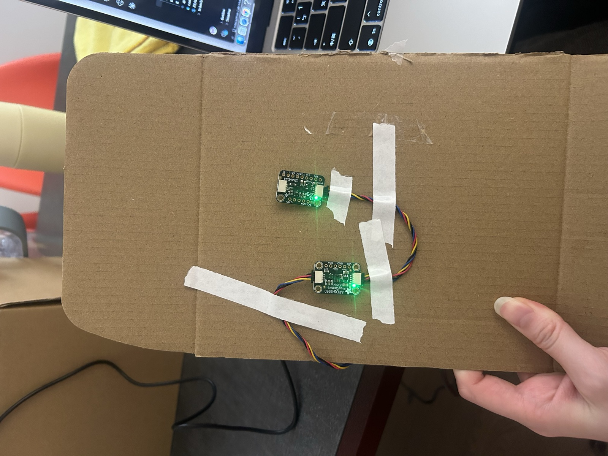
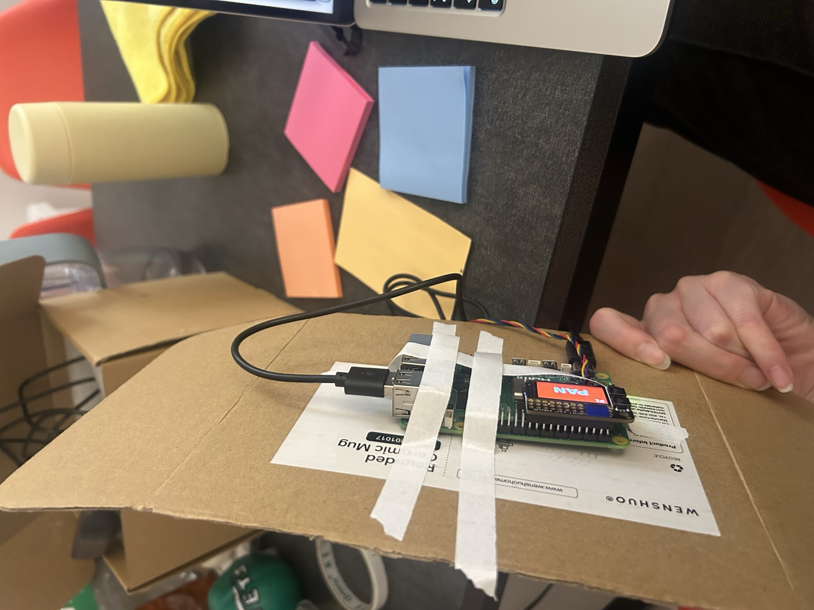
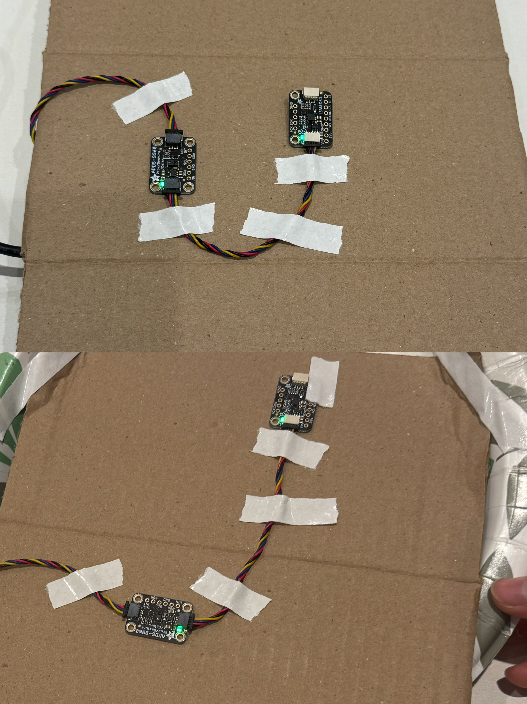
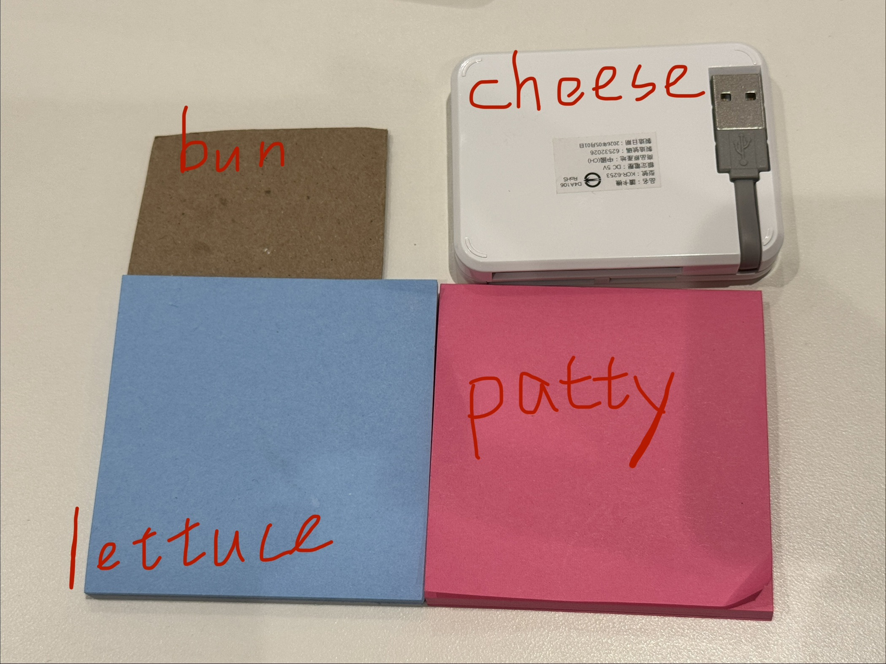
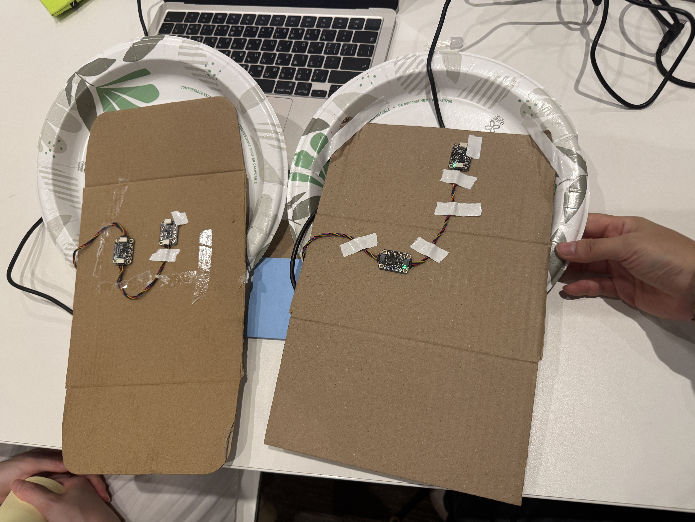

# Distributed Interaction

**Tzuyi (Monica) Wei (tw628), Alison Liu (cl2889)**

**Help.** We used Claude (AI) to help write and debug the code (`burger/server.py`, the big
screen page and `burger/pi/pan.py`) and to analyse the motion recordings. The game idea, the
design decisions and the testing are our own.

---

# Part A. MQTT Messaging

\*\*\***Brainstorm 5 ideas for messaging between devices.**\*\*\*

We started from "a two-player game where each player's Pi is a controller", and these are the
ideas we went through before settling on Pan Burger (Part C). Each one is a few sensors talking
to one referee over MQTT.

1. **Finger math duel.** A referee Pi publishes a math question on `IDD/<team>/duel/question`;
   each player answers by holding up fingers to their Pi's camera (MediaPipe hands, reused from
   Lab 5) and publishes `{"fingers": 4, "t": 1.82}`. Each Pi measures its own reaction time from
   when *it* received the question, so network delay does not decide who wins.
2. **Quick draw.** The referee waits a random time and publishes `GO`; the first player to swipe
   over their proximity sensor wins, and moving before `GO` loses. Simple enough to understand from
   across the room, but it shows the fairness problem: whose message arrives first is not the
   same as who moved first.
3. **Colour race.** The referee shows a target colour; players race to find an object of that
   colour and hold it to their APDS-9960 (the sensor from Part B), publishing the RGB they read.
4. **Tug of war.** Each player waves a hand over a proximity sensor as fast as they can; each Pi
   publishes its count every 100 ms and the referee moves a rope on the big screen by the
   difference.
5. **Flip the bacon.** Each player holds a "pan" with a motion sensor and flips a strip of bacon
   on the shared screen at the right moment, not raw and not burnt; a third player turns the heat
   up and down. This grew into Pan Burger: more ingredients, chopping and stacking, and passing
   food between the two pans.

**Inventing our own topics.** MQTT agreed on nothing in advance, which made it quick to start:
we picked topics like `IDD/panburger/burger/p1/gesture` and payloads like `{"type": "flip"}`
and could test them with `mosquitto_pub` before any Pi code existed. The cost is that nothing
else understands them; a "light" in Matter behaves the same everywhere, our "flip" only means
something to our server.

---

# Part B. Collaborative Pixel Grid

\*\*\***Include: screenshot of grid + photo of your Pi setup.**\*\*\*

Each Pi reads its APDS-9960 and publishes `{"mac": ..., "r": ..., "g": ..., "b": ...}` to
`IDD/pixelgrid/colors` ten times a second; the grid server gives every MAC address its own cell
and repaints it live. Our Pi is the left cell:






Our Pi's Mini PiTFT shows the message it is publishing: here RGB(255, 156, 202), the pink of
the room light.

* **Holding the blue sticky note** to the sensor turns our cell light blue.
* **With no card, the cell is pink.** The room light is warm, and the example scales every
  reading so that its largest channel is 255, so "white-ish with a bit more red" becomes pink.
  Our Part C calibration measured the same thing: "no card" read as red 0.48, green 0.28,
  blue 0.24.
* **The cell changes slowly**, about once every 0.7 s. The example sets
  `sensor.integration_time = 10`, but the library's property is called
  `color_integration_time`, so the line only creates an unused attribute and the sensor keeps
  its default of 256 cycles (≈ 0.7 s per reading). We hit the same thing in Part C.
* **How we ran it.** The class grid (`farlab.infosci.cornell.edu:5000`) did not answer from our
  network, so we ran the Lab's `app.py` on the laptop. macOS uses port 5000 for AirPlay, so we
  ran it on port 5052. The examples are written for paho-mqtt 1.x and our Pis have 2.x; a small
  launcher sets the version-1 callback API before running them, so the example files are
  unchanged.

---

# Part C. Pan Burger

## 1. Project description

**Pan Burger** is a two-player cooking game. Each player holds a **pan**: a Raspberry Pi with
a 6-DoF motion sensor, a colour sensor and its Mini PiTFT screen. The laptop shows a burger
shop in first person: customers queue from left to right, each with a speech bubble showing the
burger they want and a patience bar.


Every burger is built **bottom to top**: bun → fillings in the customer's order → bun. Fillings
are random (only the buns are required): one customer wants two patties and cheese, the next one
only lettuce. Ingredients are **colour cards** (brown cardboard, a white object, and pink and blue sticky
notes) held to the pan's colour sensor, and some of them need work first:

| Ingredient | Card | Work needed |
|---|---|---|
| Patty | pink | Grill it: put the card in the pan, **toss the pan up** to flip it when the side facing down is done. Both sides cooked = ready; wait too long = burnt (−3) |
| Lettuce | blue | Chop it: **chop down** with the pan 5 times |
| Cheese | white | Nothing |
| Bun | brown | Nothing |

Each pan can be one of three stations, and the player switches with the two buttons on the
PiTFT (A = previous, B = next): **grill** (screen red, "PAN"), **board** (green, "KNIFE") and
**assembly** (blue, "PLATE"). In assembly mode a plate appears by itself, and the player scans
cards in order. Finishing the top bun serves the burger to the first customer who ordered exactly
that. A customer who waits too long leaves angry (−5).

**Why it is interesting.** The two pans are identical, so the team decides how to split the work:
one player can grill while the other chops and assembles, or both can do everything. Cooked food
sits in a player's own "ready" tray, and at the assembly station a **forward swing** of the pan
throws one item to the partner's tray. That is the point where two devices have to cooperate, and it only works because
the laptop keeps one shared state for both. There is also a single-player mode (fewer, more
patient customers) and three levels.



---

## 2. Architecture



| | Where | What |
|---|---|---|
| **Input** | each pan | IMU at 100 Hz, colour/proximity at ~33 Hz, two buttons |
| **Computation** | each pan | raw motion → `flip` / `toss` / `chop`; colour → `bun` / `cheese` / `lettuce` / `meat`; buttons → mode |
| | laptop | the whole game: customers, cooking timers, what is in each tray and on each plate, serving, score |
| **Output** | laptop | the big screen and its sounds |
| | each pan | the PiTFT: full screen in the mode colour, flashes white / yellow / red on events from the server |

---

## 3. Build documentation

The pan is a piece of cardboard held like a paddle. The two sensors are taped to the front,
where the cards are held; the Pi and its screen are taped to the back, facing the player's hand.
These photos show the first version; section 4 shows how the pan changed after user testing.




### Hardware (each pan)

* Raspberry Pi 5 with the Mini PiTFT (the screen and its two buttons), powered over USB-C
* APDS-9960 colour / proximity sensor, I²C address `0x39`
* LSM6DS3TR-C 6-DoF accelerometer + gyroscope, I²C address `0x6a` (identified from its
  `WHO_AM_I` register, `0x6A`)
* both on the same Qwiic chain; a white light pointed at the cards (see 5. Reflection)
* four sticky notes as ingredient cards

### MQTT topics

Everything lives under `IDD/panburger/burger/`. The pans only report what happened; the laptop
decides what it means.

| Topic | From → to | Payload | Meaning |
|---|---|---|---|
| `p1/mode`, `p2/mode` | pan → laptop | `{"mode": "grill" \| "board" \| "assembly"}` | sent on every switch, and again every 5 s |
| `p1/card` | pan → laptop | `{"card": "meat"}` | a card was recognised |
| `p1/gesture` | pan → laptop | `{"type": "flip" \| "toss" \| "chop"}` | a motion was recognised |
| `p1/button` | pan → laptop | `B` | long press on B: throw away what is on the current station |
| `p1/feedback` | laptop → pan | `{"sound": "ding", "msg": "Patty done!", "mode": "grill"}` | the pan flashes its screen |
| `game` (retained) | laptop → all | phase, level, score, time left | |

The server also accepts a plain word (`mosquitto_pub ... -t IDD/panburger/burger/p1/card -m meat`),
which made it easy to test without the pans, and the big screen has a keyboard simulator for both
players.

### Recognising motion from real data

Before user testing, we recorded every motion with `burger/pi/record_motion.py` (100 Hz, ten labelled steps such
as "flip 5 times", "hold it like a pan and wander around without flipping") into
[`burger/pi/recordings/motion_20261103_193039.csv`](burger/pi/recordings/motion_20261103_193039.csv),
and picked the thresholds from the peaks of each motion:

| Motion | What gives it away | Measured | Doing nothing / wandering |
|---|---|---|---|
| **flip** | a jolt up and a fast rotation about Y | \|a\| 26–30 m/s², \|gy\| 6.7–10.1 rad/s, forward ≤ 7.4 | \|gy\| ≤ 2.1 |
| **toss** to partner | a jolt up **and** a big forward acceleration | forward \|ax\| 11.7–18.2 | forward ≤ 5 |
| **chop** | a sharp hit | \|a\| 17–70 | ≤ 16.4 (one 19.7 bump) |

The chops were recorded with the pan held like a knife; now that the pan stays flat, the chop
threshold still needs a new recording. Flip and toss both jolt the pan upward; the forward axis separates them (flips ≤ 7.4, tosses ≥
11.7, so the line is at 9.5). The classifier depends on the mode, so a chop can never be read as a
flip. Throwing only works at the assembly station; on the grill a forward swing is simply ignored,
so it does not flip the patty:

```python
elif s['a'] > TRIGGER_A and t >= self.lock_until:
    self.capture = list(self.recent)          # 0.1 s before the jolt ...
    self.capture_until = t + WINDOW_AFTER     # ... and 0.35 s after it

def classify(self, w):
    peak = lambda k: max(abs(x[k]) for x in w)
    if self.mode == 'grill':
        if (peak('ax') <= TOSS_MIN_FORWARD                             # 9.5
                and peak('a') > FLIP_MIN_A and peak('gy') > FLIP_MIN_ROT):  # 20, 5
            return 'flip'
    elif self.mode == 'board' and peak('a') > CHOP_MIN_A:              # 16
        return 'chop'
    elif self.mode == 'assembly' and peak('ax') > TOSS_MIN_FORWARD:
        return 'toss'
```

`burger/pi/replay.py` feeds a recording through the same detector on the laptop. On our
recording it finds 5 of 5 flips and, with the pan in assembly mode, 5 of 5 tosses, and nothing at
all while the pan is carried around without flipping.

### Reading the cards

The colour reading is turned into proportions of red, green and blue (so it does not depend on
brightness) plus the log of brightness, and matched to the nearest calibrated card. A card counts
when the proximity rises above a threshold; the reader then waits 0.3 s for a fresh colour
reading, and the next card only counts after the proximity has dropped again, so a card held
still is read once. `pan.py --calibrate` measures "no card" and each card, refuses a card that the
sensor clearly did not see, and prints how far apart the cards are.

### The referee

`server.py` is the only place where the game state lives. A pan saying `card: meat` in assembly
mode is only accepted if that player has a cooked patty in their tray **and** some waiting
customer's order starts with the current stack plus a patty; otherwise the layer is refused and
nothing is used up:

```python
candidate = p['stack'] + [card]
wanted = [c for c in self.customers if c['order'][:len(candidate)] == candidate]
if not wanted:
    return self.event(pid, 'error', 'No customer wants it stacked like that')
if card in ('meat', 'lettuce'):
    if card not in p['tray']:
        return self.event(pid, 'error',
                          'No cooked patty yet!' if card == 'meat' else 'No chopped lettuce yet!')
    p['tray'].remove(card)
```

### Files

| File | Runs on | What |
|---|---|---|
| [`burger/server.py`](burger/server.py) | laptop | game server, MQTT bridge, Socket.IO |
| [`burger/templates/index.html`](burger/templates/index.html) | browser | the big screen and the keyboard simulator |
| [`burger/pi/pan.py`](burger/pi/pan.py) | each Pi | the pan |
| [`burger/pi/record_motion.py`](burger/pi/record_motion.py) | Pi | records labelled motion data |
| [`burger/pi/replay.py`](burger/pi/replay.py) | laptop | replays a recording through the motion detector |
| [`burger/README.md`](burger/README.md) | | how to run everything |

---

## How the design changed

* **Three stations on one device.** We first wanted three Pis (grill, board, assembly). When two
  Pis became enough, we made both pans identical and let each player change station instead.
* **How to change station, three tries.**
  1. *By how the pan is held*: flat = grill, turned 90° like a knife = board, resting on the
     table = assembly. The IMU could tell all three apart (a pan held still in the hand still
     trembles: the standard deviation of |a| was 0.087–0.238, on the table 0.011–0.015), but
     waiting for a pose to be stable made it feel slow.
  2. *Tilt left / right* to step through the modes. Every tilt counted twice: swinging back past
     flat overshot to the other side, so the pan kept jumping between grill and assembly and
     could never reach the board. A 0.8 s pause after each switch fixed the double count, but
     a switch still took a deliberate tilt and a pause.
  3. *The PiTFT buttons* (A = previous, B = next, hold B = throw away). Not as physical, but
     instant and never wrong. Tilt switching is still in the code (`pan.py --tilt`).
* **No plate card.** The white plate card and the red meat card read almost the same (distance
  0.25), so we dropped the plate card: switching to assembly sets out a plate by itself.
* **Restart.** The big screen got a restart and a back-to-lobby button during a round.

---

## 4. User testing

[Video of user testing](videos/user_test.mp4) (61 s, opens or downloads as a file)

* **Before trying.** They were excited to play.
* **What surprised them.** Using colour cards as ingredients, read by a colour sensor, felt new
  to them.
* **Overall.** They found it very fun.
* **What they would change.** More sensitive sensors, and more sound effects.

### What we changed after the feedback

**1. More sound and more pressure.** We added background music and cooking sounds. When a customer
is about to get angry, more effects build up on top of the music: a heartbeat and an alarm, the
edges of the screen turn red, and the customer's speech bubble shakes.

Music: <a href="https://breakingcopyright.com/song/alex-productions-cooking">Cooking</a> by Alex Productions | Creative Commons (BY 3.0) | <a href="https://creativecommons.org/licenses/by/3.0/">License</a>

**2. More reliable sensing.** We moved the 6-DoF sensor to the very front of the cardboard, and
found that this tells flip and toss apart more accurately.



We also changed the colour of the cheese card from yellow to white, so that it is not confused
with the patty or the bun.



**3. A pan that looks like a pan.** We taped a paper plate to the end of the cardboard, so the
controller looks closer to a real pan with a handle and the game feels more immersive.



[Video of the final version](videos/full_version.mp4) (25 s, opens or downloads as a file)

---

## 5. Reflection

Our reflection is based on what we learned from user testing.

**What worked well.** Turning colour sensing into a physical game action worked: it was what
surprised players in section 4. Keeping all the game state on the laptop also kept the pans simple.

**How the sensor events worked.** Colour sensing and motion sensing are the most important
interactions in this project, but they often missed an input or read it wrong during our own
testing, and this was also the first thing people brought up in user testing. The colour sensor
was the harder one: the APDS-9960 has no light of its own, so the same card read differently
depending on distance, angle and light.

**Challenges with distributed interaction.** The suggestions we received were about the sensors and
the sound, not about the connection between the pans. The main challenge we designed for is that two pans can
act at the same moment. The laptop is the only referee, so whatever arrives first wins and both
players see the same result.

**What we would improve.** People asked for more sensitive sensors, so we would keep working on
that: add a card slot with a white LED around the colour sensor to keep the distance and light the
same, and record the motions again with the 6-DoF sensor in its new position. We would then test
these changes with new players to see whether the sensing feels better.

**Where did computation happen, and why there?** Motion recognition and card reading run on each
pan, and only the result is sent, because 100 samples a second over a shared broker would be too
much data and make the pan feel late. The game runs on the laptop, because exactly one place has to
decide what happened when both players act. This split also made the feedback easy to act on: the
new sound and red screen only changed the laptop's page, and the sensor changes only changed the
pans. We did not use a language model: every decision here has to be fast and the same every time.
