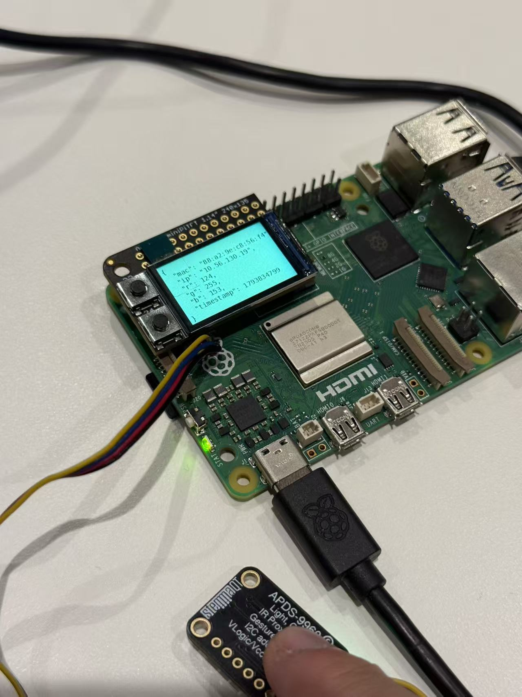
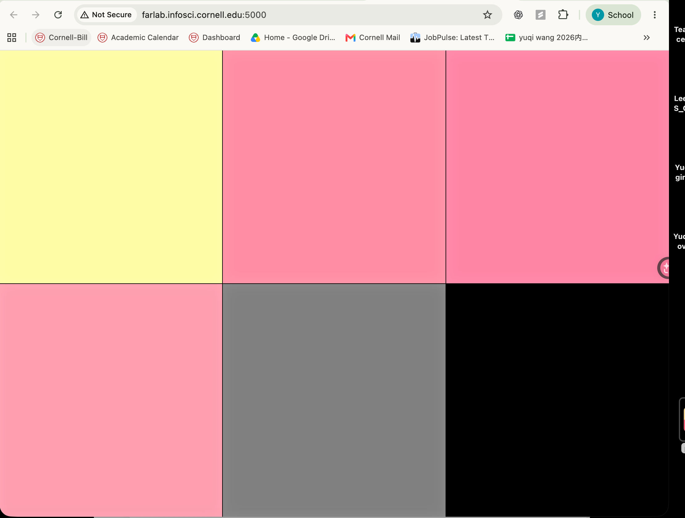
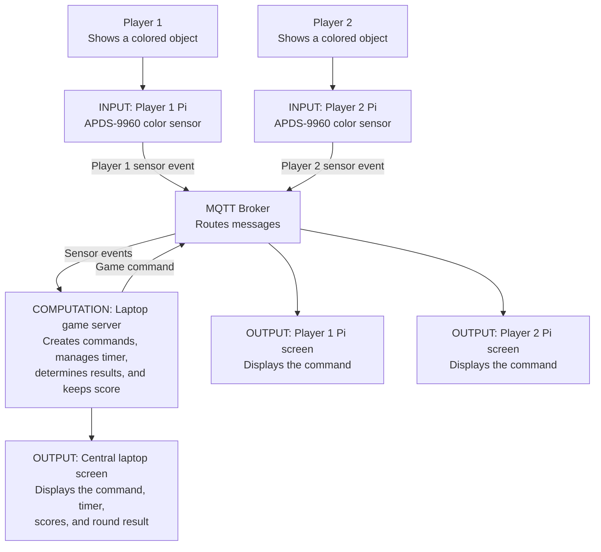
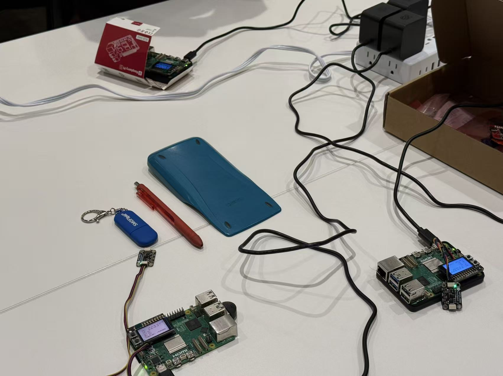

# Distributed Interaction

Author: Yuqi Wang (yw2897)
Collaborator: Jerry Lee (jdl344), Youssef Hassan (yh2443)

## Part A: MQTT Messaging
### Five Ideas for Messaging Between Devices

1. **Study Buddy**  
   One Raspberry Pi detects when someone sits at a desk and publishes their presence. Another Pi displays a light to let a friend know they are studying.

2. **Shared Plant Care**  
   A Pi monitors the soil moisture of a plant and sends a message when the soil is dry. Another Pi turns on a light to remind someone to water it.

3. **Room Mood Lights**  
   Each person selects a color on their Pi to represent their mood. The devices share their selections, and a display shows the combined mood of the group.

4. **Remote Doorbell**  
   Pressing a button on one Pi sends a message to another Pi in a different room. The receiving Pi plays a sound or flashes an LED to get someone’s attention.

5. **Collaborative Story Generator**  
   Each Pi sends a different type of input, such as a color, gesture, or distance reading. A shared program combines those inputs to choose characters, settings, and events for a short story.
---

## Part B: Collaborative Pixel Grid





---

## Part C: Make Your Own

## 1. Project Description

### Distributed Simon Says

**What does it do?**

We are building a competitive, distributed version of Simon Says for two players. A central laptop acts as the game server, and two Raspberry Pis act as player controllers.

The server broadcasts a command to both Pi screens, such as “SIMON SAYS: FIRST TO SHOW RED WINS.” Each player races to show a red object to their Pi’s APDS-9960 color sensor. The Pis publish sensor events through MQTT, and the server determines the winner based on the order in which it receives valid events.

**Why is it interesting?**

The game combines physical reflexes, attention, and competition across networked devices. Players must react quickly while checking whether a command is valid.

To make the game more challenging, each round has a 50% chance of being a fake-out. In a fake-out, the command does not include “SIMON SAYS,” and a player who triggers their sensor loses a point. The reaction window also gets shorter as the score increases, starting at 3.5 seconds and decreasing to a minimum of 1.2 seconds.

**User experience**

The players stand side by side with colored objects on a table and watch the central screen. For each round, they read the command, decide whether it is a fake-out, and, when appropriate, race to move the requested object from the table to their sensor before the other player.


## 2. Architecture Diagram



### Data Flow

1. The laptop server creates a command, decides whether it is a fake-out, and publishes it through the MQTT broker.
2. Both Raspberry Pis receive and display the command. The laptop also displays it on the central screen.
3. Each player's APDS-9960 sensor detects a color, and the corresponding Pi publishes a sensor event.
4. The server receives the events, applies the round rules and timer, and updates the score.
5. The central screen displays the round result and current scores.


## 3. Build Documentation

### Hardware Setup

Our game uses two Raspberry Pis as player controllers. Each Pi has an APDS-9960 sensor that can detect color and proximity. The sensors are connected to the Pis through I²C.

Player 2’s Pi also uses a small screen to display commands and round results received from the server.



### MQTT Topics

The devices communicate through the course MQTT broker at `farlab.infosci.cornell.edu` on port `1883`.

| Topic | Purpose | Example message |
|---|---|---|
| `IDD/simon_says_team/simon/command` | The server sends game commands and round results to the players. | `display:SIMON SAYS: FIRST TO SHOW [RED] WINS!` |
| `IDD/simon_says_team/simon/pi1/event` | Player 1 sends a detected action to the server. | `red` |
| `IDD/simon_says_team/simon/pi2/event` | Player 2 sends a detected action to the server. | `green` |


### Code Snippets

#### 1. Initializing the Sensor

```python
i2c = busio.I2C(board.SCL, board.SDA)
sensor = APDS9960(i2c)
sensor.enable_proximity = True
sensor.enable_color = True
```

This code connects to the APDS-9960 sensor through I²C and enables both proximity and color detection.

#### 2. Classifying Sensor Readings

```python
def classify(proximity_value, color, proximity=200, clear=500, margin=150):
    if proximity_value > proximity:
        return 'close'

    r, g, b, c = color

    if c > clear:
        if r > g + margin and r > b + margin:
            return 'red'
        if g > r + margin and g > b + margin:
            return 'green'
        if b > r + margin and b > g + margin:
            return 'blue'

    return None
```

The client first checks proximity. If the reading is above `200`, it reports `close`. Otherwise, it checks whether the clear-channel reading is above `500` and whether one color channel exceeds both other channels by more than `150`. If no condition is met, it returns `None`.

#### 3. Receiving Commands

```python
def on_connect(client, userdata, flags, rc):
    if rc == 0:
        client.subscribe(COMMAND_TOPIC)
        print(f'Connected. Listening as {args.player}.', flush=True)
```

After connecting to the MQTT broker, the client subscribes to the game’s command topic. This allows it to receive messages from the server.

```python
def on_message(client, userdata, msg):
    try:
        parsed = parse_message(msg.payload.decode('utf-8'))
    except UnicodeDecodeError:
        return

    if parsed is not None:
        kind, text = parsed
        with lock:
            state.message(kind, text, time.monotonic())
        display.show(text, kind)
```

When a command or result arrives, the client decodes the message, updates its round state, and displays the text on the Pi’s screen and in the terminal.

#### 4. Sending Player Events

```python
action = state.sample(detected, time.monotonic())

if action:
    info = client.publish(event_topic(args.player), action)
```

The client passes the detected action to its game state. When the state accepts an action for the current round, the client publishes it to the player’s MQTT event topic. The server can then use the received event to evaluate the round.


## 4. User Testing

We asked two people outside our team to try the game. We briefly explained the rules, then observed how they responded to real and fake-out commands.

**Video or photos:**

https://github.com/user-attachments/assets/b8edf884-67cb-40e8-96d3-ec20fad9a4be


### Participant 1

**Before playing:**
Participant 1 expected the game to be easy because it only required choosing a colored object and showing it to a sensor.

**What surprised them:**
They were surprised by how easy it was to react to the color before checking whether the command included “SIMON SAYS.” They also noticed that the sensor did not always recognize a color immediately when the object was too close.

**What they would change:**
They suggested making the text on the screens larger and adding a short countdown before each round.

### Participant 2

**Before playing:**
Participant 2 thought the game would be mainly about physical speed and expected the faster player to win most rounds.

**What surprised them:**
They found that reading carefully was just as important as reacting quickly. The fake-out commands made them hesitate, especially when the reaction window became shorter.

**What they would change:**
They suggested adding a sound for correct and incorrect actions so players could understand the result without looking back at the screen.

## 5. Reflection

### What Worked Well

The game brought sensor input, MQTT messaging, and competition together in one experience. The two Raspberry Pis acted as separate player controllers, while the server sent commands and evaluated the events it received. The screen on each Pi helped players see the current command and round result.

### Challenges With Distributed Interaction

One challenge was coordinating several devices over a network. The server determines the result using the order in which it receives player events, so network delay can affect a close race. Another challenge was making sure a sensor did not repeatedly send events while a player continued holding an object in front of it.

### How Sensor Events Worked

Each player’s APDS-9960 sensor provided color and proximity readings. The client checked proximity first and then compared the red, green, and blue readings. When the client accepted an action during a round, it published the action to that player’s MQTT topic. The server received the event and used it to evaluate the round.

### What We Would Improve

We would improve sensor calibration so that colors are recognized more consistently under different lighting conditions. We would also add clearer feedback, such as larger text, sounds, or a countdown.

For fairer timing, we would consider adding round identifiers and a ready signal so that every event can be associated with the correct round. We would also test how network delay affects close results.

### Where Computation Happened

Computation was divided between the player Pis and the server. Each player Pi processed its own sensor readings and translated them into an action such as `red`, `green`, `blue`, or `close`. The server handled the shared game logic, including commands, timing, scoring, and round results.

We chose this division so that each Pi could handle its local sensor while one central server kept both players synchronized.
