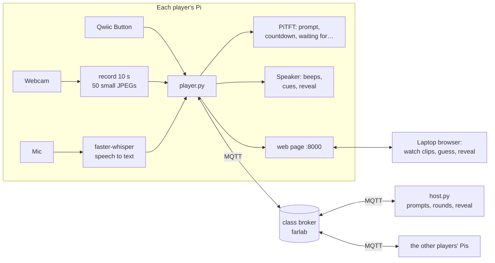

**Part B**
📸 Include: Screenshot of grid + photo of your Pi setup

Deliverables


**1. Project Description**

**Telephone Charades**

Group members: Jessica Chon (jc3932), Shifeng Hong (sh2769), Arnav Whig (aww96)

Our project is a remote, interactive charades game that lets friends play and socialize even when they can’t be in the same room. It works like a game of telephone, but with acting. Each player starts with a secret prompt, acts it out in front of a camera, and passes the clip to another player to guess. In the next round, someone acts out that guess. At the end, everyone can see how the original prompts changed as they passed from person to person. The fun comes from seeing how differently people interpret the same gestures and how far a guess can drift from the original prompt.

In our three-player setup, each player uses a Raspberry Pi to record and submit their performance. They tap a physical button to start a short recording and hold it to send the clip. The Pi sends the camera frames over MQTT, and the next player watches the clip on a web page and enters a guess. Everyone gets something to do each round, and the game moves on once everyone has submitted or the round timer runs out.

Parts needed for three players
	• Three Raspberry Pis with power supplies and a network connection
	• Three USB webcams to record the performances
	• One Qwiic Button with a Qwiic cable per Pi, or the buttons on a Mini PiTFT
	• A laptop with a web browser for each player to watch clips and type guesses
	• Optional speakers for countdown beeps and voice prompts
	• Optional USB microphones for spoken guesses

# How to run the project

Charades played like Gartic Phone, across three Raspberry Pis talking over MQTT.

Every player starts with a **secret prompt** on their PiTFT. They **act it out** in front of their webcam, and the clip travels to the next player, who watches it on their **laptop** and **guesses** (spoken into the mic or typed). That guess becomes the next player's prompt to act, and so on. At the end, the **reveal** shows how every prompt changed on its way round ("a chicken" → "surfing" → "swimming badly").

While you wait, each PiTFT shows who the game is still waiting for. The button does everything: tap to record or speak, hold to send. The speaker gives cues and reads out the reveal.

---

## What each Pi needs

| Part | Needed? | Used for | Without it |
|---|---|---|---|
| USB webcam | **yes** | recording your acting | `--fake-camera` (testing only) |
| Wi-Fi to the class broker | **yes** | everything goes over MQTT | — |
| Laptop with a browser | **yes** | watching clips, guessing, the reveal | — |
| Qwiic Button | recommended | tap = record / speak, hold = send | PiTFT buttons, or the buttons on the laptop page |
| Mini PiTFT | recommended | your prompt, the countdown, "waiting for Bella, Chen" | the terminal |
| Speaker | optional | beeps, "your turn", the reveal read aloud | silent |
| USB mic | optional | speaking your guess | type it on the laptop page |

One person (any Pi, or a laptop) also runs the **host**, which hands out prompts and moves the rounds along.

---

## 1. Put the code on each Pi

**If you have the zip** (on your Mac):

```bash
scp ~/Downloads/charades.zip pi@<your-pi>:~/Interactive-Lab-Hub/
```

then on the Pi:

```bash
cd ~/Interactive-Lab-Hub
unzip -o charades.zip && rm charades.zip
ls "Lab 6/charades"          # host.py, player.py, bots.py, check.py, ...
```

**Teammates, once it is pushed to GitHub:**

```bash
git clone --depth 1 https://github.com/arnavwhig8/Interactive-Lab-Hub.git ~/arnav-hub
cp -r ~/arnav-hub/"Lab 6/charades" ~/Interactive-Lab-Hub/"Lab 6/"
```

## 2. Install (once per Pi, ~5 min)

```bash
cd ~/Interactive-Lab-Hub/Lab\ 6
source .venv/bin/activate                 # the Lab 6 venv; if it doesn't exist:
                                          #   python3 -m venv .venv && source .venv/bin/activate
                                          #   pip install uv && uv pip install -r requirements-pi.txt
pip install uv && uv pip install -r charades/requirements-charades.txt
python -m piper.download_voices en_US-lessac-medium --data-dir voices    # the voice (optional, ~60 MB)
sudo systemctl stop piscreen.service      # frees the PiTFT (needed after every reboot)
```

## 3. Check the parts (30 s)

```bash
python charades/check.py
```

It shows "hello!" on the PiTFT, asks you to press the button, records 2 s from the webcam (look at `charades/check_camera.jpg`), asks you to say "riding a horse", talks, and connects to the broker. It ends with **Ready to play** or tells you what to fix. Only the camera and the broker are required.

## 4. Test it alone first (one Pi + two bots)

Bots are pretend players: they act by sending a drawn stick figure with a hangman version of their prompt ("r_d_n_ a h_r_e"), and they guess at random. Open **three Mac Terminal tabs**, `ssh` into your Pi in each, and run `cd ~/Interactive-Lab-Hub/Lab\ 6 && source .venv/bin/activate` first:

| Tab | Run | What it is |
|---|---|---|
| 1 | `python charades/host.py` | the game master |
| 2 | `python charades/bots.py --names Bella,Chen` | two pretend players |
| 3 | `python charades/player.py --name Arnav` | you |

Tab 3 prints your page's address, e.g. `http://100.110.141.222:8000`. Open it on your laptop. Then **hold the button** (or click **Start the game**) and play the four rounds. The host tab prints everything that happens.

## 5. Play with your team

1. All three Pis use the **same team name** (the default is `charades-arnav`, or pass `--team <name>` to every command) and **different player names**.
2. **One person** runs the host in an extra tab: `python charades/host.py`
3. **Everyone** runs `python charades/player.py --name <YourName>` on their own Pi and opens the printed address on their own laptop.
4. When the lobby shows all three names, **anyone holds their button** to start.

| Round | Task | What you do |
|---|---|---|
| 1 | **Act** | Read your prompt on the PiTFT. **Tap**: 3-2-1, then 10 s of acting (no words!). Your laptop shows the camera live while you act. Tap again to redo. **Hold** to send. |
| 2 | **Guess** | Watch the clip on your laptop. **Tap** and say your guess, or type it. **Hold** (or click Send) to send it. |
| 3 | **Act** | Act out the guess you were handed. |
| 4 | **Guess** | You get the clip of *your own* chain: what did your prompt turn into? |
| End | **Reveal** | Every chain on the laptop page; one Pi reads them out. **Hold** to play again. |

A round ends as soon as everyone has sent theirs. There's also a timer (3 min to act, 3 min to guess): if it runs out, the missing ones are skipped. Change it with `--act-seconds` / `--guess-seconds` on the host (0 = no timer). The host terminal takes **Enter** (start), **t** (+60 s for this round), **n** (skip to the next round) and **q** (quit).

**Before every game:** everyone runs the same version (`player.py` prints it, e.g. `v1.3`, and the host warns about anyone on an older one), and everyone **reloads their laptop page** once after updating. From v1.3 on, the page reloads itself whenever its Pi restarts with new code.

---

## How it works



- **Input:** each Pi senses its own player: the webcam (acting), the mic (guess), the button (record / send / start).
- **Computation:** each Pi records and compresses its clip, and turns speech into text **on the Pi** (faster-whisper, once per guess). The host only does bookkeeping: who acts what, who has sent, when the round ends.
- **Output:** the PiTFT (your prompt and who we're waiting for), the speaker (cues), and the laptop page (clips and the reveal). The page only shows your own prompt, never the others'.

### MQTT topics

| Topic | Retained | Who sends | What |
|---|---|---|---|
| `IDD/<team>/charades/players/<name>` | yes | each player | "I'm here" (empty when they leave; a last will clears it if a Pi dies) |
| `IDD/<team>/charades/state` | yes | host | the whole game: phase, round, who acts or guesses what, who has sent, the reveal |
| `IDD/<team>/charades/submit` | | players | "I sent my clip (20 frames)" or "my guess is 'surfing'" |
| `IDD/<team>/charades/clip/<game>/<key>` | | the actor | one JPEG frame (~10–20 KB, base64) per message |
| `IDD/<team>/charades/control` | | players | "start" (someone held their button in the lobby) |
| `IDD/<team>/charades/want` | | a Pi missing a clip (or the host) | "please resend clip c0r2"; the host and the actor's Pi both resend it |

Watch it all live with `mosquitto_sub -h farlab.infosci.cornell.edu -p 1883 -t 'IDD/charades-arnav/#' -u idd -P 'device@theFarm' -v`, or on http://farlab.infosci.cornell.edu:5001. Clips go through the shared class broker, so anyone watching `IDD/#` can see them. Don't film anything private.

---

## Troubleshooting

| Problem | Fix |
|---|---|
| `could not reach the MQTT broker` | The Pi must be online and able to reach farlab (Cornell Wi-Fi). Test: `ping farlab.infosci.cornell.edu` |
| `PiTFT is busy` | `sudo systemctl stop piscreen.service`, then start player.py again |
| Lobby doesn't show a teammate | Check the same `--team` on every Pi, different `--name`s, and that the host is running |
| `no webcam` | Plug it in; close anything else using it (Lab 5 scripts); try `--camera 1` |
| Guesses come out empty | `arecord -l` to find the mic, then `--mic-device plughw:<card>,0`; or just type |
| Page won't open on the laptop | Use the address player.py prints (the same one you ssh to), port 8000; laptop and Pi on a network that can reach each other |
| `port 8000 is busy` | Another player.py is still running (check your other tabs), or use `--port 8001` |
| Game stuck waiting for someone | Host tab: `t` + Enter for 60 more seconds, or `n` + Enter to skip to the next round |
| Wrong or old clips on the page | Everyone on the same version? Reload the page (Cmd-Shift-R). Then check the red warnings on the page |
| Red warning: two hosts | Only one person runs `host.py`; close the other one |
| Red warning: same name | Two Pis use the same `--name`; restart one with a different name |
| Red warning: older version | That person copies the new `charades.zip` and restarts `player.py` |
| A clip never arrives | The host waits up to 10 s for every clip and asks the actor's Pi to resend it; check `charades/logs/` on the host Pi |
| No sound | `aplay -l`; check the speaker; `--no-voice` / `--no-sound` to silence |

## Files

| File | What it does |
|---|---|
| `player.py` | one player's Pi: button, camera, mic, PiTFT, speaker, and the laptop page |
| `host.py` | the game master (one per team) |
| `game.py` | the rules: rotation, alternating act/guess, skips, the reveal (no hardware, easy to test) |
| `common.py` | broker settings, topic names, prompts, a small MQTT wrapper |
| `hardware.py` | button, PiTFT, webcam, mic + speech-to-text, Piper voice, beeps, each with a fallback |
| `web.py`, `page.html` | the laptop page (standard library only, no Flask) |
| `bots.py` | pretend players for testing with one Pi |
| `check.py` | checks a Pi's parts before playing |
| `logs/` | every host and player writes a log here (`host-<time>.log`, `player-<name>-<time>.log`): what was sent and received |
| `tests/` | 16 tests, including whole games over an in-memory broker that loses messages: `python -m pytest charades/tests -q` |

Inspired by Gartic Phone (the drawing telephone game). Code written with help from Claude (Anthropic).

**2. Architecture Diagram**


**3. Build Documentation**

### The three Pis

Every Pi runs the same code ([`charades/`](charades/)) as one player. One of them, Arnav's, also runs the host program that keeps track of the rounds; no extra device is needed.


**What each part does in the game:**

- **Webcam:** records the acting: 4 seconds at 5 frames per second, each frame shrunk to 320×240 and compressed to a JPEG of about 7 KB.
- **Qwiic Button:** the only control you need. Tap to record a take or speak a guess; hold for a second to send it, or to start a game from the lobby. Its LED pulses when it's your turn.
- **Mic:** speak your guess; the Pi turns it into text with faster-whisper (`tiny.en`, from Lab 3), on the Pi itself. Guesses can also be typed on the laptop.
- **Mini PiTFT:** shows your secret prompt, the 3-2-1 countdown, and who the game is still waiting for.
- **Speaker:** beeps for the countdown, "your turn to act / guess" (Piper voice, from Lab 3), and one Pi reads the reveal aloud.
- **Laptop page:** each Pi serves its own player's page on port 8000, where you watch the clip you have to guess, and see the reveal at the end.

### MQTT topics

Everything lives in our team's space on the class broker, `IDD/charades-arnav/charades/...`:

| Topic | Retained | Sent by | Message |
|---|---|---|---|
| `.../players/<name>` | yes | each player | "I'm here": `{"name": "Arnav", "since": 1731090215.2, "mic": true}`. Emptied when the player leaves; a **last will** empties it if a Pi loses power. |
| `.../state` | yes | host | The whole game: phase, round, who acts or guesses what, who has sent, the deadline, and at the end the reveal. Retained, so a Pi that (re)joins gets the current state at once. |
| `.../submit` | | players | Hand in this round's work: `{"game": "g191502", "round": 1, "player": "Arnav", "kind": "guess", "text": "riding a horse"}` |
| `.../clip/<game>/<key>` | | the actor | One JPEG frame per message: `{"i": 7, "n": 20, "jpg": "/9j/4AAQ...", "actor": "Arnav", "fps": 5}`. `key` names the chain and round, e.g. `c0r2`. |
| `.../control` | | players | `{"cmd": "start", "from": "Arnav"}`: someone held their button in the lobby. |
| `.../want` | | a Pi that restarted | `{"game": "g191502", "key": "c0r2", "from": "Arnav"}`: "I missed this clip". The host keeps a copy of every clip and sends it again. |

A shortened `state` message during a guess round:

```json
{
  "phase": "play", "game": "g191502", "round": 1, "rounds": 4, "task": "guess",
  "players": ["Arnav", "TEAMMATE_2", "TEAMMATE_3"],
  "assignments": {
    "TEAMMATE_2": {"task": "guess", "chain": 0, "clip": "c0r0", "frames": 20, "from": "Arnav"}
  },
  "submitted": ["TEAMMATE_3"],
  "waiting_for": ["Arnav", "TEAMMATE_2"],
  "deadline": 1731090395.4
}
```

### Code snippets

**1. The rules: who does what each round** ([`game.py`](charades/game.py))

```python
def task_for(r):
    return "act" if r % 2 == 0 else "guess"

def chain_for(self, player, r=None):
    r = self.round if r is None else r
    return (self.players.index(player) - r) % self.n
```

This is the whole "telephone" idea in two functions. Every player starts one chain with a secret prompt. Each round, every chain moves one player along (`index - round`, wrapped around), and the task alternates between acting and guessing. Everyone is busy every round, and with 3 players nobody sees the same chain twice until the last round, when you guess what *your own* prompt turned into.

**2. Saying "I'm here" in a way that survives crashes** ([`player.py`](charades/player.py))

```python
def attach(self):
    self.bus.will(self.presence, b"", retain=True)   # if this Pi dies, the broker says we left
    self.bus.subscribe(self.t["state"], self.on_state)
    self.bus.subscribe(self.t["clip"] + "/#", self.on_clip)
    self.bus.on_connected(self.announce)
```

The lobby is built from retained messages, one per player. The **last will** is a message the broker sends on the player's behalf if the connection drops without a goodbye, so a Pi that loses power disappears from the lobby by itself. `on_connected` re-announces the player after every reconnect, so a Wi-Fi hiccup doesn't drop anyone from the game.

**3. Sending a clip through MQTT, one frame at a time** ([`player.py`](charades/player.py))

```python
for i, jpg in enumerate(frames):
    self.bus.publish(f"{self.t['clip']}/{game}/{key}",
                     {"i": i, "n": n, "jpg": jpg, "actor": self.name, "fps": self.fps})
self.bus.publish(self.t["submit"],
                 {"game": game, "round": rnd, "player": self.name, "kind": "act", "frames": n})
```

MQTT is made for small messages, so instead of one ~150 KB video, a clip is sent as about 20 small JPEG messages (base64, ~10 KB each). Each frame says its number (`i`) and the total (`n`), so the guesser's Pi knows when it has the whole clip, and the laptop page shows "receiving the clip… 12/20" until it does. The take is only published when you **send** it, so retakes stay on your own Pi.

**4. The host moves the game on** ([`host.py`](charades/host.py))

```python
late = self.deadline is not None and self.clock() >= self.deadline
if self.game.all_in() or late or self.skip_requested:
    if self.game.end_round():
        self.phase, self.deadline = "reveal", None
    else:
        self.deadline = self._deadline()
    self.dirty = True          # -> publish the new state (retained)
```

A round ends as soon as everyone has sent their clip or guess, or when the timer runs out (2 minutes to act, 90 seconds to guess). Anyone missing is marked as skipped, and the next player acts the last words that were actually said. The host never touches a camera or a screen; it only does the bookkeeping and publishes one `state` message that every Pi reacts to.

**5. Speaking a guess** ([`hardware.py`](charades/hardware.py))

```python
cmd = ["arecord", "-q", "-D", self.device, "-f", "S16_LE", "-r", "16000", "-c", "1",
       "-d", str(seconds), path]
subprocess.run(cmd, check=True, timeout=seconds + 5)
segments, _ = self.model.transcribe(path, beam_size=1, language="en", vad_filter=True)
text = " ".join(s.text.strip() for s in segments).strip()
```

A tap records 4 seconds from the mic, and faster-whisper turns it into text **on the Pi**, so only the words, not the audio, go over the network. The model loads in the background when `player.py` starts, so it's ready by the time you guess. `vad_filter` skips the silence, which helps stop the model from inventing words when nobody spoke. The text shows on the PiTFT and the laptop, where you can correct it before sending.

**6. The waiting screen** ([`player.py`](charades/player.py))

```python
if handed:
    waiting = s.get("waiting_for") or []
    body = ("waiting for " + ", ".join(waiting)) if waiting else "everyone's in!"
    return f"SENT ✓{clock}", body, "next round soon", "wait"
```

After you send, your PiTFT shows who the game is still waiting for, with the time left, e.g. **SENT ✓ 1:05 / waiting for TEAMMATE_2, TEAMMATE_3**. It updates by itself each time the host's `state` message changes.

**7. Recovering a missed clip** ([`host.py`](charades/host.py))

```python
def on_want(self, topic, payload):
    """A Pi that restarted asks for a clip it missed: send the copy the host kept."""
    msg = decode(payload) or {}
    ...
    for i, jpg in frames:
        self.bus.publish(f"{self.t['clip']}/{msg['game']}/{msg['key']}",
                         {"i": i, "n": n, "jpg": jpg, "actor": actor, "resent": True})
```

Clip frames aren't retained (a retained topic only keeps its last message), so a Pi that restarts mid-game would miss them. The host subscribes to every clip and keeps a copy, and a Pi that is missing one asks on `want` and gets it again.

### Running it

On every Pi (once): install with `pip install -r charades/requirements-charades.txt` and check the parts with `python charades/check.py`. To play: the host runs `python charades/host.py`, and every player runs `python charades/player.py --name <Name>` and opens the address it prints on their laptop. Full steps are in [`charades/README.md`](charades/README.md).

**4. User Testing**

We found 3 non-team members in the Tata master’s studio to user test. After the game was completed, we received the following comments:

* The instructions were clear, the layout was intuitive and clear also. IT “made sense the way it was”
* All players said the interaction was more fun than they initially thought it’d be.  They appreciated being able to see all the clips and the progression of the tasks all at once in the end
* The camera quality wasn’t that strong and a bit laggy, so it’d be nice to have a smoother video feedback.
* It’d help to have more than 4 seconds to act out a seen
* They thought more rounds/opportunities for engagement would be nice since they wanted to keep playing. This led to a suggestion that it could later change so that players actions are streamed live and have to take turns guessing as many tasks in real-time as possible within 60 seconds.


**User testing videos:**

https://drive.google.com/file/d/16iZUg-9qkidZwZ3pFXzR4GNiiD_xoyOy/view?usp=drive_link
https://drive.google.com/file/d/1JBaXRVHbeEGvIPNhtnrFbn_-_RuEaRo3/view?usp=drive_link
https://drive.google.com/file/d/1XrJAe2J9sn0jBcxdHJswXT2f6j5UwFbc/view?usp=drive_link


**5. Reflection**

The communication between the Pis worked surprisingly smoothly. Most of the issues came from the game’s interaction flow. Testing with multiple players helped us notice problems we might have otherwise missed, since everyone had different setups, settings, and ways of interacting with the game. However, this also made troubleshooting more tedious. We had to figure out whether an issue came from someone’s device, their actions, or the game logic. Fixes also took longer to test because we needed everyone to repeat the interaction, and a change that worked for one player could create problems for another.
The camera captured each player’s performance, and the button controlled when to record and submit it. Each Pi processed these inputs locally, then sent the recorded frames and submission messages through MQTT so the other devices could receive them. This connected each player’s physical actions to the shared game.

We wanted to experiment more with rounds and points, but our access to Pis and available players limited how much we could test. If we revisited the project, we would develop those game mechanics further and test with more players to see how the experience changes as the group grows.
Computation was divided between the players’ Pis, the game host, and the laptop browsers. Each Pi handled its own camera, button inputs, and web page server, keeping device interactions close to the hardware. The game host managed the shared game state, including player assignments, submissions, and round progression. Keeping those decisions in one place helped all players stay on the same round. The MQTT broker routed messages between devices, while the laptop browsers displayed prompts, clips, and results and let players enter guesses. Prompts were selected from a predefined list, so gameplay did not require calls to a language model.


