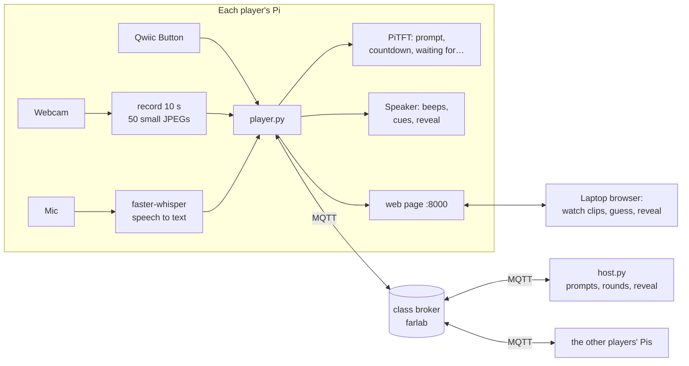

# How to run the project

Charades played like Gartic Phone, across three Raspberry Pis talking over MQTT.

Every player starts with a **secret prompt** on their PiTFT. They **act it out** in front of their webcam, and the clip travels to the next player, who watches it on their **laptop** and **guesses** (spoken into the mic or typed). That guess becomes the next player's prompt to act, and so on. At the end, the **reveal** shows how every prompt changed on its way round ("a chicken" → "surfing" → "swimming badly").

While you wait, each PiTFT shows who the game is still waiting for. The button does everything: tap to record or speak, hold to send. The speaker gives cues and reads out the reveal.

---

## What each Pi needs

| Part | Needed? | Used for | Without it |
|---|---|---|---|
| USB webcam | **yes** | recording your acting | `--fake-camera` (testing only) |
| Wi-Fi to the class broker | **yes** | everything goes over MQTT | — |
| Laptop with a browser | **yes** | watching clips, guessing, the reveal | — |
| Qwiic Button | recommended | tap = record / speak, hold = send | PiTFT buttons, or the buttons on the laptop page |
| Mini PiTFT | recommended | your prompt, the countdown, "waiting for Bella, Chen" | the terminal |
| Speaker | optional | beeps, "your turn", the reveal read aloud | silent |
| USB mic | optional | speaking your guess | type it on the laptop page |

One person (any Pi, or a laptop) also runs the **host**, which hands out prompts and moves the rounds along.

---

## 1. Put the code on each Pi

**If you have the zip** (on your Mac):

```bash
scp ~/Downloads/charades.zip pi@<your-pi>:~/Interactive-Lab-Hub/
```

then on the Pi:

```bash
cd ~/Interactive-Lab-Hub
unzip -o charades.zip && rm charades.zip
ls "Lab 6/charades"          # host.py, player.py, bots.py, check.py, ...
```

**Teammates, once it is pushed to GitHub:**

```bash
git clone --depth 1 https://github.com/arnavwhig8/Interactive-Lab-Hub.git ~/arnav-hub
cp -r ~/arnav-hub/"Lab 6/charades" ~/Interactive-Lab-Hub/"Lab 6/"
```

## 2. Install (once per Pi, ~5 min)

```bash
cd ~/Interactive-Lab-Hub/Lab\ 6
source .venv/bin/activate                 # the Lab 6 venv; if it doesn't exist:
                                          #   python3 -m venv .venv && source .venv/bin/activate
                                          #   pip install uv && uv pip install -r requirements-pi.txt
pip install uv && uv pip install -r charades/requirements-charades.txt
python -m piper.download_voices en_US-lessac-medium --data-dir voices    # the voice (optional, ~60 MB)
sudo systemctl stop piscreen.service      # frees the PiTFT (needed after every reboot)
```

## 3. Check the parts (30 s)

```bash
python charades/check.py
```

It shows "hello!" on the PiTFT, asks you to press the button, records 2 s from the webcam (look at `charades/check_camera.jpg`), asks you to say "riding a horse", talks, and connects to the broker. It ends with **Ready to play** or tells you what to fix. Only the camera and the broker are required.

## 4. Test it alone first (one Pi + two bots)

Bots are pretend players: they act by sending a drawn stick figure with a hangman version of their prompt ("r_d_n_ a h_r_e"), and they guess at random. Open **three Mac Terminal tabs**, `ssh` into your Pi in each, and run `cd ~/Interactive-Lab-Hub/Lab\ 6 && source .venv/bin/activate` first:

| Tab | Run | What it is |
|---|---|---|
| 1 | `python charades/host.py` | the game master |
| 2 | `python charades/bots.py --names Bella,Chen` | two pretend players |
| 3 | `python charades/player.py --name Arnav` | you |

Tab 3 prints your page's address, e.g. `http://100.110.141.222:8000`. Open it on your laptop. Then **hold the button** (or click **Start the game**) and play the four rounds. The host tab prints everything that happens.

## 5. Play with your team

1. All three Pis use the **same team name** (the default is `charades-arnav`, or pass `--team <name>` to every command) and **different player names**.
2. **One person** runs the host in an extra tab: `python charades/host.py`
3. **Everyone** runs `python charades/player.py --name <YourName>` on their own Pi and opens the printed address on their own laptop.
4. When the lobby shows all three names, **anyone holds their button** to start.

| Round | Task | What you do |
|---|---|---|
| 1 | **Act** | Read your prompt on the PiTFT. **Tap**: 3-2-1, then 10 s of acting (no words!). Your laptop shows the camera live while you act. Tap again to redo. **Hold** to send. |
| 2 | **Guess** | Watch the clip on your laptop. **Tap** and say your guess, or type it. **Hold** (or click Send) to send it. |
| 3 | **Act** | Act out the guess you were handed. |
| 4 | **Guess** | You get the clip of *your own* chain: what did your prompt turn into? |
| End | **Reveal** | Every chain on the laptop page; one Pi reads them out. **Hold** to play again. |

A round ends as soon as everyone has sent theirs. There's also a timer (3 min to act, 3 min to guess): if it runs out, the missing ones are skipped. Change it with `--act-seconds` / `--guess-seconds` on the host (0 = no timer). The host terminal takes **Enter** (start), **t** (+60 s for this round), **n** (skip to the next round) and **q** (quit).

**Before every game:** everyone runs the same version (`player.py` prints it, e.g. `v1.3`, and the host warns about anyone on an older one), and everyone **reloads their laptop page** once after updating. From v1.3 on, the page reloads itself whenever its Pi restarts with new code.

---

## How it works



- **Input:** each Pi senses its own player: the webcam (acting), the mic (guess), the button (record / send / start).
- **Computation:** each Pi records and compresses its clip, and turns speech into text **on the Pi** (faster-whisper, once per guess). The host only does bookkeeping: who acts what, who has sent, when the round ends.
- **Output:** the PiTFT (your prompt and who we're waiting for), the speaker (cues), and the laptop page (clips and the reveal). The page only shows your own prompt, never the others'.

### MQTT topics

| Topic | Retained | Who sends | What |
|---|---|---|---|
| `IDD/<team>/charades/players/<name>` | yes | each player | "I'm here" (empty when they leave; a last will clears it if a Pi dies) |
| `IDD/<team>/charades/state` | yes | host | the whole game: phase, round, who acts or guesses what, who has sent, the reveal |
| `IDD/<team>/charades/submit` | | players | "I sent my clip (20 frames)" or "my guess is 'surfing'" |
| `IDD/<team>/charades/clip/<game>/<key>` | | the actor | one JPEG frame (~10–20 KB, base64) per message |
| `IDD/<team>/charades/control` | | players | "start" (someone held their button in the lobby) |
| `IDD/<team>/charades/want` | | a Pi missing a clip (or the host) | "please resend clip c0r2"; the host and the actor's Pi both resend it |

Watch it all live with `mosquitto_sub -h farlab.infosci.cornell.edu -p 1883 -t 'IDD/charades-arnav/#' -u idd -P 'device@theFarm' -v`, or on http://farlab.infosci.cornell.edu:5001. Clips go through the shared class broker, so anyone watching `IDD/#` can see them. Don't film anything private.

---

## Troubleshooting

| Problem | Fix |
|---|---|
| `could not reach the MQTT broker` | The Pi must be online and able to reach farlab (Cornell Wi-Fi). Test: `ping farlab.infosci.cornell.edu` |
| `PiTFT is busy` | `sudo systemctl stop piscreen.service`, then start player.py again |
| Lobby doesn't show a teammate | Check the same `--team` on every Pi, different `--name`s, and that the host is running |
| `no webcam` | Plug it in; close anything else using it (Lab 5 scripts); try `--camera 1` |
| Guesses come out empty | `arecord -l` to find the mic, then `--mic-device plughw:<card>,0`; or just type |
| Page won't open on the laptop | Use the address player.py prints (the same one you ssh to), port 8000; laptop and Pi on a network that can reach each other |
| `port 8000 is busy` | Another player.py is still running (check your other tabs), or use `--port 8001` |
| Game stuck waiting for someone | Host tab: `t` + Enter for 60 more seconds, or `n` + Enter to skip to the next round |
| Wrong or old clips on the page | Everyone on the same version? Reload the page (Cmd-Shift-R). Then check the red warnings on the page |
| Red warning: two hosts | Only one person runs `host.py`; close the other one |
| Red warning: same name | Two Pis use the same `--name`; restart one with a different name |
| Red warning: older version | That person copies the new `charades.zip` and restarts `player.py` |
| A clip never arrives | The host waits up to 10 s for every clip and asks the actor's Pi to resend it; check `charades/logs/` on the host Pi |
| No sound | `aplay -l`; check the speaker; `--no-voice` / `--no-sound` to silence |

## Files

| File | What it does |
|---|---|
| `player.py` | one player's Pi: button, camera, mic, PiTFT, speaker, and the laptop page |
| `host.py` | the game master (one per team) |
| `game.py` | the rules: rotation, alternating act/guess, skips, the reveal (no hardware, easy to test) |
| `common.py` | broker settings, topic names, prompts, a small MQTT wrapper |
| `hardware.py` | button, PiTFT, webcam, mic + speech-to-text, Piper voice, beeps, each with a fallback |
| `web.py`, `page.html` | the laptop page (standard library only, no Flask) |
| `bots.py` | pretend players for testing with one Pi |
| `check.py` | checks a Pi's parts before playing |
| `logs/` | every host and player writes a log here (`host-<time>.log`, `player-<name>-<time>.log`): what was sent and received |
| `tests/` | 16 tests, including whole games over an in-memory broker that loses messages: `python -m pytest charades/tests -q` |

Inspired by Gartic Phone (the drawing telephone game). Code written with help from Claude (Anthropic).
