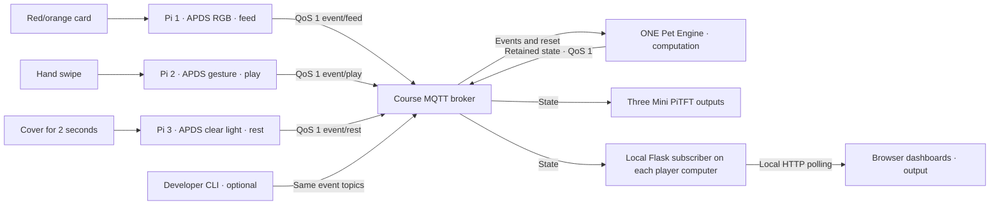

# Longan — Shared Virtual Pet

A runnable Lab 6 MVP: three remote Raspberry Pi 5 stations care for one pet through MQTT. One engine owns all game rules. Each player can run their own local Flask dashboard; no home-network port forwarding is needed.

**Development status:** software tests are documented in [TESTING.md](docs/TESTING.md). Actual APDS-9960 calibration, Mini PiTFT rendering, the course broker connection, and three-person remote play must still be checked on real hardware. Simulation is explicitly marked and disabled by the engine unless requested.

## 1. Get the code on your Pi

For an existing checkout, enter its repository directory, then:

```bash
git switch Fall2026
git pull --ff-only origin Fall2026
cd "Lab 6/shared_virtual_pet"
python3 -m venv --system-site-packages .venv
source .venv/bin/activate
python -m pip install -r requirements-hardware.txt
cp .env.example .env
nano .env
```

If you do not have the repository yet:

```bash
git clone --branch Fall2026 --single-branch https://github.com/JindiChai/Interactive-Lab-Hub.git
cd "Interactive-Lab-Hub/Lab 6/shared_virtual_pet"
```

Then run the setup starting with `python3 -m venv` above. If Git reports local changes, preserve/commit them before pulling; do not reset or discard them. Keep using the working Raspberry Pi OS I2C/SPI setup from the pixel-grid lab. If venv support is missing: `sudo apt install python3-venv`. Do not run the application as root.

For a laptop (no hardware libraries):

```bash
python3 -m venv .venv
source .venv/bin/activate
python -m pip install -r requirements.txt
cp .env.example .env
nano .env
```

Set `MQTT_USERNAME` and `MQTT_PASSWORD` from the course's parent [Lab 6 README](../README.md). Keep the same broker, prefix and device mapping on all machines. `.env` is ignored by Git. No credentials are included in this project. Shell environment variables override `.env`.

Default broker: `farlab.infosci.cornell.edu:1883`; namespace: `IDD/jindi-sharedpet-2026`. Change the namespace for private development sessions so they do not collide with a teammate's game. The course broker uses plaintext MQTT; `MQTT_TLS=1` is available only if your chosen broker supports TLS on the configured port.

## 2. Test independently with one computer

Use separate terminals, each in this directory with `source .venv/bin/activate`.

**Terminal A — the only engine:**

```bash
python pet_engine.py --allow-simulation
```

**Terminal B — dashboard:**

```bash
python dashboard.py --developer
```

Open <http://127.0.0.1:5000>. If that port is occupied, use `--port 5001`. The server binds to loopback. On a headless Pi, either run the dashboard on your laptop with the same `.env`, or forward it over SSH: `ssh -L 5000:127.0.0.1:5000 YOUR_PI_USER@YOUR_PI_HOST`.

**Terminal C — simulated inputs:**

```bash
python simulate.py --reset
python simulate.py --role feed
python simulate.py --role play
python simulate.py --role rest
sleep 3
python simulate.py --role feed
python simulate.py --role play
python simulate.py --role rest
```

Start the sequence promptly after reset. Values should rise from 40 to approximately 80 (minus any 15-second decay). Once every value is at least 70, wait 10 seconds for **Together, we did it!**. If the commands took longer, send another action for any low attribute. After victory, attributes freeze. `python simulate.py --reset` starts a new round at 40/40/40.

For repeated testing: `python simulate.py --interactive`. The equivalent unified station simulation is `python sensor_client.py --role play --simulate --no-display`. Each one-shot command sends one UUID event and exits after the broker's QoS 1 acknowledgement. A broker acknowledgement is not engine acceptance: check the dashboard or engine logs. Each role has a shared simulated device ID and a 3-second engine cooldown.

To verify decay independently, reset and send no actions for 15 seconds: all three values should become 39. To check reconnect, interrupt network access temporarily and restore it. Clients retry automatically; the dashboard marks stale data. After reconnect, repeat your physical action. Inputs produced while fully disconnected are not stored for later replay; uncertain in-flight QoS messages may be retransmitted and are deduplicated.

## 3. Real hardware demonstration

Stop the development engine with Ctrl+C, then start **one engine only** on Pi 1 OR a laptop:

```bash
python pet_engine.py
```

Start the ordinary dashboard on any/all players' computers:

```bash
python dashboard.py
```

This hides developer controls and rejects their HTTP endpoints. The engine now rejects simulated action events. A manual new round is still available with `python simulate.py --reset`.

On each Pi, in an additional terminal:

```bash
# Pi 1: show a red/orange card, then remove it
python sensor_client.py --role feed --debug

# Pi 2: left/right swipe
python sensor_client.py --role play --debug

# Pi 3: keep sensor uncovered during startup calibration;
# then cover it for 2 seconds and uncover to re-arm
python sensor_client.py --role rest --debug
```

Default real device IDs are pi1/feed, pi2/play, pi3/rest. Customize `FEED_DEVICE_ID`, `PLAY_DEVICE_ID`, `REST_DEVICE_ID` consistently in every `.env`. `--device-id` must match the engine's mapping. These are gameplay identity checks, not cryptographic authentication: everyone with shared course credentials can publish to the namespace. Normal play assigns one role to each person; changing code or spoofing IDs is outside the game rules.

Your two teammates should pull the same branch, install dependencies, configure matching `.env` values, and run only their role's station and optionally their own dashboard. They must **not** start extra engines. All remote traffic travels through the broker; different Wi-Fi networks are supported.

### Calibration

Run with `--debug` to see raw RGB, normalized RGB and clear light readings, gesture codes, or proximity values. Remove `--debug` for normal use.

| Role | Defaults and tuning |
| --- | --- |
| Feed | `--red-min 0.46 --blue-max 0.25 --clear-min 10 --stable-readings 3`. Color fractions use RGB sum normalization, require red > green and enough ambient light. Hold card until stable, remove for at least 3 readings, wait 3 seconds before next action. |
| Play | `--play-mode gesture`, valid gesture codes 3/4 (left/right), 3-second cooldown. Adjust `--gesture-rotation 0` (also 90/180/270). Move hand through the sensor's field rather than holding it still. |
| Play fallback | `python sensor_client.py --role play --play-mode proximity --proximity-near 100 --proximity-far 40 --debug`. Approach above near threshold, withdraw below far threshold for 3 readings. This is a near/far cycle, not directional gesture recognition. |
| Rest | Startup median of uncovered clear readings over 3 seconds. Dark < baseline × `--dark-ratio 0.25`; release > baseline × `--release-ratio 0.55`. Hold dark for `--dark-hold 2` seconds; use bright enough ambient light. Recalibrate by restarting if lighting changes. |
| Color engine | `--gain 1` is the driver index for **4×**, not 1×; 0/1/2/3 = 1×/4×/16×/64×. `--integration-cycles 10` gives 27.8ms. Uses actual `color_integration_time` API rather than the old demo's `integration_time` attribute. |

Cooldown is also enforced by the engine. Stable/release filtering reduces noise; continuous coverage or a continuously visible card produces only one event per cycle. Changing lighting or card material requires real calibration.

### Mini PiTFT and existing service

The display follows `pixel_grid_publisher.py`: CS GPIO5, DC GPIO25, backlight GPIO22, reset None, ST7789 135×240 with offsets 53/40, rotation 90, 64MHz SPI, rendered canvas 240×135. The screen redraws only when visible text changes. It displays role, stats, mood, connectivity and action feedback. “Accepted” feedback requires the engine's event ID acknowledgement in state.

If `piscreen.service` already owns the display, manually run:

```bash
sudo systemctl stop piscreen.service
# Run the station; press Ctrl+C when finished.
sudo systemctl start piscreen.service
```

The application never changes the service automatically. Use `--no-display` to avoid display initialization. A display initialization/rendering error falls back to headless mode. Sensor initialization errors explain the failure and exit; sensors are never silently replaced by simulation.

## 4. Architecture and protocol



Under the configurable prefix:

| Suffix | Payload / behavior |
| --- | --- |
| `event/feed`, `event/play`, `event/rest` | JSON event; QoS 1; never retained |
| `control/reset` | Manual reset event with role `admin`; QoS 1; never retained |
| `state` | Authoritative snapshot; QoS 1 retained; heartbeat every second |

An event contains `event_id` (UUID), `device_id`, `role`, `event`, `timestamp` (Unix seconds), `round_id` (from latest state) and boolean `simulated`. Engine rejects invalid JSON/types, topic-role mismatches, stale events (>30s), future events (>5s), wrong devices, old rounds, duplicate UUIDs and retained actions. Keep system clocks synchronized (normal Raspberry Pi OS NTP). Reset also uses the current round ID, so duplicates cannot reset the next round.

State includes fullness/happiness/energy, mood, status, round_id, version, last_action/device/event_id, last_simulated, contributors, cooperation_seconds and published_at. Browsers do not compute decay or victory; they poll their own Flask MQTT cache. Retained state older than 5 seconds is visibly stale. Startup needs a fresh engine heartbeat before actions are sent.

Game starts at 40/40/40; an accepted action adds 20 to its attribute, clamped 0–100. Every 15 seconds all attributes lose 1. Below 30 means Needs Care; all at least 70 means Happy. Ten uninterrupted seconds of Happy wins, then progression freezes. If decay and the win deadline exactly coincide, decay is processed first. The game engine uses monotonic time, not client timestamps, for rules.

**Single authority:** a file lock prevents duplicate engines on the same machine/namespace. It is not a distributed lock; designate one engine host and do not run one on another host. Game state is in memory. Restarting the engine starts a new round, invalidating old queued events. Network outages do not pause the engine's local clock. The retained snapshot is a display cache, not save-game storage.

## 5. Files and tests

| Files | Purpose |
| --- | --- |
| `pet_logic.py`, `events.py` | Pure game rules, event/state validation |
| `pet_engine.py`, `mqtt_client.py`, `config.py` | Authoritative process, reconnect wrapper, local configuration |
| `station.py`, `simulate.py` | MQTT state cache and development CLI |
| `sensor_client.py`, `sensor_triggers.py`, `display.py` | Shared hardware app, testable triggers, optional PiTFT |
| `dashboard.py`, `templates/index.html`, `static/style.css`, `static/app.js` | Local Flask dashboard, responsive SVG pet and UI |
| `requirements*.txt`, `.env.example`, `.gitignore` | Runtime/hardware/test dependency lists and safe configuration |
| `tests/test_*.py` | Offline unit tests |
| `tests/local_broker.py`, `tests/integration_mqtt.py` | Optional isolated real MQTT integration checks |
| `docs/README_part_c_draft.md`, `docs/DOCUMENTATION_CHECKLIST.md`, `docs/TESTING.md` | Submission draft, evidence checklist, verified limits |

Run all unit tests without contacting a broker:

```bash
python -m unittest discover -s tests -v
```

Core-only tests need only Python's standard library:

```bash
python -m unittest discover -s tests -p test_pet_logic.py -v
python -m unittest discover -s tests -p test_events.py -v
python -m unittest discover -s tests -p test_sensors.py -v
```

Optional local MQTT integration (development machine, Python 3.11+; separate optional test dependencies):

```bash
python -m pip install -r requirements-test.txt
python tests/integration_mqtt.py
```

The integration script chooses loopback ports and a unique namespace, clears credentials in its own process, launches a local broker/engine/dashboard, verifies a full game and broker restart, then cleans up all child processes. It never contacts the course broker. Allow about one minute.

## Troubleshooting

- **Waiting for engine:** check same prefix, broker credentials and exactly one engine. A retained old state alone is insufficient. Check clock synchronization.
- **Connection rejected / retrying:** check `.env`, network/firewall and broker availability. No sensor telemetry is continuously published.
- **Sent but no increase:** inspect engine logs for cooldown, disabled simulation, expired event or wrong device. If all stats froze, reset after victory.
- **Duplicate engines across machines:** stop all but the designated one; reset. There is no cross-host election in this MVP.
- **No I2C device:** confirm wiring and `i2cdetect -y 1` shows 0x39; enable I2C through Raspberry Pi configuration if necessary.
- **Color never triggers:** increase illumination or gain, inspect normalized readings and calibrate thresholds. Dark rooms cannot reliably detect a colored card without illumination.
- **Gesture unreliable:** try rotation/hand distance, then proximity fallback. Both need physical tests.
- **Display absent/busy:** stop the other display program or use `--no-display`; do not run the pixel-grid publisher alongside this station on the same sensor/display.
- **Ctrl+C:** stops each process; restart `piscreen.service` manually if you stopped it.

## References

Existing [Lab 6 requirements and deliverables](../README.md), [working hardware reference](../pixel_grid_publisher.py), [hardware dependencies](../requirements-pi.txt), [Adafruit APDS-9960 API](https://docs.circuitpython.org/projects/apds9960/en/latest/api.html), [Paho MQTT client API](https://eclipse.dev/paho/files/paho.mqtt.python/html/client.html).
