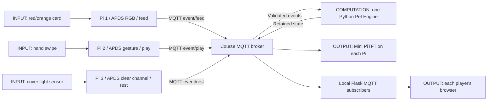

# Lab 6 Part C — Shared Virtual Pet: Longan

**Team:** Jindi Chai, Yilin Wu, Sina Liu. **Status:** implementation draft; replace all TODO evidence with actual observations before submission.

## 1. Project Description

Longan is a cooperative virtual pet cared for by three remote players. A red/orange card feeds it, a left/right hand swipe plays with it, and a two-second sensor cover gives it rest. Each player contributes a different resource. Fullness, happiness and energy decay over time; the team wins by keeping all three at 70 or above for 10 seconds. One role alone cannot sustain every attribute. The shared display makes distant actions visible as care for the same companion.

TODO: add the team's own motivation, initial expectations and final user experience.

## 2. Architecture Diagram



Each sensor is connected by I2C; the Mini PiTFT uses SPI. Devices can be on different networks. Only local browser-to-Flask traffic uses HTTP. Shared game communication uses the MQTT broker.

## 3. Build Documentation

Follow [installation and launch instructions](../README.md). Put broker credentials only in local `.env` files. The reference demo's display pins and orientation are reused; normalized RGB thresholds, gesture cooldown, and darkness hysteresis are specific to this game.

- TODO photo: Pi 1, RGB card and clearly visible sensor/display wiring.
- TODO photo: Pi 2 and swipe direction/orientation.
- TODO photo: Pi 3, uncovered environment and hand-covered sensor.
- TODO table: actual gain, color thresholds, ambient baseline, gesture/fallback choice per device.
- TODO screenshots: waiting, ordinary play, Needs Care, Happy countdown, victory.
- TODO video: three real sensor actions causing the same shared state to update.

## 4. MQTT Topics

Prefix: `IDD/jindi-sharedpet-2026` (record actual namespace if changed).

- `/event/feed`, `/event/play`, `/event/rest`: UUID events, QoS 1, not retained.
- `/control/reset`: manual new round, not retained.
- `/state`: authoritative state, QoS 1 retained, heartbeat every second.

Events include device ID, role, action, timestamp and round ID. Duplicate event UUIDs cannot apply twice. The retained snapshot lets a newly connected display see the current pet; a heartbeat timestamp distinguishes live data from an old retained message.

## 5. Code Explanations

[`pet_logic.py`](../pet_logic.py) is independent of hardware and MQTT. Its `tick()` advances decay and continuous happiness in time order; `apply()` handles round checks, UUID deduplication, cooldown and clamping. A single engine means separate Pis cannot disagree about decay or win time.

[`sensor_triggers.py`](../sensor_triggers.py) requires stable activation and release. For rest, trigger and release thresholds differ, reducing noisy cover/uncover transitions. The trigger is disarmed after activation until release, so holding a card or covering the sensor does not flood events.

```python
# Feed: relative RGB, sufficient ambient light, red/orange dominance.
return r / total >= red_min and b / total <= blue_max and r > g
```

[`station.py`](../station.py) is shared by hardware and simulation. Both publish the same protocol, so solo development exercises the same MQTT/game path. [`dashboard.py`](../dashboard.py) receives state over MQTT and serves it locally; it never recalculates rules.

TODO: add one actual debug reading and explain the final threshold selection. Do not include broker passwords in screenshots or snippets.

## 6. User Testing

**Required: at least two participants who are not on the team.** Software tests and teammates do not replace this requirement.

| Evidence | Participant A | Participant B |
| --- | --- | --- |
| Anonymous label/date | TODO | TODO |
| What they thought before trying | TODO | TODO |
| Task attempted / sensor role | TODO | TODO |
| What actually happened | TODO | TODO |
| What surprised them | TODO | TODO |
| What they would change | TODO | TODO |
| Photo/video filename | TODO | TODO |

TODO: summarize failures, misunderstandings, cooperation and the resulting design changes. Do not claim user-test outcomes before observing them.

## 7. Reflection

- What worked well? TODO with evidence.
- What was difficult about distributed interaction, delay and connection loss? TODO.
- Which sensor interactions were reliable and which needed calibration/fallback? TODO.
- What would we improve? TODO after testing.
- Where did computation happen and why? Sensor recognition is local; shared game rules are centralized in one engine; browser/PiTFT render received state. This keeps timing consistent across networks. No language model or cloud inference is part of the running game.
- Known MVP tradeoffs: engine restart starts a new round; no distributed leader election; device IDs are gameplay assignments rather than strong authentication.

## 8. Team Contributions

Record actual work, not planned assignments.

| Member | Actual contributions | Evidence/commit/demo role |
| --- | --- | --- |
| Jindi Chai | TODO | TODO |
| Yilin Wu | TODO | TODO |
| Sina Liu | TODO | TODO |

TODO: acknowledge coding assistance according to course policy, and distinguish generated scaffolding from your team's integration, calibration and testing.
